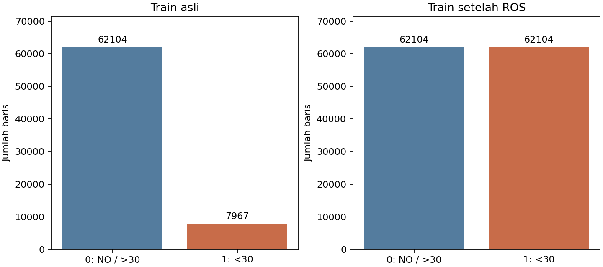
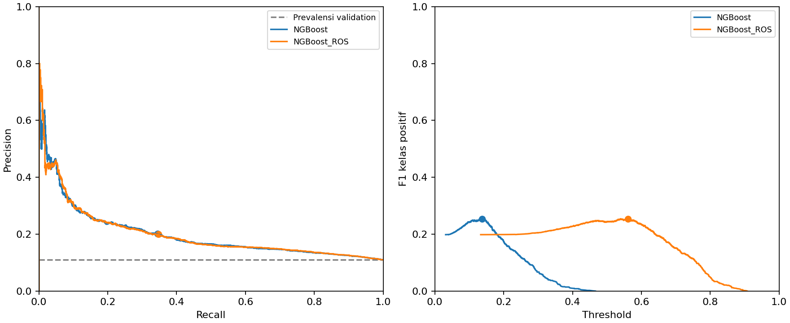

# Klasifikasi Rawat Inap Ulang Pasien Diabetes Menggunakan NGBoost dan Rotation Forest serta Evaluasi Random Oversampling

Bambang Herlambang (5803024019), Benedictus Erlangga (5803024011), Robertus Geraldyn Alexandro Gabeler (5803024025)

Program Studi Informatika, Fakultas Teknik, Universitas Katolik Widya Mandala Surabaya

## Abstrak

Klasifikasi rawat inap ulang perlu mempertimbangkan ketidakseimbangan kelas, pengulangan kunjungan pasien, dan ambang keputusan. Penelitian ini membandingkan NGBoost dan Rotation Forest pada dataset Diabetes 130-US Hospitals for Years 1999-2008, serta mengevaluasi penambahan random oversampling pada NGBoost. Dari 101.766 kunjungan, sebanyak 1.652 kunjungan berstatus meninggal dikeluarkan. Sebanyak 100.114 kunjungan tersisa dibagi berdasarkan pasien menjadi 70.071 data latih, 15.065 validasi, dan 14.978 uji. Preprocessing dan reduksi menjadi 32 komponen dipelajari hanya dari data latih. Pada evaluasi uji awal dengan ambang yang dipilih melalui validasi, NGBoost memperoleh average precision 0,2068 dan F1 0,2606, sedangkan Rotation Forest memperoleh 0,1573 dan 0,2265. Percobaan tambahan menyeimbangkan data latih menjadi 62.104 sampel per kelas. Pada validasi dengan ambang 0,5, oversampling meningkatkan recall NGBoost dari 0 menjadi 0,5238. Setelah ambang masing-masing model dipilih dengan aturan F1 maksimum, F1 NGBoost tanpa dan dengan oversampling hampir sama, yaitu 0,2540 dan 0,2534. Brier score varian oversampling lebih buruk pada validasi. Hasil menunjukkan bahwa peningkatan recall pada ambang tetap belum cukup untuk menyatakan keunggulan oversampling. Penelitian terbatas pada satu pembagian pasien; hasil pemilihan ambang pada validasi bukan evaluasi independen dan belum menunjukkan kesiapan penggunaan klinis.

Kata kunci: klasifikasi, rawat inap ulang, NGBoost, Rotation Forest, random oversampling, ambang keputusan.

## 1 Pendahuluan

Dataset Diabetes 130-US Hospitals for Years 1999-2008 memuat catatan rawat inap pasien dengan diabetes dari 130 rumah sakit dan jaringan layanan di Amerika Serikat [1]. Data tersebut menyediakan atribut demografi, penggunaan layanan, diagnosis, hasil laboratorium, terapi, serta label rawat inap ulang. Penelitian asal dataset menggunakan catatan klinis untuk mengkaji hubungan pemeriksaan HbA1c dan rawat inap ulang dengan regresi logistik multivariabel [2]. Penelitian ini menggunakan data yang sama sebagai bahan kajian klasifikasi, dengan sasaran mengidentifikasi kunjungan yang tercatat diikuti rawat inap ulang kurang dari 30 hari.

Pada CSV asli, kelas rawat inap ulang kurang dari 30 hari hanya mencakup 11,160% kunjungan. Model yang selalu memprediksi kelas lainnya karena itu dapat memiliki akurasi tinggi meskipun tidak mengenali kasus positif. Selain itu, satu pasien dapat memiliki beberapa kunjungan. Pengacakan kunjungan tanpa memperhatikan pasien dapat menempatkan riwayat pasien yang sama pada bagian pelatihan dan evaluasi. Pemisahan berdasarkan pasien digunakan agar pengukuran berfokus pada generalisasi ke pasien yang berbeda.

NGBoost dipilih karena menghasilkan prediksi probabilistik melalui natural gradient boosting [3]. Rotation Forest dipilih sebagai pembanding dengan mekanisme pembentukan ensemble yang berbeda, yaitu transformasi fitur menggunakan principal component analysis pada kelompok fitur [4]. Kedua algoritma menggunakan representasi masukan yang sama. DummyClassifier dengan strategi prior menjadi baseline agar peningkatan terhadap prediktor prevalensi dapat diperiksa.

Random oversampling menambah sampel kelas minoritas melalui pengambilan berulang dari sampel yang sudah ada [5]. Namun, perubahan keseimbangan kelas pada data latih juga dapat mengubah sebaran probabilitas model. Perbandingan hanya pada ambang 0,5 berpotensi mencampurkan pengaruh ranking prediksi dengan pengaruh ambang keputusan. Penelitian ini karena itu membandingkan NGBoost sebelum dan sesudah oversampling, baik pada ambang tetap maupun setelah masing-masing ambang dipilih melalui validasi.

Tujuan penelitian adalah membandingkan NGBoost dan Rotation Forest pada rancangan evaluasi berbasis pasien, serta menilai apakah manfaat oversampling tetap terlihat setelah penyesuaian ambang. Kontribusi penelitian bersifat empiris pada konfigurasi yang diuji: dokumentasi preprocessing, pemisahan pasien, evaluasi diskriminasi dan probabilitas, serta pembacaan hasil oversampling dengan aturan pemilihan ambang yang sama. Penelitian ini tidak mengusulkan algoritma baru atau mengklaim bahwa pemakaian algoritma tersebut pada dataset ini merupakan yang pertama.

## 2 Metode

### 2.1 Dataset dan target

CSV asli berisi 101.766 kunjungan dari 71.518 pasien dan 50 kolom, terdiri atas 47 calon fitur, dua ID, dan satu target. Dataset diperoleh dari UCI dengan lisensi CC BY 4.0 [1]. Unit analisis adalah kunjungan rawat inap. Target biner bernilai 1 untuk label sumber <30 dan 0 untuk NO atau >30. Kelas 0 berarti tidak tercatat rawat inap ulang kurang dari 30 hari; kelas ini tidak sama dengan tidak pernah rawat inap ulang. Batas label sumber dipertahankan tanpa menggantinya menjadi kurang dari atau sama dengan 30 hari.

Prediksi dirancang pada saat pasien keluar rumah sakit sehingga informasi yang tersedia selama kunjungan dapat menjadi masukan. ID kunjungan, ID pasien, dan target asli tidak menjadi prediktor. Pasien yang sama dapat menyumbang beberapa kunjungan, tetapi seluruh kunjungannya ditempatkan pada set yang sama.

### 2.2 Karakteristik dan pembersihan data

Delapan fitur numerik meliputi lama rawat dan hitungan prosedur laboratorium, prosedur lain, obat, kunjungan rawat jalan, gawat darurat, rawat inap terdahulu, serta diagnosis. Lama rawat berada pada rentang 1 sampai 14 hari. Usia berupa interval 10 tahun; kode administrasi dan diagnosis ICD-9 diperlakukan sebagai kategori nominal. Status obat No, Steady, Up, dan Down menunjukkan tidak diresepkan, dosis tetap, dinaikkan, dan diturunkan. Nilai None pada HbA1c dan glukosa berarti pemeriksaan tidak dilakukan, sehingga dipertahankan sebagai kategori.

Data dibaca sebagai string, spasi dibersihkan, dan tanda ? atau string kosong dinormalisasi menjadi missing. Tiga nilai gender Unknown/Invalid juga menjadi missing. Tidak ditemukan duplikasi baris persis maupun ID kunjungan. ID kosong, target tidak dikenal, konflik ID kunjungan, serta nilai hitungan yang tidak valid diperlakukan sebagai kesalahan yang menghentikan proses, bukan dihapus secara diam-diam.

Kode pada discharge_disposition_id mengikuti IDS_mapping.csv. Kode 11 berarti meninggal; kode 19 meninggal di rumah; kode 20 meninggal di fasilitas medis; dan kode 21 meninggal dengan tempat tidak diketahui. Tiga kode terakhir memiliki keterangan Medicaid/hospice pada sumber. Frekuensinya berturut-turut 1.642, 8, 2, dan 0. Sebanyak 1.652 kunjungan tersebut dikeluarkan karena sasaran adalah prediksi setelah pasien keluar hidup. Kunjungan terdahulu pasien tetap dipertahankan. Hospice berkode 13 atau 14 tidak otomatis dianggap meninggal dan tetap masuk cohort.

Kode administrasi yang tidak diketahui diubah menjadi missing: admission_type_id 5/6/8; discharge_disposition_id 18/25/26; serta admission_source_id 9/15/17/20/21. Arti kode bergantung pada kolom; kode 20 pada admission_source_id adalah Not Mapped. Kamus lengkap beserta jumlah setiap kode disimpan sebagai lampiran data proyek.

### 2.3 Pembagian pasien dan transformasi

Setelah pembersihan, 100.114 kunjungan dibagi menggunakan GroupShuffleSplit dengan seed 42. Pembagian pertama mengambil sekitar 70% pasien untuk pelatihan; sisanya dibagi sama untuk validasi dan uji. Pembagian tidak distratifikasi dan tidak menggunakan urutan waktu. Persentase ditetapkan atas pasien, sehingga persentase kunjungan dapat sedikit berbeda. Tidak ada pasien yang tumpang tindih antarset.

Tabel 1. Pembagian kunjungan dan pasien setelah cleaning.

| Set | Kunjungan | Pasien | Kelas 0 | Kelas 1 |
|---|---|---|---|---|
| Latih | 70.071 | 49.307 | 62.104 | 7.967 |
| Validasi | 15.065 | 10.566 | 13.406 | 1.659 |
| Uji | 14.978 | 10.566 | 13.247 | 1.731 |

Semua keputusan berbasis statistik dipelajari pada data latih asli. Kolom weight dikeluarkan karena missing pada train lebih dari 50%; missing pada data asli sebesar 96,858%. Kolom acetohexamide, examide, dan citoglipton dikeluarkan karena konstan pada train. Dari 47 calon fitur tersisa 43 kolom. Fitur numerik diimputasi median dan distandardisasi, sedangkan fitur kategorikal diimputasi dengan kategori missing dan di-one-hot. Kategori yang muncul kurang dari 10 kali pada train dikelompokkan melalui pengaturan encoder.

Encoding menghasilkan 1.222 fitur. Representasi bersama TruncatedSVD dengan 32 komponen diikuti StandardScaler di-fit pada train asli, lalu dipakai untuk mentransformasi train, validasi, dan uji. Reduksi ini memberi masukan kontinu dan membatasi komputasi. Oleh sebab itu, perbandingan algoritma dalam penelitian ini berlaku untuk representasi hasil reduksi tersebut, bukan kemampuan masing-masing pada fitur asli tanpa reduksi.

### 2.4 Model dan konfigurasi eksperimen

NGBoost menggunakan distribusi Bernoulli dan base learner DecisionTreeRegressor. Rotation Forest menggunakan implementasi aeon [8]. Parameter awal ditetapkan sebelum evaluasi validasi pada percobaan awal, tanpa pencarian hiperparameter. Kedua model awal memakai data latih dan adapter yang sama. Baseline prior dilatih pada data latih asli dan menghasilkan probabilitas konstan sebesar prevalensi kelas positif train.

Tabel 2. Konfigurasi model utama.

| Model | Konfigurasi |
|---|---|
| NGBoost | 150 estimator; learning_rate 0,03; minibatch_frac 0,75; base tree max_depth 3 dan min_samples_leaf 20; seed 42 |
| Rotation Forest | 20 estimator; min_group dan max_group 3; remove_proportion 0,5; n_jobs 2; seed 42 |
| DummyClassifier | strategy prior; dilatih pada distribusi train asli |

Seluruh 70.071 kunjungan train menjadi kumpulan pelatihan, tanpa mengambil subset permanen. Parameter minibatch_frac 0,75 pada NGBoost berarti setiap iterasi boosting mengambil sampel acak 75% dari kumpulan tersebut. Anggaran estimator kedua algoritma tidak identik; penelitian ini membandingkan konfigurasi awal yang dipilih, bukan hasil optimasi dengan anggaran komputasi yang disamakan.

### 2.5 Percobaan random oversampling

Percobaan tambahan melatih ulang NGBoost tanpa oversampling dan NGBoost dengan RandomOverSampler, sampling_strategy minority serta seed 42. Adapter dipelajari pada train asli sebelum resampling. Parameter NGBoost, split, dan representasi fitur dibuat sama pada pasangan percobaan revisi. Oversampling hanya menggandakan sampel minoritas pada representasi train yang sudah ditransformasi; validasi dan uji mempertahankan distribusi kelas asli. Penempatan resampling sesudah pemisahan menghindari pola kebocoran yang dijelaskan dalam dokumentasi imbalanced-learn [6].

Train asli terdiri atas 62.104 kelas 0 dan 7.967 kelas 1. Setelah oversampling, masing-masing kelas berjumlah 62.104, sehingga terdapat 124.208 baris pelatihan. Tambahan 54.137 baris merupakan duplikasi sampel, bukan pasien atau kunjungan baru. Random oversampling dipilih karena tidak menginterpolasi kategori obat atau diagnosis. Untuk varian ini, minibatch NGBoost mengambil sampel dari kumpulan train hasil oversampling. Tidak dilakukan oversampling pada Rotation Forest dalam percobaan tambahan ini.

### 2.6 Evaluasi dan keterlacakan

Average precision (AP) menjadi metrik ranking utama karena kelas positif sedikit. AP merangkum precision dengan bobot kenaikan recall dan berbeda dari luas kurva precision-recall yang dihitung dengan integrasi trapezoid [7]. Precision dihitung sebagai TP/(TP+FP), recall sebagai TP/(TP+FN), dan F1 sebagai dua kali hasil kali precision dan recall dibagi jumlah keduanya. Metrik pelengkap meliputi akurasi, balanced accuracy, ROC-AUC, confusion matrix, Brier score, dan log loss. Brier score serta log loss yang lebih kecil menunjukkan kesalahan probabilitas yang lebih rendah pada data evaluasi.

Evaluasi memiliki dua tahap dengan status yang berbeda. Tahap awal membandingkan NGBoost dan Rotation Forest pada validasi dengan ambang 0,5. Selanjutnya, ambang dipilih untuk memaksimalkan F1 positif pada validasi; jika seri, dipilih ambang tertinggi. Model utama dipilih berdasarkan AP validasi. Protokol dan hash artefak dicatat sebelum set uji dibaca pada evaluasi awal. Baseline tetap memakai ambang 0,5.

Tahap tambahan mengevaluasi pasangan NGBoost tanpa/dengan oversampling hanya pada validasi, pertama pada 0,5 dan kemudian pada ambang F1 maksimum untuk masing-masing model. Prediksi validasi tersimpan dipakai kembali tanpa training ulang saat memilih ambang. Target diperiksa baris per baris dan metrik ambang 0,5 dicocokkan dengan eksperimen sumber. Hasil setelah pemilihan ambang diukur pada validasi yang sama sehingga bukan evaluasi independen. Set uji tahap awal sudah pernah digunakan dan tidak disebut sebagai holdout baru untuk model revisi.

Implementasi menggunakan Python 3.12, NumPy 2.3.4, pandas 2.3.3, SciPy 1.16.3, scikit-learn 1.7.2, NGBoost 0.5.11, aeon 1.6.0, dan imbalanced-learn 0.14.0. Hasil agregat, seed, konfigurasi, hash dataset, dan hash sumber pemilihan ambang disimpan dalam repository. Pengujian sintetis memeriksa perilaku pipeline dan metrik, sedangkan hasil artikel berasal dari eksekusi pada dataset penuh.

## 3 Hasil

### 3.1 Perbandingan awal pada validasi

Tabel 3 menunjukkan hasil validasi tahap awal pada ambang 0,5. Prevalensi positif validasi sebesar 0,1101 menjadi acuan AP baseline prior. NGBoost memperoleh AP 0,1993, di atas Rotation Forest 0,1568. Namun, NGBoost tidak menghasilkan prediksi positif pada ambang 0,5. Rotation Forest mendeteksi 34 dari 1.659 kasus positif dan menghasilkan 69 false positive. Dengan demikian, ranking probabilitas dan keputusan kelas pada satu ambang memperlihatkan aspek performa yang berbeda.

Tabel 3. Hasil tahap awal pada validasi dengan ambang 0,5.

| Model | AP | Precision | Recall | F1 |
|---|---|---|---|---|
| Baseline prior | 0,1101 | 0,0000 | 0,0000 | 0,0000 |
| NGBoost | 0,1993 | 0,0000 | 0,0000 | 0,0000 |
| Rotation Forest | 0,1568 | 0,3301 | 0,0205 | 0,0386 |

### 3.2 Hasil uji tahap awal

Set uji berisi 1.731 kasus positif dari 14.978 kunjungan. NGBoost dipilih sebagai model utama berdasarkan AP validasi. Ambang yang dipilih dari validasi sebesar 0,1438 untuk NGBoost dan 0,2000 untuk Rotation Forest. Pada ambang tersebut, NGBoost memperoleh AP 0,2068 dan F1 0,2606, sedangkan Rotation Forest memperoleh AP 0,1573 dan F1 0,2265. Baseline prior memiliki akurasi 0,8844 meskipun recall positifnya nol.

Tabel 4. Hasil uji tahap awal pada ambang yang dipilih melalui validasi.

| Model | Ambang | AP | Precision | Recall | F1 |
|---|---|---|---|---|---|
| Baseline prior | 0,5000 | 0,1156 | 0,0000 | 0,0000 | 0,0000 |
| NGBoost | 0,1438 | 0,2068 | 0,2237 | 0,3120 | 0,2606 |
| Rotation Forest | 0,2000 | 0,1573 | 0,1647 | 0,3628 | 0,2265 |

NGBoost menghasilkan 540 true positive, 1.874 false positive, 1.191 false negative, dan 11.373 true negative. Rotation Forest menangkap lebih banyak kasus positif, yaitu 628, dengan 3.186 false positive. NGBoost memperoleh Brier score 0,0987 dan log loss 0,3424, dibandingkan 0,1022 dan 0,3580 pada baseline. Rotation Forest memperoleh Brier score 0,1053 dan log loss 0,7014. Hasil ini merupakan skor uji model tahap awal, bukan skor uji model revisi yang dilatih ulang.

### 3.3 Perubahan setelah oversampling pada ambang tetap

Pada run revisi, NGBoost tanpa oversampling memperoleh AP validasi 0,1994; nilainya sedikit berbeda dari run awal 0,1993 dan dicatat terpisah. Pasangan revisi menggunakan preprocessing dan parameter yang sama satu sama lain. Pada ambang 0,5, varian ROS meningkatkan recall menjadi 0,5238 dan F1 menjadi 0,2439, dengan precision 0,1590. Varian tersebut menghasilkan 869 true positive, 4.597 false positive, dan 790 false negative.

Tabel 5. Hasil pasangan revisi pada validasi dengan ambang 0,5.

| Model | AP | Precision | Recall | F1 | Brier | Log loss |
|---|---|---|---|---|---|---|
| NGBoost | 0,1994 | 0,0000 | 0,0000 | 0,0000 | 0,0948 | 0,3329 |
| NGBoost + ROS | 0,2001 | 0,1590 | 0,5238 | 0,2439 | 0,2255 | 0,6434 |

Perubahan AP dari 0,1994 menjadi 0,2001 relatif kecil. Brier score meningkat dari 0,0948 menjadi 0,2255 dan log loss dari 0,3329 menjadi 0,6434, yang berarti kualitas probabilitas memburuk menurut kedua metrik tersebut pada validasi. Penambahan deteksi pada ambang tetap disertai pertambahan prediksi positif yang salah.

### 3.4 Perbandingan setelah pemilihan ambang

Setelah masing-masing ambang dipilih dengan aturan F1 maksimum pada validasi, F1 NGBoost tanpa oversampling menjadi 0,2540 dan F1 varian ROS menjadi 0,2534. NGBoost biasa menggunakan ambang 0,1374, sedangkan varian ROS menggunakan 0,5605. NGBoost biasa menghasilkan 571 true positive dan 2.266 false positive; ROS menghasilkan 576 true positive dan 2.312 false positive. Selisih F1 ROS dikurangi model tanpa oversampling sebesar -0,0006 setelah pembulatan empat desimal.

Tabel 6. Hasil validasi yang juga dipakai memilih ambang F1 maksimum.

| Model | Ambang | Precision | Recall | F1 |
|---|---|---|---|---|
| NGBoost | 0,1374 | 0,2013 | 0,3442 | 0,2540 |
| NGBoost + ROS | 0,5605 | 0,1994 | 0,3472 | 0,2534 |

Kurva precision-recall kedua model tampak berdekatan, konsisten dengan AP yang hampir sama. Ambang yang menghasilkan F1 tertinggi bergeser cukup besar, tetapi nilai F1 maksimum hampir sama. AP, ROC-AUC, Brier score, dan log loss tetap sama ketika hanya ambang keputusan yang diubah karena probabilitas prediksi tidak berubah.

### 3.5 Analisis kesalahan menurut riwayat rawat inap

Analisis deskriptif pada set uji tahap awal menunjukkan variasi recall menurut jumlah rawat inap dalam tahun sebelumnya. NGBoost memiliki recall 0,0328 pada kelompok tanpa riwayat rawat inap dan 0,8523 pada kelompok dengan dua atau lebih rawat inap. Sebanyak 825 dari 1.191 false negative NGBoost berasal dari kelompok tanpa riwayat. Temuan ini menunjukkan bahwa skor agregat belum menggambarkan kemampuan deteksi yang seragam pada seluruh kelompok.

Tabel 7. Recall model tahap awal pada set uji menurut riwayat rawat inap.

| Riwayat rawat inap | Kunjungan | Positif | Recall NGBoost | Recall Rotation Forest |
|---|---|---|---|---|
| 0 | 10.013 | 853 | 0,0328 | 0,2063 |
| 1 | 2.759 | 377 | 0,2255 | 0,3289 |
| 2+ | 2.206 | 501 | 0,8523 | 0,6547 |

## 4 Pembahasan

### 4.1 Pemilihan model dan arti metrik

Pada konfigurasi awal, NGBoost melampaui Rotation Forest dalam AP dan F1 set uji, sementara Rotation Forest memiliki recall lebih tinggi. Hasil ini menunjukkan perbedaan antara kemampuan menempatkan kasus positif pada ranking yang lebih tinggi dan jumlah kasus yang terdeteksi pada ambang tertentu. Precision NGBoost 0,2237 berarti sebagian besar prediksi positifnya masih merupakan false positive, sehingga performa tersebut tidak dapat langsung diterjemahkan sebagai manfaat operasional.

Baseline prior menegaskan keterbatasan akurasi dalam data dengan kelas positif kecil: akurasi uji 88,44% dicapai tanpa mendeteksi satu pun kasus positif. Penilaian dengan AP, precision, recall, F1 dan confusion matrix memberikan gambaran yang lebih lengkap. Brier score dan log loss diperlukan karena probabilitas yang baik untuk ranking belum tentu memiliki kualitas estimasi risiko yang sama. Tidak dilakukan kalibrasi pascatraining dalam penelitian ini.

### 4.2 Oversampling dan ambang keputusan

Pada ambang 0,5, oversampling tampak memberi peningkatan deteksi yang besar. Namun, setelah kedua model diberi kesempatan memilih ambang dengan aturan yang sama, recall dan F1 menjadi hampir sama. Temuan ini mendukung interpretasi bahwa pergeseran keputusan pada ambang tetap merupakan bagian penting dari perubahan yang terlihat; data yang seimbang tidak dengan sendirinya memberikan ranking yang lebih baik.

Interpretasi tersebut terbatas pada hubungan metrik yang diamati, bukan pembuktian mekanisme kausal perubahan model. Oversampling dapat mengubah pembelajaran sekaligus sebaran probabilitas. AP pasangan revisi memang berbeda, tetapi hanya sekitar 0,0006. Tanpa pengulangan split atau interval ketidakpastian, penelitian tidak menyatakan bahwa selisih tersebut signifikan. Model tanpa oversampling juga dapat meningkatkan recall dengan menurunkan ambang, sehingga recall nol pada 0,5 tidak berarti model tersebut tidak mampu mengenali kasus positif.

Brier score dan log loss ROS yang lebih tinggi memperlihatkan bahwa peningkatan recall pada 0,5 disertai kesalahan probabilitas yang lebih besar pada distribusi validasi asli. Pemilihan ambang tidak memperbaiki kedua metrik ini. Untuk penggunaan yang memerlukan probabilitas risiko, pemeriksaan kalibrasi serta pemilihan ambang berdasarkan biaya kesalahan memerlukan penelitian lanjutan. F1 maksimum di penelitian ini adalah aturan akademik pembanding, bukan batas keputusan klinis.

### 4.3 Batas validitas dan pekerjaan lanjutan

Pemisahan pasien mengurangi tumpang tindih identitas antarset, tetapi tidak menjamin generalisasi lintas waktu atau rumah sakit. Kunjungan dalam pasien yang sama tetap berkorelasi di dalam setiap set. Cohort hanya mengeluarkan kunjungan berstatus meninggal; hospice dan transfer lain tetap dipertahankan. Pilihan tersebut perlu diperhatikan ketika membandingkan hasil dengan penelitian lain yang memakai cohort atau definisi target berbeda.

Data berasal dari layanan AS tahun 1999-2008 dan belum divalidasi pada rumah sakit Indonesia. Pemeriksaan bias menurut demografi, perubahan praktik layanan, dan data eksternal belum dilakukan. Adapter SVD juga dapat memengaruhi kemampuan masing-masing algoritma; belum ada ablasi terhadap jumlah komponen atau representasi tanpa reduksi. Dua konfigurasi model belum dituning dan tidak menggunakan anggaran komputasi yang disetarakan, sehingga penelitian tidak menyimpulkan bahwa satu keluarga algoritma selalu lebih baik.

Pemilihan ambang dan pelaporan F1 pasangan revisi menggunakan validasi yang sama, sehingga nilai tersebut dapat optimistis. Set uji telah digunakan pada tahap awal dan tidak lagi merupakan data baru untuk seluruh rangkaian penelitian. Evaluasi lanjutan dapat memakai validasi silang berbasis pasien dengan pemilihan ambang di dalam bagian pelatihan atau data eksternal yang belum digunakan. Pada validasi silang, seleksi kolom, imputasi, encoding, SVD, scaling dan oversampling harus di-fit ulang pada training fold saja. Penelitian ini belum menjalankan prosedur tersebut, menguji signifikansi, atau menghasilkan interval kepercayaan.

## 5 Kesimpulan

NGBoost dan Rotation Forest telah dibandingkan untuk klasifikasi rawat inap ulang kurang dari 30 hari dengan pemisahan berbasis pasien. Pada evaluasi uji awal, NGBoost memperoleh AP 0,2068 dan F1 0,2606, lebih tinggi daripada Rotation Forest pada konfigurasi yang dicoba, sementara Rotation Forest mempunyai recall lebih tinggi. Hasil tersebut menunjukkan perlunya membaca metrik ranking, keputusan kelas, dan probabilitas secara bersama.

Random oversampling menyeimbangkan data latih dan meningkatkan recall NGBoost pada ambang 0,5. Setelah masing-masing ambang dipilih dengan aturan F1 maksimum, F1 kedua varian hampir sama, yaitu 0,2540 tanpa oversampling dan 0,2534 dengan oversampling. Oversampling belum menunjukkan keunggulan yang jelas pada satu split ini dan memperburuk Brier score serta log loss pada validasi. Hasil pemilihan ambang merupakan hasil validasi, bukan estimasi uji independen. Generalisasi dan kegunaan di luar eksperimen ini memerlukan evaluasi lebih lanjut.

## Ketersediaan data dan kode

Dataset dan lisensinya tersedia di UCI [1]. Kode, konfigurasi, kamus data, laporan dan hasil agregat tersedia pada repository kelompok: https://github.com/bambangh31/data-mining-classification-kelompok-1. Model terlatih dan matriks preprocessing dapat dibuat ulang secara lokal. Angka tahap awal bersumber dari results/week-11 dan results/week-12; angka revisi bersumber dari results/revisi-dosen. Hash berkas sumber artikel dicatat dalam docs/artikel/sumber-angka.json. Artikel ini disusun dari hasil tersimpan tanpa menambah evaluasi test.

## Daftar pustaka

[1] Clore, J., Cios, K., DeShazo, J., dan Strack, B. 2014. Diabetes 130-US Hospitals for Years 1999-2008. UCI Machine Learning Repository. DOI: 10.24432/C5230J. https://doi.org/10.24432/C5230J

[2] Strack, B., DeShazo, J. P., Gennings, C., Olmo, J. L., Ventura, S., Cios, K. J., dan Clore, J. N. 2014. Impact of HbA1c Measurement on Hospital Readmission Rates: Analysis of 70,000 Clinical Database Patient Records. BioMed Research International, 2014, 781670. DOI: 10.1155/2014/781670. https://doi.org/10.1155/2014/781670

[3] Duan, T., Avati, A., Ding, D. Y., Thai, K. K., Basu, S., Ng, A., dan Schuler, A. 2020. NGBoost: Natural Gradient Boosting for Probabilistic Prediction. Proceedings of Machine Learning Research, 119, 2690-2700. https://proceedings.mlr.press/v119/duan20a.html

[4] Rodriguez, J. J., Kuncheva, L. I., dan Alonso, C. J. 2006. Rotation Forest: A New Classifier Ensemble Method. IEEE Transactions on Pattern Analysis and Machine Intelligence, 28(10), 1619-1630. DOI: 10.1109/TPAMI.2006.211. https://www.lucykuncheva.co.uk/papers/jrlkcatpami06.pdf

[5] The imbalanced-learn developers. RandomOverSampler. Dokumentasi perangkat lunak, diakses 14 November 2026. Versi implementasi eksperimen 0.14.0. https://imbalanced-learn.org/stable/references/generated/imblearn.over_sampling.RandomOverSampler.html

[6] The imbalanced-learn developers. Common pitfalls and recommended practices. Dokumentasi perangkat lunak, diakses 14 November 2026. https://imbalanced-learn.org/stable/common_pitfalls.html

[7] The scikit-learn developers. average_precision_score. Dokumentasi scikit-learn 1.7.2, diakses 14 November 2026. https://scikit-learn.org/1.7/modules/generated/sklearn.metrics.average_precision_score.html

[8] The aeon developers. Rotation Forest Classifier. Dokumentasi aeon, diakses 14 November 2026. Versi implementasi eksperimen 1.6.0. https://www.aeon-toolkit.org/en/latest/examples/classification/rotation_forest.html
