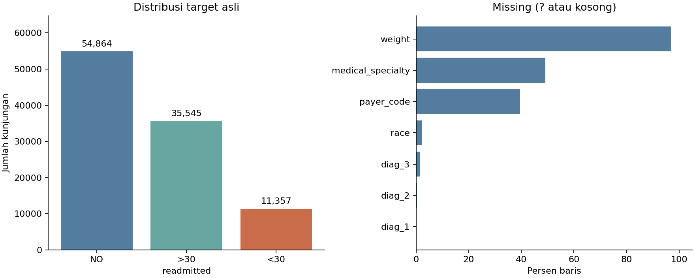

# Week 10 — dataset, karakteristik, BOD dan algoritma

Dokumen siap baca: [PDF week 10](week-10-data-mining-kelompok-1.pdf).

Tanggal kelas: 27 Oktober 2026. Dokumen dan pemeriksaan aktual disiapkan pada
3 November 2026; tanggal kelas tidak dianggap sebagai bukti pekerjaan selesai.

## Dataset dan sumber

**Diabetes 130-US Hospitals for Years 1999-2008** memuat catatan kunjungan
rawat inap pasien dengan diabetes dari 130 rumah sakit/jaringan layanan di AS,
periode 1999–2008. Dataset digunakan untuk klasifikasi readmission, bukan
diagnosis diabetes/non-diabetes.

- Sumber asli: [UCI](https://archive.ics.uci.edu/dataset/296/diabetes-130-us-hospitals-for-years-1999-2008).
- Pembuat dataset: Clore, Cios, DeShazo, dan Strack (2014).
- DOI: [10.24432/C5230J](https://doi.org/10.24432/C5230J).
- Lisensi: CC BY 4.0; atribusi sumber dipertahankan.
- Berkas: `diabetic_data.csv` dan `IDS_mapping.csv`; ZIP diberikan pada
  3 November 2026. Tanggal unduh aslinya tidak diketahui.
- CSV diperiksa langsung, dengan hash SHA-256
  `0689e7ec031237dc63031b938805c48377748761a3b26acab621567afa24df97`.

## Tunjukkan data

[Contoh enam baris aktual](contoh-data.md) menampilkan sebagian kolom, tanpa
ID pasien/kunjungan. [Kamus data lengkap](kamus-data.md) menjelaskan 50 kolom,
tipe analisis, peran, jumlah nilai unik dan missing value.
File aslinya disimpan lokal di `data/raw/` tanpa diubah.

## Karakteristik data aktual

| Karakteristik | Hasil pemeriksaan |
|---|---|
| Unit observasi | Satu kunjungan rawat inap |
| Jumlah baris / kolom | 101.766 / 50 |
| Pasien berbeda | 71.518 |
| Fitur awal | 47: 8 numerik dan 39 kategorikal |
| Kolom lain | 2 ID dan 1 target |
| Baris di luar kunjungan pertama tiap pasien | 30.248; pasien berulang perlu split berbasis pasien |
| Duplikasi baris / ID kunjungan | 0 / 0 |
| Target | `readmitted`: NO, >30, <30 |
| Kelas positif biner awal | <30: 11.357 baris (11,160% data asli) |

| Target asli | Jumlah | Persen |
|---|---|---|
| NO | 54.864 | 53,912% |
| >30 | 35.545 | 34,928% |
| <30 | 11.357 | 11,160% |

Data mencampur karakteristik pasien, kode administrasi, hitungan layanan,
diagnosis, hasil lab, dan status obat. Angka pada kode diagnosis/administrasi
tidak menunjukkan besaran kontinu. `?` adalah missing; `None` pada hasil lab
berarti pemeriksaan tidak dilakukan dan dipertahankan sebagai kategori.

Missing utama: weight 98.569 baris; medical_specialty 49.949;
payer_code 40.256; race 2.273; diag_3 1.423; diag_2 358; diag_1 21.
Terdapat 3 gender Unknown/Invalid. Tidak menghapus semua baris yang mengandung
missing karena akan menghilangkan banyak data. Aturan imputasi dan keputusan
kolom ditentukan pada train setelah split.



Angka sumber: [profil JSON](../../results/dataset/dataset_profile.json),
[distribusi target](../../results/dataset/target_distribution.csv),
[missing](../../results/dataset/missing_summary.csv), dan
[ringkasan numerik](../../results/dataset/numeric_summary.csv).

## BOD — rumusan masalah dan tujuan

Bagian ini memuat bahan BOD; kepanjangan istilah serta format akhir mengikuti
penjelasan dosen.

| Komponen | Rumusan proyek |
|---|---|
| Masalah | Readmission dini merupakan kejadian yang ingin dikenali dari karakteristik kunjungan pasien diabetes |
| Pertanyaan analisis | Apakah pasien pada suatu kunjungan tercatat kembali dirawat dalam kurang dari 30 hari? |
| Tujuan | Membangun dan membandingkan dua algoritma klasifikasi dengan preprocessing dan split yang sama |
| Target operasional | 1 untuk <30; 0 untuk NO atau >30. Kelas 0 bukan berarti tidak pernah readmission |
| Waktu prediksi | Saat keluar rumah sakit; variabel selama rawat boleh menjadi fitur |
| Manfaat | Memahami pola data dan trade-off deteksi readmission dini sebagai kajian akademik |
| Ruang lingkup | Data historis AS; generalisasi ke pasien berbeda dengan pembagian berbasis pasien |
| Kriteria evaluasi | Average precision sebagai metrik pembanding utama; precision, recall, F1, ROC-AUC, balanced accuracy dan confusion matrix sebagai pelengkap |
| Kriteria keberhasilan awal | Pipeline berjalan, tidak ada overlap pasien, model nontrivial melampaui AP baseline pada validation; besar skor bukan jaminan manfaat klinis |

Kunjungan berstatus keluar meninggal (`11,19,20,21`) dikeluarkan sebagai
pilihan cohort awal. Kunjungan hospice/transfer lain tetap ada. Data historis,
bias representasi, faktor rumah sakit yang tidak lengkap, serta tidak adanya
validasi eksternal membatasi interpretasi. Tidak menyimpulkan sebab-akibat
atau kesiapan penggunaan klinis dari skor tugas kuliah.

## Algoritma yang dipakai

| Algoritma | Alasan dan konfigurasi awal |
|---|---|
| Logistic Regression | Model linier probabilistik yang relatif mudah dijelaskan; one-hot kategori dan scaling numerik; solver liblinear, C=1, max_iter=1000, class_weight=balanced |
| Random Forest | Ensemble pohon untuk interaksi/nonlinier; 150 pohon, max_depth=16, min_samples_leaf=5, max_features=sqrt, class_weight=balanced_subsample |
| DummyClassifier | Baseline selalu memprediksi kelas mayoritas; bukan pengganti dua algoritma utama |

Parameter awal ditetapkan sebelum melihat hasil validation, bukan hasil tuning.
Seed 42; threshold 0,5. Class weighting memakai label train, tanpa oversampling
sebelum split. Dua algoritma memakai train/validation yang sama.
AP dipilih karena kelas positif sedikit; akurasi saja berisiko menyesatkan.
Average precision bukan trapezoidal PR-AUC.

Referensi algoritma: [Logistic Regression](https://scikit-learn.org/1.7/modules/generated/sklearn.linear_model.LogisticRegression.html),
[Random Forest](https://scikit-learn.org/1.7/modules/generated/sklearn.ensemble.RandomForestClassifier.html),
[average precision](https://scikit-learn.org/1.7/modules/generated/sklearn.metrics.average_precision_score.html).

## Rencana coding week 11–12

Week 11 menghubungkan cleaning, split pasien sekitar 70/15/15, transformasi
yang di-fit hanya pada train, baseline, dua model awal dan evaluasi validation.
Week 12 dapat melanjutkan tuning, CV berbasis pasien dan analisis kesalahan.
Test tidak digunakan untuk pemilihan model/parameter. Lihat
[hasil week 11](../week-11/README.md) dan [aturan preprocessing](../preprocessing.md).

## Membuat ulang bahan karakteristik

```powershell
.\.venv\Scripts\python.exe -m src.profile_data
```

Perintah ini membaca CSV asli dan menghasilkan contoh, kamus, rekap dan grafik.
