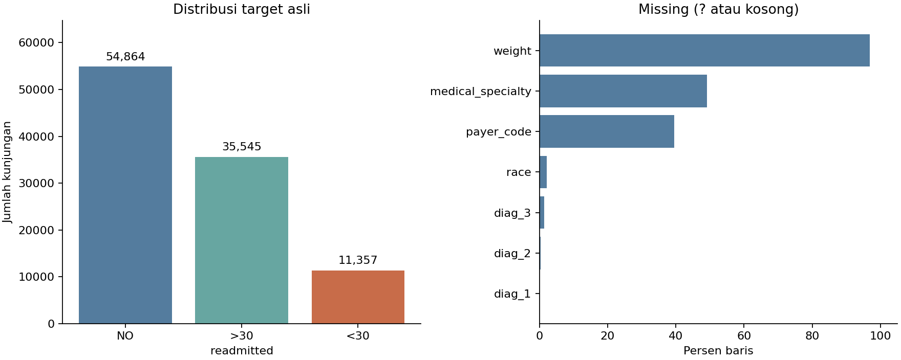
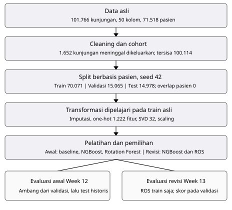
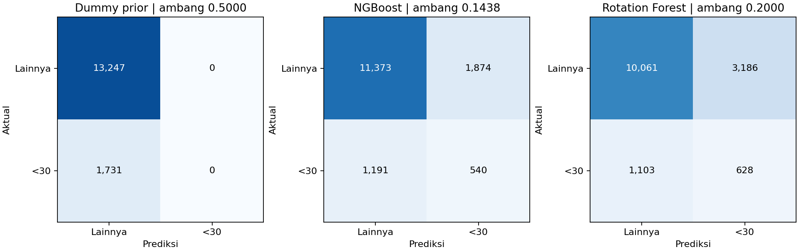

# Laporan pertama Week 13

Klasifikasi rawat inap ulang pasien diabetes

Kelompok 1 | Data Mining | Pembaruan 17 November 2026

| Anggota | NRP |
|---|---|
| Bambang Herlambang | 5803024019 |
| Benedictus Erlangga | 5803024011 |
| Robertus Geraldyn Alexandro Gabeler | 5803024025 |

## Ringkasan laporan pertama

Laporan pertama ini menyatukan pekerjaan Week 10 sampai Week 12 dan percobaan revisi dosen: pelengkapan karakteristik kode, NGBoost dengan random oversampling, serta penjelasan data pelatihan. Dua algoritma utama adalah NGBoost dan Rotation Forest, dengan DummyClassifier sebagai baseline. Artikel IMRAD Week 15 dan presentasi Week 16 belum menjadi keluaran laporan ini.

Pada uji historis Week 12, NGBoost memperoleh AP 0,2068 dan F1 0,2606. Pada percobaan revisi yang dievaluasi di validation, F1 NGBoost biasa dan NGBoost dengan oversampling hampir sama setelah masing-masing ambang dipilih: 0,2540 dan 0,2534. Hasil tersebut belum menunjukkan keunggulan yang jelas dari oversampling. Skor uji historis dan validasi revisi tidak dibandingkan sebagai eksperimen pada set yang sama.

## 1. Pendahuluan

### 1.1 Latar belakang

Sasaran proyek adalah mengenali kunjungan pasien diabetes yang tercatat diikuti rawat inap ulang dalam kurang dari 30 hari. Unit observasi adalah kunjungan, bukan satu pasien. Proyek ini mempelajari klasifikasi readmission, bukan diagnosis diabetes dan bukan hubungan sebab akibat.

Ketidakseimbangan target membuat akurasi tinggi dapat dicapai hanya dengan memilih kelas mayoritas. Di sisi lain, satu pasien dapat muncul beberapa kali sehingga pengacakan kunjungan tanpa memperhatikan pasien berisiko menempatkan riwayat pasien yang sama pada train dan test. Penelitian ini menempatkan pemisahan pasien dan pembacaan metrik positif sebagai dasar evaluasi.

### 1.2 Rumusan masalah

RQ1: Bagaimana karakteristik dataset, makna kode administrasi, missing value, dan pengulangan pasien memengaruhi keputusan preprocessing dan pembagian data?

RQ2: Bagaimana perbandingan NGBoost dan Rotation Forest pada representasi dan split pasien yang sama, menurut AP, precision, recall, F1, serta kualitas probabilitas?

RQ3: Apakah penambahan random oversampling pada NGBoost masih memperlihatkan keuntungan setelah ambang kedua model dipilih dengan aturan F1 maksimum yang sama pada validation?

### 1.3 Tujuan dan batasan

Tujuan laporan adalah menyediakan alur yang dapat diperiksa dari sumber data sampai evaluasi, membandingkan dua konfigurasi klasifikasi, dan menjawab revisi dosen dengan bukti eksperimen. Pembahasan terbatas pada target biner <30, satu pembagian pasien, informasi saat keluar rumah sakit, serta data historis AS. Tidak dilakukan penerapan pada layanan rumah sakit atau pengujian efektivitas intervensi.

Revisi yang sudah dilaksanakan meliputi kamus kode yang lebih lengkap, percobaan NGBoost + ROS, dan penjelasan penggunaan seluruh kumpulan train. Revisi tersebut tetap merupakan bagian laporan Week 13; bukan keluaran Week 14.

### 1.4 Definisi masalah klasifikasi dan waktu prediksi

Masukan model adalah karakteristik satu kunjungan rawat inap yang telah tersedia pada akhir perawatan. Keluaran berupa probabilitas label readmitted <30. Waktu prediksi ditetapkan saat pasien keluar karena lama rawat, jumlah prosedur, hasil pemeriksaan, perubahan obat dan status keluar baru lengkap pada tahap tersebut. Apabila tujuan diubah menjadi prediksi saat masuk rumah sakit, fitur-fitur yang baru diketahui saat keluar perlu ditinjau dan eksperimen harus diulang.

Penelitian menggunakan label pada CSV sumber secara langsung. Kelas positif bukan semua kejadian readmission: kunjungan yang diikuti rawat inap ulang >30 masuk kelas negatif bersama NO. Karena itu, istilah negatif pada laporan berarti tidak memiliki label <30 dalam dataset, bukan pernyataan bahwa pasien tidak pernah dirawat lagi. Dataset tidak digunakan untuk menyimpulkan bahwa terapi tertentu menyebabkan atau mencegah readmission.

Terdapat dua unit yang perlu dibedakan. Unit observasi dan perhitungan metrik adalah kunjungan, sedangkan unit pembagian data adalah pasien. Seluruh kunjungan seorang pasien harus berada pada set yang sama. Satu pasien dapat menyumbang lebih dari satu kesalahan prediksi; jumlah kesalahan kunjungan tidak boleh langsung disebut jumlah pasien yang salah diprediksi.

### 1.5 Hubungan laporan dengan tahapan tugas

Tabel 1. Pemetaan kebutuhan tugas ke bukti pekerjaan

| Tahap | Pertanyaan yang dijawab | Bukti yang digunakan |
|---|---|---|
| Week 10 | Data apa, makna kolom/kode, tujuan dan algoritma? | CSV asli, mapping administrasi, profil dan kamus data. |
| Week 11 | Bagaimana data dibersihkan dan model dipelajari? | Kode preprocessing/mining, metadata dan metrik validation awal. |
| Week 12 | Bagaimana ambang dipilih dan hasil uji dibaca? | Protokol beku, metrik test historis, kelompok kesalahan. |
| Week 13 | Apa hasil sementara dan tindak lanjut revisi? | Sintesis hasil dan eksperimen NGBoost tanpa/dengan ROS pada validation. |

Laporan pertama menyajikan pekerjaan yang telah tersedia sampai revisi Week 13. Penambahan uraian pada versi ini bertujuan membuat hubungan antara keputusan metode, implementasi dan angka hasil dapat diperiksa. Rincian yang belum dikerjakan tetap ditulis sebagai keterbatasan atau rencana, sehingga pembaca dapat membedakan hasil pengamatan dari usulan penelitian berikutnya.

## 2. Business objective dan tujuan data mining

Bagian BOD menghubungkan masalah pemantauan readmission dengan sasaran teknis klasifikasi. Calon pembaca hasil adalah pihak akademik yang mempelajari pemilahan risiko kunjungan. Pengelola layanan dapat menjadi pemangku kepentingan konseptual, tetapi laporan ini belum menetapkan kebijakan klinis, biaya kesalahan, atau target operasional rumah sakit.

### 2.1 Tujuan dan kriteria keberhasilan

Tabel 2. Tujuan dan kriteria keberhasilan

| Komponen | Rumusan |
|---|---|
| Pertanyaan | Apakah kunjungan pasien akan diikuti rawat inap ulang tercatat kurang dari 30 hari? |
| Tujuan | Membandingkan dua algoritma dengan target, split pasien, dan preprocessing yang sama. |
| Waktu prediksi | Saat pasien keluar rumah sakit; informasi selama kunjungan dapat dipakai. |
| Manfaat akademik | Memahami pola readmission dan hubungan precision, recall, threshold serta imbalance. |
| Kriteria awal | Pipeline tanpa overlap pasien dan AP model di atas baseline pada validation. |

Kriteria keberhasilan dibatasi pada bukti akademik yang dapat diperiksa: tidak ada overlap pasien, proses dapat diulang, hasil dibedakan menurut set evaluasi, dan model nontrivial memiliki AP validation di atas baseline. Tidak ditetapkan target penurunan readmission, penghematan biaya, atau manfaat klinis karena data eksperimen belum mengukur hasil tersebut.

### 2.2 Situasi, risiko, dan penanganan

Tabel 3. Risiko dan keputusan penanganan

| Risiko atau kendala | Keputusan penanganan |
|---|---|
| Kelas positif sedikit | Periksa AP, precision, recall dan F1; bandingkan dengan prior. ROS hanya untuk train. |
| Pasien muncul berulang | GroupShuffleSplit berdasarkan patient_nbr; overlap pasien antarset harus nol. |
| Missing dan kategori nominal | Seleksi/imputasi dipelajari di train; kode administrasi tidak diperlakukan sebagai besaran. |
| Dimensi one-hot besar | Adapter SVD 32 komponen bersama; hasil dibatasi pada representasi ini. |
| Pemilihan model dari test | Gunakan validasi untuk model/ambang; protokol awal dicatat sebelum evaluasi uji. |
| Perubahan tahap eksperimen | Pisahkan model awal dan revisi; jangan memberi skor test lama kepada model revisi. |

Sumber daya yang dibuktikan adalah dataset lokal, implementasi Python, library yang dipin versinya, repository Git, serta laporan agregat. Spesifikasi perangkat keras, biaya komputasi dan durasi kerja tiap anggota tidak dilaporkan karena belum dicatat secara konsisten.

### 2.3 Pengguna hasil dan keputusan yang didukung

Dalam skenario pembelajaran, hasil klasifikasi dapat menjadi bahan simulasi penyusunan prioritas peninjauan kunjungan setelah pasien keluar. Pengguna hipotetisnya adalah tim yang meninjau kebutuhan tindak lanjut, sedangkan keputusan yang disimulasikan ialah kunjungan mana yang lebih dahulu diperiksa. Proyek tidak mencakup integrasi sistem rumah sakit, intervensi kepada pasien, atau pengukuran manfaat klinis.

Tujuan bisnis perlu diterjemahkan menjadi keluaran yang bisa dinilai pada data. Model yang hanya mengeluarkan kelas mayoritas dapat mencapai akurasi tinggi tetapi tidak membantu menemukan label <30. Karena itu, keberhasilan teknis dinilai dari kemampuan ranking di atas baseline, jangkauan kelas positif, dan beban false positive. Tidak ditetapkan klaim penghematan biaya karena tidak tersedia nilai biaya, kapasitas layanan atau hasil intervensi.

### 2.4 Konsekuensi false positive dan false negative

Tabel 4. Makna keputusan pada skenario peninjauan

| Keadaan | Makna pada data | Implikasi dalam simulasi |
|---|---|---|
| True positive | Label <30 dan diprediksi positif. | Kasus target masuk daftar peninjauan. |
| False positive | Label NO/>30 tetapi diprediksi positif. | Daftar peninjauan bertambah tanpa label target <30. |
| False negative | Label <30 tetapi diprediksi negatif. | Kasus target tidak masuk daftar pada ambang tersebut. |
| True negative | Label NO/>30 dan diprediksi negatif. | Kunjungan dikeluarkan dari daftar sesuai label biner. |

Menurunkan ambang dapat menambah true positive sekaligus false positive. Tanpa informasi kapasitas dan biaya, tidak ada dasar untuk menyatakan satu ambang sebagai pilihan operasional terbaik. Aturan maksimum F1 dipakai sebagai aturan eksperimen yang dapat direproduksi, bukan sebagai keputusan layanan yang telah disepakati pengguna rumah sakit.

Kriteria keberhasilan laporan juga mencakup keterlacakan. Sumber data, definisi label, aturan pengecualian, pemisahan pasien dan batas penggunaan test harus dinyatakan. Hasil yang tidak lebih baik setelah oversampling tetap merupakan temuan yang perlu dilaporkan. Keberhasilan menyelesaikan tugas tidak sama dengan keberhasilan model mencapai kelayakan penggunaan nyata.

### 2.5 Keterbatasan sumber daya dan ruang lingkup

Percobaan menggunakan konfigurasi awal yang tetap, satu pembagian pasien, dan representasi fitur bersama. Tidak dilakukan grid search atau pencarian banyak seed untuk mendapatkan skor tertinggi. Pilihan ini menjaga percobaan tetap terbatas dan mudah ditelusuri, tetapi tidak cukup untuk menentukan algoritma terbaik secara umum. Perbandingan hanya berlaku pada cohort, fitur, parameter dan protokol yang dijelaskan dalam laporan.

## 3. Dataset dan karakteristik data

Dataset Diabetes 130-US Hospitals for Years 1999-2008 berasal dari UCI, DOI 10.24432/C5230J, dengan lisensi CC BY 4.0. Data mencakup 130 rumah sakit dan jaringan layanan di Amerika Serikat pada 1999-2008. CSV memuat 101.766 kunjungan, 71.518 pasien, dan 50 kolom: 47 calon fitur, dua ID, serta satu target.

Tabel 5. Karakteristik dataset

| Kelompok | Karakteristik |
|---|---|
| Delapan numerik | Lama rawat 1-14 hari dan tujuh hitungan layanan/diagnosis. Kode administrasi dan diagnosis tetap kategorikal. |
| Demografi | Kelompok usia interval 10 tahun, gender, ras, dan kelompok berat dalam pound. |
| Missing | Tanda ? atau kosong; weight 96,858%, medical_specialty 49,082%, payer_code 39,557%. None pada lab berarti tes tidak dilakukan. |
| Target asli | NO: 54.864; >30: 35.545; <30: 11.357 (11,160%). Target biner <30 = 1, lainnya = 0. |
| Pengulangan | 30.248 kunjungan di luar kunjungan pertama pasien. Tidak ada duplikasi baris persis atau ID kunjungan. |

### 3.1 Contoh data aktual

Tabel 6. Contoh aktual sebelum cleaning

| Usia | Gender | Hari | Obat | Rawat inap terdahulu | HbA1c | Target |
|---|---|---|---|---|---|---|
| [0-10) | Female | 1 | 1 | 0 | None | NO |
| [10-20) | Female | 3 | 18 | 0 | None | >30 |
| [20-30) | Female | 2 | 13 | 1 | None | NO |
| [30-40) | Male | 2 | 16 | 0 | None | NO |

Empat baris tersebut diambil dari data asli sebelum cleaning. ID pasien dan kunjungan tidak ditampilkan. number_inpatient menghitung rawat inap pada tahun sebelum kunjungan, bukan jumlah rawat pada masa depan.

Missing pada grafik dihitung dari ? atau kosong. Selain weight, missing medical_specialty dan payer_code cukup besar, tetapi keputusan drop tetap dihitung dari train. None pada tes laboratorium tidak dimasukkan sebagai missing. Persentase label positif setelah cohort dan per split dapat berbeda dari prevalensi data asli.

### 3.2 Arti kode meninggal dan kategori lain

Tabel 7. Kode status meninggal

| Kode discharge | Arti | Jumlah |
|---|---|---|
| 11 | Expired atau meninggal | 1.642 |
| 19 | Meninggal di rumah; Medicaid/hospice | 8 |
| 20 | Meninggal di fasilitas medis; Medicaid/hospice | 2 |
| 21 | Meninggal, tempat tidak diketahui; Medicaid/hospice | 0 |

Kode ini hanya berlaku pada discharge_disposition_id. Kode 20 pada admission_source_id berarti Not Mapped. Hospice 13/14 tidak otomatis menunjukkan meninggal. Status obat No/Steady/Up/Down berarti tidak diresepkan/dosis tetap/naik/turun; change Ch/No menunjukkan perubahan terapi. HbA1c dan glukosa memiliki kategori hasil serta None untuk tes tidak dilakukan. Rincian seluruh kode dan frekuensinya dipisahkan pada docs/week-10/kode-kategori.md serta lampiran PDF Week 10.

### 3.3 Asal berkas, skema, dan lingkup statistik

Dua berkas sumber utama adalah diabetic_data.csv dan IDS_mapping.csv. CSV observasi mempunyai 50 kolom: dua ID, satu target dan 47 kandidat prediktor. Jadi, angka 50 kolom pada berkas dan 47 fitur pada deskripsi dataset tidak bertentangan. Setelah keputusan berbasis train diterapkan, jumlah kolom prediktor berubah menjadi 43; sesudah encoding jumlah dimensi berubah lagi menjadi 1.222.

Statistik pada subbagian ini dihitung dari CSV asli sebelum pengecualian cohort, kecuali dinyatakan lain. Profil awal dipakai untuk memahami bentuk data, sedangkan keputusan median, kategori langka, scaling dan penghapusan kolom dipelajari dari train. Pemisahan lingkup tersebut mencegah angka deskriptif seluruh data dianggap sebagai statistik yang boleh dipakai melatih transformer.

Data memuat 30.248 baris kunjungan di luar kemunculan pertama tiap pasien. Angka ini bukan jumlah pasien yang berulang, melainkan jumlah baris tambahan. Tidak ditemukan duplikasi seluruh baris maupun encounter_id pada profil sumber. Kunjungan berulang pasien dipertahankan karena merupakan observasi berbeda, lalu diikat dalam kelompok pasien saat pembagian data.

### 3.4 Kamus seluruh kolom: identitas dan karakteristik kunjungan

Tabel 8. Kamus data - identitas, demografi, dan administrasi

| Kolom | Peran/tipe | Arti dan nilai pada data asli |
|---|---|---|
| encounter_id | ID; kategorikal | ID kunjungan; metadata, bukan prediktor Nilai/contoh: ID unik; tidak digunakan sebagai fitur |
| patient_nbr | ID; kategorikal | ID pasien; kelompok pembagian data, bukan prediktor Nilai/contoh: ID unik; tidak digunakan sebagai fitur |
| race | fitur; kategorikal | Kategori ras yang tercatat Nilai/contoh: AfricanAmerican, Asian, Caucasian, Hispanic, Other |
| gender | fitur; kategorikal | Gender yang tercatat Nilai/contoh: Female, Male, Unknown/Invalid |
| age | fitur; kategorikal | Kelompok usia dalam interval 10 tahun Nilai/contoh: [0-10), [10-20), [20-30), [30-40), [40-50), [50-60), [60-70), [70-80), [80-90), [90-100) |
| weight | fitur; kategorikal | Kelompok berat badan; missing sangat tinggi Nilai/contoh: >200, [0-25), [100-125), [125-150), [150-175), [175-200), [25-50), [50-75), [75-100) |
| admission_type_id | fitur; kategorikal | Kode jenis masuk; lihat IDS_mapping.csv Nilai/contoh: 1, 2, 3, 4, 5, 6, 7, 8 |
| discharge_disposition_id | fitur; kategorikal | Kode status/tujuan keluar; lihat IDS_mapping.csv Nilai/contoh: 1, 10, 11, 12, 13, 14, 15, 16, 17, 18; ... (contoh, bukan seluruh nilai) |
| admission_source_id | fitur; kategorikal | Kode sumber rujukan; lihat IDS_mapping.csv Nilai/contoh: 1, 10, 11, 13, 14, 17, 2, 20, 22, 25; ... (contoh, bukan seluruh nilai) |
| time_in_hospital | fitur; numerik | Lama rawat, hari (1-14) Nilai/contoh: 1 sampai 14 |
| payer_code | fitur; kategorikal | Kode pembayar/asuransi Nilai/contoh: BC, CH, CM, CP, DM, FR, HM, MC, MD, MP; ... (contoh, bukan seluruh nilai) |
| medical_specialty | fitur; kategorikal | Spesialisasi dokter yang menerima pasien Nilai/contoh: AllergyandImmunology, Anesthesiology, Anesthesiology-Pediatric, Cardiology, Cardiology-Pediatric, DCPTEAM, Dentistry, Dermatology, Emergency/Trauma, Endocrinology; ... (contoh, bukan seluruh nilai) |
| num_lab_procedures | fitur; numerik | Jumlah pemeriksaan laboratorium selama kunjungan Nilai/contoh: 1 sampai 132 |

### 3.5 Kamus seluruh kolom: layanan, diagnosis, dan pemeriksaan

Tabel 9. Kamus data - layanan, diagnosis, dan pemeriksaan

| Kolom | Peran/tipe | Arti dan nilai pada data asli |
|---|---|---|
| num_procedures | fitur; numerik | Jumlah prosedur selain pemeriksaan laboratorium Nilai/contoh: 0 sampai 6 |
| num_medications | fitur; numerik | Jumlah obat berbeda selama kunjungan Nilai/contoh: 1 sampai 81 |
| number_outpatient | fitur; numerik | Jumlah kunjungan rawat jalan dalam tahun sebelumnya Nilai/contoh: 0 sampai 42 |
| number_emergency | fitur; numerik | Jumlah kunjungan gawat darurat dalam tahun sebelumnya Nilai/contoh: 0 sampai 76 |
| number_inpatient | fitur; numerik | Jumlah kunjungan rawat inap dalam tahun sebelumnya Nilai/contoh: 0 sampai 21 |
| diag_1 | fitur; kategorikal | Kode diagnosis utama (ICD-9); kategori, bukan angka kontinu Nilai/contoh: 10, 11, 110, 112, 114, 115, 117, 131, 133, 135; ... (contoh, bukan seluruh nilai) |
| diag_2 | fitur; kategorikal | Kode diagnosis kedua (ICD-9) Nilai/contoh: 11, 110, 111, 112, 114, 115, 117, 123, 130, 131; ... (contoh, bukan seluruh nilai) |
| diag_3 | fitur; kategorikal | Kode diagnosis ketiga (ICD-9) Nilai/contoh: 11, 110, 111, 112, 115, 117, 122, 123, 131, 132; ... (contoh, bukan seluruh nilai) |
| number_diagnoses | fitur; numerik | Jumlah diagnosis yang tercatat Nilai/contoh: 1 sampai 16 |
| max_glu_serum | fitur; kategorikal | Kategori hasil glukosa; None berarti tidak diperiksa Nilai/contoh: >200, >300, None, Norm |
| A1Cresult | fitur; kategorikal | Kategori hasil HbA1c; None berarti tidak diperiksa Nilai/contoh: >7, >8, None, Norm |

### 3.6 Kamus seluruh kolom: status obat bagian pertama

Tabel 10. Kamus data - status obat bagian pertama

| Kolom | Peran/tipe | Arti dan nilai pada data asli |
|---|---|---|
| metformin | fitur; kategorikal | Status penggunaan/perubahan dosis obat metformin: No, Steady, Up, Down (sesuai kategori yang tersedia) Nilai/contoh: Down, No, Steady, Up |
| repaglinide | fitur; kategorikal | Status penggunaan/perubahan dosis obat repaglinide: No, Steady, Up, Down (sesuai kategori yang tersedia) Nilai/contoh: Down, No, Steady, Up |
| nateglinide | fitur; kategorikal | Status penggunaan/perubahan dosis obat nateglinide: No, Steady, Up, Down (sesuai kategori yang tersedia) Nilai/contoh: Down, No, Steady, Up |
| chlorpropamide | fitur; kategorikal | Status penggunaan/perubahan dosis obat chlorpropamide: No, Steady, Up, Down (sesuai kategori yang tersedia) Nilai/contoh: Down, No, Steady, Up |
| glimepiride | fitur; kategorikal | Status penggunaan/perubahan dosis obat glimepiride: No, Steady, Up, Down (sesuai kategori yang tersedia) Nilai/contoh: Down, No, Steady, Up |
| acetohexamide | fitur; kategorikal | Status penggunaan/perubahan dosis obat acetohexamide: No, Steady, Up, Down (sesuai kategori yang tersedia) Nilai/contoh: No, Steady |
| glipizide | fitur; kategorikal | Status penggunaan/perubahan dosis obat glipizide: No, Steady, Up, Down (sesuai kategori yang tersedia) Nilai/contoh: Down, No, Steady, Up |
| glyburide | fitur; kategorikal | Status penggunaan/perubahan dosis obat glyburide: No, Steady, Up, Down (sesuai kategori yang tersedia) Nilai/contoh: Down, No, Steady, Up |
| tolbutamide | fitur; kategorikal | Status penggunaan/perubahan dosis obat tolbutamide: No, Steady, Up, Down (sesuai kategori yang tersedia) Nilai/contoh: No, Steady |
| pioglitazone | fitur; kategorikal | Status penggunaan/perubahan dosis obat pioglitazone: No, Steady, Up, Down (sesuai kategori yang tersedia) Nilai/contoh: Down, No, Steady, Up |
| rosiglitazone | fitur; kategorikal | Status penggunaan/perubahan dosis obat rosiglitazone: No, Steady, Up, Down (sesuai kategori yang tersedia) Nilai/contoh: Down, No, Steady, Up |
| acarbose | fitur; kategorikal | Status penggunaan/perubahan dosis obat acarbose: No, Steady, Up, Down (sesuai kategori yang tersedia) Nilai/contoh: Down, No, Steady, Up |
| miglitol | fitur; kategorikal | Status penggunaan/perubahan dosis obat miglitol: No, Steady, Up, Down (sesuai kategori yang tersedia) Nilai/contoh: Down, No, Steady, Up |

### 3.7 Kamus seluruh kolom: status obat bagian kedua dan target

Tabel 11. Kamus data - status obat bagian kedua dan target

| Kolom | Peran/tipe | Arti dan nilai pada data asli |
|---|---|---|
| troglitazone | fitur; kategorikal | Status penggunaan/perubahan dosis obat troglitazone: No, Steady, Up, Down (sesuai kategori yang tersedia) Nilai/contoh: No, Steady |
| tolazamide | fitur; kategorikal | Status penggunaan/perubahan dosis obat tolazamide: No, Steady, Up, Down (sesuai kategori yang tersedia) Nilai/contoh: No, Steady, Up |
| examide | fitur; kategorikal | Status penggunaan/perubahan dosis obat examide: No, Steady, Up, Down (sesuai kategori yang tersedia) Nilai/contoh: No |
| citoglipton | fitur; kategorikal | Status penggunaan/perubahan dosis obat citoglipton: No, Steady, Up, Down (sesuai kategori yang tersedia) Nilai/contoh: No |
| insulin | fitur; kategorikal | Status penggunaan/perubahan dosis obat insulin: No, Steady, Up, Down (sesuai kategori yang tersedia) Nilai/contoh: Down, No, Steady, Up |
| glyburide-metformin | fitur; kategorikal | Status penggunaan/perubahan dosis obat glyburide-metformin: No, Steady, Up, Down (sesuai kategori yang tersedia) Nilai/contoh: Down, No, Steady, Up |
| glipizide-metformin | fitur; kategorikal | Status penggunaan/perubahan dosis obat glipizide-metformin: No, Steady, Up, Down (sesuai kategori yang tersedia) Nilai/contoh: No, Steady |
| glimepiride-pioglitazone | fitur; kategorikal | Status penggunaan/perubahan dosis obat glimepiride-pioglitazone: No, Steady, Up, Down (sesuai kategori yang tersedia) Nilai/contoh: No, Steady |
| metformin-rosiglitazone | fitur; kategorikal | Status penggunaan/perubahan dosis obat metformin-rosiglitazone: No, Steady, Up, Down (sesuai kategori yang tersedia) Nilai/contoh: No, Steady |
| metformin-pioglitazone | fitur; kategorikal | Status penggunaan/perubahan dosis obat metformin-pioglitazone: No, Steady, Up, Down (sesuai kategori yang tersedia) Nilai/contoh: No, Steady |
| change | fitur; kategorikal | Apakah terdapat perubahan obat diabetes (Ch/No) Nilai/contoh: Ch, No |
| diabetesMed | fitur; kategorikal | Apakah obat diabetes diresepkan (Yes/No) Nilai/contoh: No, Yes |
| readmitted | target; kategorikal | Target asli: NO, >30, <30 Nilai/contoh: <30, >30, NO |

Delapan kolom numerik berisi hitungan layanan atau lama rawat. Kode diagnosis dan administrasi tetap kategorikal walaupun sebagian ditulis dengan angka. Tidak tepat mengartikan selisih kode 1 dan 2 sebagai jarak klinis yang sama dengan selisih kode 2 dan 3. Usia juga dipertahankan sebagai kelompok interval, tanpa menganggap titik tengah interval sebagai umur sebenarnya.

Status obat membedakan No, Steady, Up dan Down sesuai kategori yang benar-benar muncul pada obat tersebut. No berarti tidak diresepkan pada catatan ini; nilainya berbeda dari ? yang menunjukkan missing. Perubahan dosis menunjukkan status tercatat selama kunjungan, bukan efek kausal obat terhadap readmission. Beberapa obat sangat jarang atau konstan sehingga keberadaan nama kolom belum menjamin informasi prediktif yang bervariasi.

### 3.8 Statistik delapan variabel numerik

Tabel 12. Statistik numerik pada seluruh CSV asli

| Variabel | Min | Q1 | Median | Q3 | Maks | Rerata |
|---|---|---|---|---|---|---|
| time_in_hospital | 1,00 | 2,00 | 4,00 | 6,00 | 14,00 | 4,40 |
| num_lab_procedures | 1,00 | 31,00 | 44,00 | 57,00 | 132,00 | 43,10 |
| num_procedures | 0,00 | 0,00 | 1,00 | 2,00 | 6,00 | 1,34 |
| num_medications | 1,00 | 10,00 | 15,00 | 20,00 | 81,00 | 16,02 |
| number_outpatient | 0,00 | 0,00 | 0,00 | 0,00 | 42,00 | 0,37 |
| number_emergency | 0,00 | 0,00 | 0,00 | 0,00 | 76,00 | 0,20 |
| number_inpatient | 0,00 | 0,00 | 0,00 | 1,00 | 21,00 | 0,64 |
| number_diagnoses | 1,00 | 6,00 | 8,00 | 9,00 | 16,00 | 7,42 |

Median number_outpatient dan number_emergency sama-sama 0, sedangkan maksimum masing-masing 42 dan 76. Perbedaan ini menunjukkan banyak kunjungan tanpa riwayat layanan tersebut dan sebagian kecil dengan hitungan tinggi. Laporan tidak menghapus nilai tinggi hanya karena jauh dari median: pipeline memeriksa validitas bilangan nonnegatif, bukan menerapkan pemotongan outlier berdasarkan perkiraan visual.

Rerata lama rawat sekitar 4,40 hari dengan median 4 hari dan rentang 1-14 hari. Jumlah obat mempunyai median 15 dan maksimum 81. Besaran antarvariabel berbeda, sehingga pipeline numerik menggunakan standardisasi setelah imputasi. Ringkasan ini tidak memuat uji hubungan dengan target dan tidak menunjukkan variabel mana yang paling penting bagi model.

### 3.9 Missing value dan kategori yang tampak serupa

Tabel 13. Missing awal sebelum perubahan kode administrasi

| Kolom | Baris missing | Persen data asli |
|---|---|---|
| weight | 98.569 | 96,858% |
| medical_specialty | 49.949 | 49,082% |
| payer_code | 40.256 | 39,557% |
| race | 2.273 | 2,234% |
| diag_3 | 1.423 | 1,398% |
| diag_2 | 358 | 0,352% |
| diag_1 | 21 | 0,021% |

Missing awal di tabel berarti tanda ? atau string kosong setelah normalisasi. Kode administrasi yang bermakna tidak diketahui ditangani sesudahnya, sehingga kolom yang tampak tidak memiliki missing pada CSV dapat mempunyai missing setelah cleaning. Persentase pada seluruh CSV juga dapat berbeda sedikit dari persentase train karena cohort dan keanggotaan set berbeda.

String None pada max_glu_serum muncul 96.420 kali dan pada A1Cresult 84.748 kali. Pada dua kolom ini None berarti tes tidak dilakukan, sehingga dipertahankan sebagai kategori. Mengubah semua string None menjadi NaN akan menyatukan dua makna yang berbeda dan mengubah informasi pemeriksaan yang diterima encoder.

### 3.10 Kamus lengkap kode jenis masuk

Tabel 14. Mapping admission_type_id dan frekuensi asli

| Kode | Arti pada IDS_mapping.csv | Jumlah | Perlakuan |
|---|---|---|---|
| 1 | Emergency | 53.990 | Dipertahankan sebagai kategori |
| 2 | Urgent | 18.480 | Dipertahankan sebagai kategori |
| 3 | Elective | 18.869 | Dipertahankan sebagai kategori |
| 4 | Newborn | 10 | Dipertahankan sebagai kategori |
| 5 | Not Available | 4.785 | Diubah menjadi missing |
| 6 | NULL | 5.291 | Diubah menjadi missing |
| 7 | Trauma Center | 21 | Dipertahankan sebagai kategori |
| 8 | Not Mapped | 320 | Diubah menjadi missing |

Arti berbahasa Inggris dipertahankan dari mapping sumber agar kode mudah dicocokkan kembali. Frekuensi dihitung sebelum cleaning pada seluruh CSV asli. Kode dengan jumlah 0 tetap dicantumkan karena tersedia dalam mapping; keberadaan kode pada kamus tidak berarti kode tersebut muncul pada data pelatihan.

### 3.11 Kamus lengkap kode status keluar

Tabel 15. Mapping discharge_disposition_id dan frekuensi asli

| Kode | Arti pada IDS_mapping.csv | Jumlah | Perlakuan |
|---|---|---|---|
| 1 | Discharged to home | 60.234 | Dipertahankan sebagai kategori |
| 2 | Discharged/transferred to another short term hospital | 2.128 | Dipertahankan sebagai kategori |
| 3 | Discharged/transferred to SNF | 13.954 | Dipertahankan sebagai kategori |
| 4 | Discharged/transferred to ICF | 815 | Dipertahankan sebagai kategori |
| 5 | Discharged/transferred to another type of inpatient care institution | 1.184 | Dipertahankan sebagai kategori |
| 6 | Discharged/transferred to home with home health service | 12.902 | Dipertahankan sebagai kategori |
| 7 | Left AMA | 623 | Dipertahankan sebagai kategori |
| 8 | Discharged/transferred to home under care of Home IV provider | 108 | Dipertahankan sebagai kategori |
| 9 | Admitted as an inpatient to this hospital | 21 | Dipertahankan sebagai kategori |
| 10 | Neonate discharged to another hospital for neonatal aftercare | 6 | Dipertahankan sebagai kategori |
| 11 | Expired | 1.642 | Kunjungan dikeluarkan: meninggal |
| 12 | Still patient or expected to return for outpatient services | 3 | Dipertahankan sebagai kategori |
| 13 | Hospice / home | 399 | Dipertahankan sebagai kategori |
| 14 | Hospice / medical facility | 372 | Dipertahankan sebagai kategori |
| 15 | Discharged/transferred within this institution to Medicare approved swing bed | 63 | Dipertahankan sebagai kategori |
| 16 | Discharged/transferred/referred another institution for outpatient services | 11 | Dipertahankan sebagai kategori |
| 17 | Discharged/transferred/referred to this institution for outpatient services | 14 | Dipertahankan sebagai kategori |
| 18 | NULL | 3.691 | Diubah menjadi missing |
| 19 | Expired at home. Medicaid only, hospice. | 8 | Kunjungan dikeluarkan: meninggal |
| 20 | Expired in a medical facility. Medicaid only, hospice. | 2 | Kunjungan dikeluarkan: meninggal |
| 21 | Expired, place unknown. Medicaid only, hospice. | 0 | Kunjungan dikeluarkan: meninggal |
| 22 | Discharged/transferred to another rehab fac including rehab units of a hospital . | 1.993 | Dipertahankan sebagai kategori |
| 23 | Discharged/transferred to a long term care hospital. | 412 | Dipertahankan sebagai kategori |
| 24 | Discharged/transferred to a nursing facility certified under Medicaid but not certified under Medicare. | 48 | Dipertahankan sebagai kategori |
| 25 | Not Mapped | 989 | Diubah menjadi missing |
| 26 | Unknown/Invalid | 0 | Diubah menjadi missing |
| 30 | Discharged/transferred to another Type of Health Care Institution not Defined Elsewhere | 0 | Dipertahankan sebagai kategori |
| 27 | Discharged/transferred to a federal health care facility. | 5 | Dipertahankan sebagai kategori |
| 28 | Discharged/transferred/referred to a psychiatric hospital of psychiatric distinct part unit of a hospital | 139 | Dipertahankan sebagai kategori |
| 29 | Discharged/transferred to a Critical Access Hospital (CAH). | 0 | Dipertahankan sebagai kategori |

Arti berbahasa Inggris dipertahankan dari mapping sumber agar kode mudah dicocokkan kembali. Frekuensi dihitung sebelum cleaning pada seluruh CSV asli. Kode dengan jumlah 0 tetap dicantumkan karena tersedia dalam mapping; keberadaan kode pada kamus tidak berarti kode tersebut muncul pada data pelatihan.

### 3.12 Kamus lengkap kode sumber masuk

Tabel 16. Mapping admission_source_id dan frekuensi asli

| Kode | Arti pada IDS_mapping.csv | Jumlah | Perlakuan |
|---|---|---|---|
| 1 | Physician Referral | 29.565 | Dipertahankan sebagai kategori |
| 2 | Clinic Referral | 1.104 | Dipertahankan sebagai kategori |
| 3 | HMO Referral | 187 | Dipertahankan sebagai kategori |
| 4 | Transfer from a hospital | 3.187 | Dipertahankan sebagai kategori |
| 5 | Transfer from a Skilled Nursing Facility (SNF) | 855 | Dipertahankan sebagai kategori |
| 6 | Transfer from another health care facility | 2.264 | Dipertahankan sebagai kategori |
| 7 | Emergency Room | 57.494 | Dipertahankan sebagai kategori |
| 8 | Court/Law Enforcement | 16 | Dipertahankan sebagai kategori |
| 9 | Not Available | 125 | Diubah menjadi missing |
| 10 | Transfer from critial access hospital | 8 | Dipertahankan sebagai kategori |
| 11 | Normal Delivery | 2 | Dipertahankan sebagai kategori |
| 12 | Premature Delivery | 0 | Dipertahankan sebagai kategori |
| 13 | Sick Baby | 1 | Dipertahankan sebagai kategori |
| 14 | Extramural Birth | 2 | Dipertahankan sebagai kategori |
| 15 | Not Available | 0 | Diubah menjadi missing |
| 17 | NULL | 6.781 | Diubah menjadi missing |
| 18 | Transfer From Another Home Health Agency | 0 | Dipertahankan sebagai kategori |
| 19 | Readmission to Same Home Health Agency | 0 | Dipertahankan sebagai kategori |
| 20 | Not Mapped | 161 | Diubah menjadi missing |
| 21 | Unknown/Invalid | 0 | Diubah menjadi missing |
| 22 | Transfer from hospital inpt/same fac reslt in a sep claim | 12 | Dipertahankan sebagai kategori |
| 23 | Born inside this hospital | 0 | Dipertahankan sebagai kategori |
| 24 | Born outside this hospital | 0 | Dipertahankan sebagai kategori |
| 25 | Transfer from Ambulatory Surgery Center | 2 | Dipertahankan sebagai kategori |
| 26 | Transfer from Hospice | 0 | Dipertahankan sebagai kategori |

Arti berbahasa Inggris dipertahankan dari mapping sumber agar kode mudah dicocokkan kembali. Frekuensi dihitung sebelum cleaning pada seluruh CSV asli. Kode dengan jumlah 0 tetap dicantumkan karena tersedia dalam mapping; keberadaan kode pada kamus tidak berarti kode tersebut muncul pada data pelatihan.

Kode harus selalu dibaca bersama nama kolomnya. Misalnya, kode 20 pada status keluar berarti meninggal di fasilitas medis, sedangkan pada sumber masuk berarti Not Mapped. Aturan cleaning menggunakan pasangan kolom dan kode, bukan menghapus setiap sel bernilai 20. Kode hospice 13 dan 14 pada status keluar tidak secara otomatis berarti meninggal dan tetap dipertahankan pada cohort yang digunakan.

Payer_code dan medical_specialty mempunyai banyak kategori serta missing yang cukup besar. Laporan tidak menebak kepanjangan setiap singkatan pembayar yang tidak dijelaskan mapping administrasi. Nilainya dipertahankan sebagai kategori sumber. Hal yang sama berlaku untuk kode diagnosis ICD-9: pipeline tidak mengubahnya menjadi kelompok penyakit buatan atau angka kontinu.

### 3.13 Perubahan populasi setelah pengecualian meninggal

Tabel 17. Distribusi target sebelum dan sesudah pemilihan cohort

| Target asli | CSV asli | Setelah cohort | Label biner |
|---|---|---|---|
| NO | 54.864 | 53.212 | 0 |
| >30 | 35.545 | 35.545 | 0 |
| <30 | 11.357 | 11.357 | 1 |

Pada data ini seluruh 1.652 kunjungan yang dikeluarkan berlabel NO. Jumlah <30 dan >30 tidak berubah. Akibatnya prevalensi positif cohort sedikit lebih tinggi daripada data asli. Pengecualian tidak dilakukan untuk mengejar skor, melainkan untuk menyelaraskan populasi dengan prediksi setelah keluar hidup. Hal ini membatasi penerapan hasil pada cohort yang sama dan perlu disebut ketika membandingkan dengan penelitian yang memakai aturan pengecualian berbeda.

## 4. Rancangan metode dan algoritma

Penelitian memakai supervised binary classification. Dua algoritma dengan mekanisme berbeda dipilih untuk perbandingan awal, lalu dilakukan ablation sederhana penambahan ROS pada NGBoost. Semua tahap yang mempelajari statistik fitur menggunakan train saja. Alur berikut membedakan jalur uji awal dari jalur validasi revisi.

Gambar 2. Alur penelitian dan pemisahan evaluasi awal dari evaluasi revisi

### 4.1 NGBoost

NGBoost membangun prediksi probabilistik melalui natural gradient boosting (Duan dkk., 2020). Implementasi tugas memakai NGBClassifier dengan distribusi Bernoulli untuk label 0/1 dan decision tree sebagai base learner. Probabilitas kelas 1 dipakai untuk ranking dan evaluasi; label prediksi diperoleh dengan menerapkan ambang keputusan. Model probabilistik tidak otomatis berarti probabilitasnya telah terkalibrasi pada data evaluasi.

### 4.2 Rotation Forest dan baseline

Rotation Forest membentuk ensemble dengan rotasi fitur melalui PCA pada kelompok fitur (Rodriguez, Kuncheva dan Alonso, 2006). Dalam proyek ini, Rotation Forest menerima representasi SVD yang sama dengan NGBoost. Baseline DummyClassifier strategy prior menghasilkan probabilitas konstan sesuai prevalensi train dan memprediksi kelas mayoritas pada ambang 0,5. Baseline menguji apakah model memberi nilai tambah terhadap prediktor sederhana.

Pemakaian SVD bersama mengendalikan representasi masukan, tetapi dapat memengaruhi performa kedua algoritma. Belum ada pengujian tanpa SVD. Jumlah estimator kedua model juga berbeda, sehingga hasil tidak diklaim sebagai perbandingan hasil tuning dengan anggaran komputasi setara.

### 4.3 Pemetaan variabel masukan ke prediksi

Secara konseptual, tiap kunjungan diwakili vektor x dan label y dalam {0,1}. Model mempelajari fungsi p(x) untuk memperkirakan peluang label 1. Keputusan biner dibuat dengan aturan y_pred = 1 bila p(x) >= t dan 0 jika lebih kecil. Nilai t adalah ambang yang dipilih pada validation. Dengan p(x) yang sama, perubahan t dapat mengubah jumlah prediksi positif tanpa memperbaiki urutan ranking probabilitas.

Representasi x tidak langsung memakai ID dan readmitted. Setelah seleksi, 43 kolom ditransformasikan menjadi matriks sparse 1.222 dimensi. Adapter mengubah matriks menjadi 32 komponen kontinu agar kedua model utama menerima bentuk masukan yang sama. Jadi, hasil merupakan penilaian atas rangkaian preprocessing, adapter dan model, bukan kemampuan algoritma pada 47 kolom mentah.

### 4.4 Mekanisme pembelajaran NGBoost pada implementasi

Model menggunakan NGBClassifier dengan Bernoulli dan LogScore. Untuk sebuah label y dan probabilitas p, log loss biner adalah -[y log(p) + (1-y) log(1-p)]. Kontribusi kesalahan lebih besar ketika model memberi probabilitas tinggi pada label yang salah. Parameter distribusi diperbarui secara bertahap dengan natural gradient, sedangkan pohon regresi menjadi pembelajar dasar untuk arah pembaruan (Duan dkk., 2020).

Konfigurasi proyek membatasi pohon pada kedalaman 3 dan minimum 20 sampel per daun. Learning rate 0,03 membatasi besar langkah pembaruan, sementara 150 estimator menjadi batas jumlah iterasi. Minibatch_frac 0,75 memilih sebagian baris dari kumpulan train pada tiap iterasi. Nilai-nilai tersebut adalah konfigurasi percobaan; laporan belum membuktikan bahwa konfigurasi itu optimal.

### 4.5 Mekanisme Rotation Forest dan pembanding prior

Rotation Forest membangun keragaman pohon melalui transformasi PCA pada kelompok fitur. Implementasi aeon yang digunakan menerima atribut kontinu; proyek memasukkan hasil adapter 32 dimensi dan memakai 20 estimator, min_group/max_group 3 serta remove_proportion 0,5. Transformasi di dalam ensemble berbeda dari SVD bersama sebelum model: keduanya terjadi pada tahap yang berbeda (Rodriguez dkk., 2006; dokumentasi aeon 1.6.0).

Baseline prior mengestimasi proporsi kelas dari train asli. Semua kunjungan evaluasi menerima probabilitas positif yang sama, sekitar 0,1137. Pada ambang 0,5 seluruh prediksi menjadi negatif. Baseline diperlukan agar akurasi sekitar 89% tidak keliru dibaca sebagai bukti model kuat. Karena ranking baseline konstan, ROC-AUC bernilai 0,5 dan AP mengikuti prevalensi positif pada set evaluasi.

### 4.6 Alasan representasi bersama dan batas perbandingan

Tabel 18. Komponen yang disamakan dan yang berbeda

| Komponen | Pelaksanaan | Konsekuensi interpretasi |
|---|---|---|
| Cohort dan split | Sama untuk model awal dan revisi. | Perbedaan skor tidak berasal dari pembagian pasien baru. |
| Adapter | SVD 32 + scaler; fit train asli. | Masukan kontinu sebanding; belum menguji tanpa SVD. |
| Model awal | NGBoost 150 dan Rotation Forest 20 estimator. | Jumlah estimator dan biaya komputasi tidak disetarakan. |
| Ablasi ROS | NGBoost dengan parameter tetap; ROS menjadi perbedaan utama. | Mengamati penambahan ROS pada konfigurasi ini. |
| Pemilihan ambang | Maksimum F1 pada validation. | Hasil validation terpilih dapat optimistis. |

Tidak dilakukan klaim bahwa SVD 32 adalah jumlah komponen terbaik. Metadata eksperimen awal mencatat jumlah explained variance ratio sekitar 0,7610, yang menjelaskan representasi input pada train, bukan persentase akurasi dan bukan persentase informasi target yang berhasil dipertahankan. Evaluasi tanpa SVD atau dengan jumlah komponen lain memerlukan eksperimen terpisah.

## 5. Implementasi preprocessing dan pembagian data

CSV dibaca sebagai string agar None pada lab tidak berubah menjadi missing. Cleaning mencakup normalisasi spasi dan ?, validasi ID/target/numerik, serta perubahan kode administrasi tidak diketahui dan gender invalid menjadi missing. Kunjungan meninggal dikeluarkan sebagai keputusan cohort untuk prediksi setelah keluar hidup; kunjungan terdahulu pasien tetap dipertahankan. Tersisa 100.114 kunjungan.

Tabel 19. Pembagian kunjungan dan pasien

| Set | Kunjungan | Pasien | Kelas 0 | Kelas 1 |
|---|---|---|---|---|
| train | 70.071 | 49.307 | 62.104 | 7.967 |
| validation | 15.065 | 10.566 | 13.406 | 1.659 |
| test | 14.978 | 10.566 | 13.247 | 1.731 |

Pembagian GroupShuffleSplit seed 42 memakai sekitar 70/15/15 persen pasien. Tidak ada pasien antarset yang tumpang tindih. Seluruh 70.071 kunjungan train menjadi kumpulan pelatihan; validation untuk pemilihan dan test untuk evaluasi sesudah protokol ditetapkan. NGBoost memakai minibatch_frac 0,75 sehingga setiap iterasi mengambil sampel acak 75% dari kumpulan train, tanpa membuang subset secara permanen.

Keputusan berbasis statistik dipelajari pada train: weight dikeluarkan karena missing lebih dari 50%; acetohexamide, examide dan citoglipton konstan. Tersisa 43 kolom fitur. Numerik diimputasi median dan diskalakan; kategori diimputasi dan di-one-hot, menghasilkan 1.222 fitur. Adapter bersama TruncatedSVD 32 komponen dan StandardScaler juga di-fit pada train saja.

Tabel 20. Konfigurasi model awal

| Model | Konfigurasi |
|---|---|
| NGBoost | Bernoulli; 150 estimator; learning rate 0,03; minibatch 0,75; base tree depth 3; min leaf 20; seed 42. |
| Rotation Forest | 20 estimator; min/max group 3; remove proportion 0,5; n_jobs 2; seed 42. |
| Baseline prior | DummyClassifier strategy prior; probabilitas mengikuti prevalensi train asli. |

AP adalah metrik ranking utama, didampingi precision, recall, F1, ROC-AUC, balanced accuracy dan confusion matrix. Brier score dan log loss lebih kecil lebih baik. AP berbeda dari integrasi trapezoid PR-AUC.

### 5.1 Aturan validasi masukan dan pencegahan kebocoran

Tabel 21. Validasi masukan dan pencegahan kebocoran

| Bagian | Pelaksanaan |
|---|---|
| Validasi baris | Target hanya NO/>30/<30; ID tidak kosong; konflik encounter_id menghentikan proses. |
| Validasi numerik | Hitungan harus bilangan bulat nonnegatif; time_in_hospital dalam 1-14 hari. |
| Penggunaan ID | patient_nbr untuk split; encounter_id untuk audit; keduanya tidak masuk prediktor. |
| Fit transformer | Seleksi kolom, median, encoder, scaling dan SVD dipelajari di train asli. |
| Kategori baru | Encoder menangani kategori yang tidak dikenal tanpa fit ulang pada validasi/test. |
| Oversampling | Diterapkan setelah transformasi train; tidak menyeimbangkan validasi/test. |

Data uji memuat pasien yang tidak berada di train atau validation. Namun, split ini tidak menjamin urutan waktu, pemisahan rumah sakit, atau independensi setiap kunjungan dalam pasien yang sama. Hasil menilai pasien berbeda pada cohort yang ditentukan, bukan prediksi tahun mendatang.

### 5.2 Urutan cleaning yang dapat ditelusuri

Tabel 22. Urutan operasi dalam clean_data

| Urutan | Operasi | Alasan |
|---|---|---|
| 1 | Periksa kolom wajib dan hilangkan spasi tepi. | Mencegah perbedaan format dibaca sebagai nilai berbeda. |
| 2 | Ubah ? dan kosong menjadi missing. | Menyamakan penanda kehilangan data tanpa mengubah None lab. |
| 3 | Periksa ID dan hapus duplikasi identik. | Menjaga kunjungan dapat diaudit dan dibagi berdasarkan pasien. |
| 4 | Tolak encounter_id konflik dan target tidak dikenal. | Menghentikan proses ketika makna observasi tidak dapat dipastikan. |
| 5 | Keluarkan status meninggal; ubah kode unknown/gender invalid. | Menetapkan cohort dan membedakan unknown dari kategori valid. |
| 6 | Konversi dan validasi delapan numerik. | Menolak teks tidak numerik, negatif dan hitungan pecahan. |
| 7 | Bentuk target dan split pasien sebelum fit. | Membatasi pembelajaran statistik pada train. |

Normalisasi deterministik berdasarkan skema dan arti kode tidak sama dengan belajar dari statistik seluruh data. Daftar kode unknown dan kode meninggal ditentukan dari mapping sumber. Sebaliknya, penentuan kolom dengan missing >50%, kolom konstan, median dan kategori langka bergantung pada isi train sehingga baru dijalankan setelah split.

Pipeline tidak menghapus kunjungan berulang pasien, tidak menyeimbangkan seluruh cohort sebelum split, dan tidak memasukkan ID menjadi prediktor. Jika encounter_id muncul lagi dengan isi berbeda, proses berhenti untuk pemeriksaan manual. Pada data yang tersedia, jumlah duplikasi identik 0 sehingga pembersihan duplikasi tidak mengubah ukuran cohort.

### 5.3 Rincian split dan jawaban penggunaan seluruh data train

Tabel 23. Peran setiap kumpulan data dalam eksperimen

| Kumpulan | Boleh dipelajari | Tidak dipakai untuk |
|---|---|---|
| Train asli | Seleksi fitur, imputasi, encoder, scaler, SVD, parameter model. | Pelaporan performa generalisasi sebagai hasil independen. |
| Train setelah ROS | Fit NGBoost_ROS; hanya turunan dari train asli. | Membentuk pasien baru atau mengganti distribusi validation/test. |
| Validation | Membandingkan hasil dan memilih ambang. | Fit ulang median, kategori, SVD atau model. |
| Test historis | Evaluasi model awal setelah protokol dibekukan. | Memilih ambang revisi atau mengklaim holdout baru. |

Pembagian pertama memilih sekitar 70% pasien sebagai train dan 30% sisanya sebagai kumpulan sementara. Pembagian kedua membagi kumpulan sementara menjadi validation dan test dengan proporsi setengah-setengah. Kedua GroupShuffleSplit memakai seed 42. Ukuran test_size merujuk jumlah kelompok pasien, sehingga proporsi kunjungan tidak harus tepat 70/15/15 (dokumentasi scikit-learn 1.7).

Jawaban atas pertanyaan dosen adalah: seluruh dataset tidak dipakai untuk train. Namun, seluruh 70.071 kunjungan yang ditetapkan sebagai train menjadi kumpulan pelatihan. NGBoost mengambil minibatch acak 75% per iterasi dari kumpulan itu; pada varian ROS kumpulannya berukuran 124.208. Minibatch adalah cara menghitung pembaruan model, sedangkan split menentukan data mana yang boleh ikut belajar.

### 5.4 Seleksi kolom dan perubahan missing pada train

Tabel 24. Missing setelah cleaning dan proporsi pada train

| Kolom | Missing cohort | Missing train (%) | Keputusan |
|---|---|---|---|
| race | 2.239 | 2,268 | Dipertahankan; kategori missing |
| gender | 3 | 0,004 | Dipertahankan; kategori missing |
| weight | 96.958 | 96,790 | Dikeluarkan |
| admission_type_id | 10.237 | 10,144 | Dipertahankan; kategori missing |
| discharge_disposition_id | 4.680 | 4,650 | Dipertahankan; kategori missing |
| admission_source_id | 6.929 | 6,957 | Dipertahankan; kategori missing |
| payer_code | 39.591 | 39,322 | Dipertahankan; kategori missing |
| medical_specialty | 49.129 | 49,043 | Dipertahankan; kategori missing |
| diag_1 | 21 | 0,019 | Dipertahankan; kategori missing |
| diag_2 | 358 | 0,340 | Dipertahankan; kategori missing |
| diag_3 | 1.421 | 1,414 | Dipertahankan; kategori missing |

Ambang penghapusan missing menggunakan lebih dari 50% pada train. Weight berada di atas ambang dan dikeluarkan. Medical_specialty mendekati 49% pada train sehingga tetap dipertahankan; payer_code juga tetap masuk. Keputusan ini mengikuti aturan yang sama, bukan memilih kolom setelah melihat skor validasi. Tiga kolom konstan pada train tidak mempunyai variasi yang dapat dipelajari sehingga dikeluarkan.

Sesudah dua ID dan target dilepas, terdapat 47 kandidat fitur. Penghapusan weight dan tiga kolom konstan menyisakan 43: delapan numerik dan 35 kategorikal. Tidak ada imputasi terhadap target. Nilai target yang tidak dikenal menyebabkan penghentian proses, karena memberi label buatan akan mengubah masalah klasifikasi yang dievaluasi.

### 5.5 Imputasi, one-hot encoding, dan standardisasi

Jalur numerik menggunakan SimpleImputer strategi median dan StandardScaler. Untuk nilai x, standardisasi mengikuti bentuk z = (x - rerata_train)/simpangan_baku_train. Rerata dan simpangan baku dipelajari sesudah imputasi train; validation/test hanya ditransformasikan. Walaupun numerik pada CSV yang tersedia tidak missing, aturan imputasi membuat pipeline tetap memiliki perilaku yang jelas terhadap masukan kosong yang valid.

Jalur kategori mengganti missing dengan token __MISSING__. OneHotEncoder memakai min_frequency 10 dan handle_unknown infrequent_if_exist. Kategori dengan frekuensi train di bawah batas dikelompokkan sebagai infrequent; kategori baru diarahkan ke kelompok itu bila tersedia, dan ditangani menurut perilaku encoder bila tidak tersedia. Validation/test tidak dipakai menambah daftar kategori atau menghitung ulang frekuensi (dokumentasi scikit-learn 1.7).

One-hot menghindari pemberian urutan numerik buatan pada diagnosis, obat dan kode administrasi. Matriks sparse menyimpan terutama posisi yang bernilai nonnol, karena banyak indikator kategori bernilai nol. Jumlah 1.222 adalah dimensi keluaran transformer, bukan jumlah variabel klinis asli. Nama fitur dan skema disimpan agar hubungan antara keluaran dan kolom sumber dapat diperiksa.

### 5.6 Adapter SVD dan artefak hasil preprocessing

Tabel 25. Ukuran representasi pada tiap set

| Set | Baris | Dimensi encoded | Elemen nonnol | Dimensi adapter |
|---|---|---|---|---|
| train | 70.071 | 1222 | 3.013.053 | 32 |
| validation | 15.065 | 1222 | 647.794 | 32 |
| test | 14.978 | 1222 | 644.054 | 32 |

TruncatedSVD memproyeksikan matriks sparse menjadi komponen kontinu tanpa memusatkan seluruh matriks sparse. Komponen yang digunakan berjumlah 32, n_iter 5 dan random_state 42. StandardScaler berikutnya bekerja pada hasil proyeksi. Adapter di-fit pada train asli, kemudian objek yang sama mentransformasikan validation/test (dokumentasi scikit-learn 1.7).

Artefak yang disimpan mencakup cleaned.csv, X dan y tiap set, ID audit, feature_schema.json, feature_names.json, preprocessor.joblib serta metadata.json. File ID tidak dimasukkan ke model. Metadata mencatat hash CSV sumber, seed, versi library, keputusan kolom, jumlah baris, jumlah pasien dan jumlah kelas sehingga hasil dapat dicocokkan dengan eksperimen berikutnya.

## 6. Implementasi mining dan rancangan evaluasi

Modul src/mining.py membaca train dan validation untuk eksperimen awal. Adapter dan model disimpan lokal pada models_paper; hasil agregat memuat parameter, versi library, metrik serta prediksi validasi. Tidak ada fit menggunakan test pada tahap tersebut. Parameter model awal ditentukan sebelum melihat skor validasi dan belum merupakan hasil pencarian hiperparameter.

Modul src/week12.py memisahkan freeze dan evaluate. Tahap freeze memilih ambang F1 pada validasi, mempertahankan baseline 0,5, memilih model utama dari AP validasi, serta mencatat hash input dan model. Tahap evaluate memeriksa kesesuaian artefak sebelum memprediksi test. Protokol awal tersimpan pada results/week-12/protocol.json.

Tabel 26. Definisi metrik evaluasi

| Ukuran | Definisi atau kegunaan |
|---|---|
| Precision | TP/(TP+FP): proporsi prediksi positif yang benar. |
| Recall | TP/(TP+FN): proporsi kasus positif yang berhasil ditemukan. |
| F1 positif | 2 x precision x recall / (precision+recall); kompromi keduanya. |
| Average precision | Ringkasan precision dengan bobot peningkatan recall; tidak memerlukan satu threshold. |
| ROC-AUC | Ranking positif terhadap negatif pada rentang ambang. |
| Brier dan log loss | Kesalahan probabilitas; nilai lebih rendah lebih baik. |
| Confusion matrix | TN, FP, FN, TP menunjukkan jumlah kunjungan pada setiap jenis keputusan. |

Unit hitung metrik adalah kunjungan. Pemilihan ambang mengubah label prediksi dan F1, tetapi tidak mengubah AP, ROC-AUC, Brier atau log loss dari probabilitas yang sama. Analisis per kelompok memakai ambang model yang sama, tanpa memilih ambang berbeda dari skor kelompok test.

### 6.1 Kontrak input, probabilitas, dan keluaran model

Runner awal memastikan target preprocessing adalah biner sebelum memuat matriks train dan validation. Adapter di-fit sekali pada train dan dipakai untuk seluruh model awal. Fungsi positive_probability memilih kolom probabilitas kelas 1 berdasarkan classes_ bila tersedia; untuk NGBClassifier Bernoulli digunakan urutan label 0/1 yang disyaratkan model. Dengan demikian, probabilitas kelas negatif tidak keliru dipakai sebagai skor kelas positif.

Fungsi binary_metrics memeriksa panjang target dan probabilitas, keberadaan dua kelas, serta probabilitas finite dalam rentang 0-1. Label prediksi dihitung dengan perbandingan >= threshold. Confusion matrix menggunakan urutan label [0,1]. Jika tidak ada prediksi positif, precision dan F1 dikembalikan 0 melalui zero_division=0; hasil itu tidak diartikan sebagai nilai precision yang terukur dari sampel positif.

### 6.2 Makna metrik dan contoh perhitungan dari hasil nyata

Pada test historis NGBoost, TP=540, FP=1.874, FN=1.191 dan TN=11.373. Precision = 540/(540+1.874) = 0,2237; recall = 540/(540+1.191) = 0,3120. F1 = 2TP/(2TP+FP+FN) = 0,2606. Accuracy = (TP+TN)/14.978 = 0,7954. Contoh ini menggunakan hasil tersimpan, bukan observasi sintetis.

Balanced accuracy merata-ratakan recall kelas positif dan spesifisitas kelas negatif. Ukuran ini memberi bobot yang sama kepada kedua kelas, sehingga prediktor semua negatif memperoleh 0,5 meskipun accuracy tinggi. F1 berfokus pada precision dan recall positif serta tidak memasukkan true negative secara langsung. Pemilihan metrik menentukan aspek kesalahan mana yang diperhatikan.

Tabel 27. Tiga kelompok ukuran evaluasi

| Kelompok | Metrik | Pertanyaan yang dijawab |
|---|---|---|
| Keputusan biner | Precision, recall, F1, accuracy, balanced accuracy, confusion matrix. | Apa akibat memilih ambang tertentu? |
| Ranking | AP dan ROC-AUC. | Seberapa baik skor mengurutkan kunjungan positif dan negatif? |
| Probabilitas | Brier score, log loss, diagram reliabilitas. | Seberapa dekat probabilitas terhadap label/proporsi aktual? |

AP dihitung sebagai penjumlahan precision pada titik kenaikan recall dengan bobot besar kenaikan tersebut. Implementasi menggunakan average_precision_score, bukan luas trapezoid kurva precision-recall. AP tidak memerlukan satu threshold tetap; karena itu, model dengan F1 nol pada ambang 0,5 masih dapat mempunyai AP di atas baseline (dokumentasi scikit-learn 1.7).

Brier score adalah rerata (p-y)^2. Log loss memberi penalti kuat pada prediksi sangat yakin yang salah. Keduanya lebih kecil lebih baik dan tetap sama ketika hanya threshold label diubah. Diagram reliabilitas membandingkan rerata probabilitas dengan proporsi positif per bin; bin dengan sedikit observasi lebih mudah berubah. Laporan tidak melakukan fitting kalibrasi tambahan.

### 6.3 Pembekuan protokol dan batas penggunaan test

Tabel 28. Urutan pemilihan dan evaluasi Week 12

| Tahap | Data yang dipakai | Keputusan/hasil |
|---|---|---|
| Reproduksi validation | Model awal dan validation. | Cocokkan metrik dengan eksperimen Week 11. |
| Pilih threshold | Skor dan label validation. | Maksimum F1 positif; threshold lebih tinggi bila seri. |
| Pilih model utama | AP validation kedua model. | NGBoost dipilih; baseline tetap threshold 0,5. |
| Simpan protokol | Metadata dan artefak lokal. | Hash dan konfigurasi dikunci sebelum evaluasi test tahap awal. |
| Evaluate | Model/protokol yang cocok dan test. | Simpan metrik, diagram dan analisis kelompok. |

Protokol membatasi keputusan pada evaluasi awal yang tersimpan. Setelah hasil test diketahui, test tersebut tidak lagi diperlakukan sebagai sumber informasi yang belum pernah dilihat untuk eksperimen baru. Karena itu, percobaan ROS revisi hanya dilaporkan pada validation dan tidak menerima angka test milik model lama. Hash memeriksa konsistensi berkas, tetapi bukan bukti bahwa keseluruhan proses bebas dari semua bentuk bias penelitian.

## 7. Hasil Week 11 dan Week 12

### 7.1 Week 11 pada validation dengan ambang 0,5

Tabel 29. Hasil validation awal pada ambang 0,5

| Model | AP | Precision | Recall | F1 |
|---|---|---|---|---|
| Baseline prior | 0,1101 | 0,0000 | 0,0000 | 0,0000 |
| NGBoost | 0,1993 | 0,0000 | 0,0000 | 0,0000 |
| Rotation Forest | 0,1568 | 0,3301 | 0,0205 | 0,0386 |

Baseline menghasilkan akurasi tinggi karena kelas 0 dominan. NGBoost memiliki AP tertinggi tetapi belum memprediksi positif pada ambang 0,5. Rotation Forest menangkap 34 dari 1.659 kasus positif. Akurasi dan threshold 0,5 saja belum cukup menilai model.

### 7.2 Week 12 pada set uji historis

Model Week 11 dipertahankan. Ambang dipilih untuk memaksimalkan F1 pada validation, dengan ambang lebih tinggi saat seri; NGBoost dipilih berdasarkan AP validation. Protokol dan hash artefak dicatat sebelum set uji dibaca. Set uji berisi 14.978 kunjungan dari 10.566 pasien, dengan 1.731 kasus positif.

Tabel 30. Hasil test awal pada ambang dari validation

| Model | Ambang | AP uji | Precision | Recall | F1 |
|---|---|---|---|---|---|
| Baseline prior | 0,5000 | 0,1156 | 0,0000 | 0,0000 | 0,0000 |
| NGBoost | 0,1438 | 0,2068 | 0,2237 | 0,3120 | 0,2606 |
| Rotation Forest | 0,2000 | 0,1573 | 0,1647 | 0,3628 | 0,2265 |

NGBoost menangkap 540 kasus positif dengan 1.874 false positive; Rotation Forest menangkap 628 dengan 3.186 false positive. Recall Rotation Forest lebih tinggi, sedangkan F1 dan AP NGBoost lebih tinggi pada set uji ini. Analisis kesalahan menurut usia dan jumlah rawat inap terdahulu tersedia di hasil Week 12.

Hasil di atas adalah riwayat evaluasi sebelum percobaan revisi. Model revisi dilatih ulang dan disimpan terpisah; perubahan kecil AP NGBoost validation (0,1993 menjadi 0,1994) dicatat sebagai hasil run berbeda. Skor test model lama tidak dipakai sebagai skor test untuk model revisi.

### 7.3 Analisis kesalahan menurut riwayat rawat inap

Tabel 31. Recall test menurut riwayat rawat inap

| Rawat inap terdahulu | Kunjungan | Positif | Recall NGBoost | Recall Rotation Forest |
|---|---|---|---|---|
| 0 | 10.013 | 853 | 0,0328 | 0,2063 |
| 1 | 2.759 | 377 | 0,2255 | 0,3289 |
| 2+ | 2.206 | 501 | 0,8523 | 0,6547 |

Recall NGBoost hanya 3,28% pada kelompok tanpa riwayat rawat inap dan 85,23% pada kelompok dengan dua atau lebih rawat inap dalam tahun sebelumnya. Sebanyak 825 dari 1.191 kasus positif yang terlewat berasal dari kelompok tanpa riwayat. Hasil ini memperlihatkan bahwa metrik agregat belum menjamin deteksi yang merata antar kelompok; perbandingan tersebut deskriptif dan tidak membuktikan penyebab kesalahan.

AP mengukur ranking, sedangkan diagram reliabilitas membandingkan rata-rata probabilitas dengan proporsi positif aktual dalam bin. Model tidak otomatis terkalibrasi hanya karena menghasilkan probabilitas. Brier score test awal NGBoost 0,0987 dan log loss 0,3424 lebih rendah daripada baseline 0,1022 dan 0,3580 pada set ini. Hasil tersebut tidak dipindahkan menjadi klaim kalibrasi model revisi.

### 7.4 Metrik tambahan dan jumlah kesalahan pada validation awal

Tabel 32. Confusion matrix validation awal pada ambang 0,5

| Model | TN | FP | FN | TP | Balanced acc. |
|---|---|---|---|---|---|
| Baseline prior | 13.406 | 0 | 1.659 | 0 | 0,5000 |
| NGBoost | 13.406 | 0 | 1.659 | 0 | 0,5000 |
| Rotation Forest | 13.337 | 69 | 1.625 | 34 | 0,5077 |

NGBoost dan baseline mempunyai confusion matrix yang sama pada ambang 0,5, tetapi probabilitasnya berbeda. AP NGBoost 0,1993 melebihi AP baseline 0,1101, sehingga ranking kunjungannya lebih informatif pada validation ini. Kesimpulan yang tepat adalah threshold 0,5 belum menghasilkan deteksi positif, bukan bahwa NGBoost sama persis dengan baseline pada semua ukuran.

Rotation Forest menghasilkan 103 prediksi positif: 34 benar dan 69 salah. Precision sekitar 0,3301 lebih tinggi daripada hasilnya setelah threshold diperkecil pada evaluasi test, tetapi recall validation hanya 0,0205. Angka precision tidak cukup dibaca sendiri ketika hampir semua kasus positif terlewat. Perbandingan antarset juga harus memperhatikan perubahan threshold dan komposisi kasus.

### 7.5 Confusion matrix dan kualitas probabilitas pada test historis

Tabel 33. Jumlah prediksi test pada threshold terkunci

| Model | TN | FP | FN | TP | Prediksi + |
|---|---|---|---|---|---|
| Baseline prior | 13.247 | 0 | 1.731 | 0 | 0 |
| NGBoost | 11.373 | 1.874 | 1.191 | 540 | 2.414 |
| Rotation Forest | 10.061 | 3.186 | 1.103 | 628 | 3.814 |

Tabel 34. Ranking dan probabilitas test historis

| Model | ROC-AUC | AP | Brier | Log loss | Bal. acc. |
|---|---|---|---|---|---|
| Baseline prior | 0,5000 | 0,1156 | 0,1022 | 0,3580 | 0,5000 |
| NGBoost | 0,6535 | 0,2068 | 0,0987 | 0,3424 | 0,5852 |
| Rotation Forest | 0,5936 | 0,1573 | 0,1053 | 0,7014 | 0,5611 |

NGBoost mengeluarkan 2.414 prediksi positif pada test historis dan 540 di antaranya benar berlabel <30. Rotation Forest mengeluarkan 3.814 prediksi positif dan menangkap 628 kasus. Tambahan 88 true positive pada Rotation Forest disertai tambahan 1.312 false positive dibanding NGBoost. Ini menunjukkan perbedaan beban peninjauan, bukan bukti langsung tentang manfaat atau biaya layanan.

Baseline semua negatif mempunyai accuracy 0,8844, lebih tinggi daripada kedua model pada threshold terpilih. Namun, baseline melewatkan seluruh 1.731 kasus positif. NGBoost memiliki AP dan F1 lebih tinggi daripada Rotation Forest pada konfigurasi ini, sedangkan Rotation Forest memiliki recall lebih tinggi. Tidak ada satu angka accuracy yang merangkum seluruh kompromi tersebut.

### 7.6 Hasil menurut kelompok usia

Tabel 35. Recall menurut kelompok usia pada test historis

| Usia | Kunjungan | Positif | Recall NGBoost | Recall RotF |
|---|---|---|---|---|
| [0-10) | 26 | 0 | Tidak terdefinisi | Tidak terdefinisi |
| [10-20) | 96 | 5 | 0,4000 | 0,2000 |
| [20-30) | 247 | 29 | 0,4138 | 0,4828 |
| [30-40) | 586 | 81 | 0,5185 | 0,4568 |
| [40-50) | 1.484 | 159 | 0,3082 | 0,3836 |
| [50-60) | 2.553 | 262 | 0,3015 | 0,4122 |
| [60-70) | 3.157 | 339 | 0,2802 | 0,3481 |
| [70-80) | 3.922 | 472 | 0,3136 | 0,3305 |
| [80-90) | 2.510 | 332 | 0,3072 | 0,3645 |
| [90-100) | 397 | 52 | 0,2115 | 0,2308 |

Kelompok [0-10) mempunyai 26 kunjungan tanpa label positif sehingga recall tidak terdefinisi, bukan bernilai nol. Beberapa kelompok muda juga mempunyai sedikit kasus positif. Perubahan beberapa true positive saja dapat menggeser recall kelompok kecil secara besar; karena itu, perbandingan angka usia tidak cukup untuk menyimpulkan diskriminasi atau penyebab perbedaan model.

Pada kelompok usia [70-80) terdapat 3.922 kunjungan dan 472 kasus positif. NGBoost menangkap 148 dan Rotation Forest 156. Kedua model masih melewatkan banyak kasus pada kelompok dengan kontribusi observasi besar ini. Analisis usia bersifat deskriptif pada threshold global yang sama untuk semua usia; tidak dipilih threshold per usia dari test.

### 7.7 Rincian kasus terlewat menurut riwayat rawat inap

Tabel 36. False negative menurut riwayat rawat inap, test historis

| Riwayat | Positif | TP NGBoost | FN NGBoost | TP RotF | FN RotF |
|---|---|---|---|---|---|
| 0 | 853 | 28 | 825 | 176 | 677 |
| 1 | 377 | 85 | 292 | 124 | 253 |
| 2+ | 501 | 427 | 74 | 328 | 173 |

Perbedaan recall antarriwayat adalah indikasi lokasi kelemahan model untuk diteliti lebih lanjut. Laporan tidak melakukan feature importance atau SHAP sehingga tidak menyatakan bahwa number_inpatient menjadi penyebab kesalahan atau fitur terpenting. Pengelompokan menggunakan nilai variabel pada test dan prediksi yang sudah terkunci, tanpa melatih ulang model untuk kelompok tertentu.

### 7.8 Pembacaan bin reliabilitas NGBoost

Tabel 37. Bin probabilitas NGBoost pada test historis

| Bin | Jumlah | Rerata probabilitas | Proporsi positif |
|---|---|---|---|
| 0 | 7.648 | 0,0751 | 0,0737 |
| 1 | 6.469 | 0,1297 | 0,1413 |
| 2 | 735 | 0,2367 | 0,2735 |
| 3 | 113 | 0,3346 | 0,4248 |
| 4 | 13 | 0,4174 | 0,3077 |

Pada bin 0 terdapat 7.648 kunjungan dengan rerata probabilitas 0,0751 dan proporsi positif 0,0737. Pada bin 3 terdapat 113 kunjungan dengan rerata probabilitas 0,3346 dan proporsi positif 0,4248. Bin 4 hanya berisi 13 kunjungan sehingga tidak dapat dijadikan dasar kuat untuk klaim kalibrasi pada rentang tinggi. Tidak ada hasil untuk bin kosong; ketiadaan titik tidak berarti model akurat pada rentang itu.

## 8. Revisi dosen dan oversampling

Percobaan tambahan membandingkan NGBoost tanpa oversampling dan NGBoost dengan RandomOverSampler (ROS). Parameter, seed, split dan adapter dibuat sama. ROS diterapkan pada train setelah adapter di-fit pada train asli; validation/test tidak di-resample. Metode ini menggandakan sampel minoritas tanpa membuat interpolasi kategori diagnosis dan obat.

Train asli terdiri dari 62.104 kelas 0 dan 7.967 kelas 1. Sesudah ROS, masing-masing menjadi 62.104, total 124.208 baris. Tambahan 54.137 baris adalah duplikasi sampel minoritas, bukan pasien atau kunjungan baru.

Tabel 38. Hasil validation revisi pada ambang 0,5

| Model | AP | Precision | Recall | F1 | Brier |
|---|---|---|---|---|---|
| Baseline prior | 0,1101 | 0,0000 | 0,0000 | 0,0000 | 0,0980 |
| NGBoost | 0,1994 | 0,0000 | 0,0000 | 0,0000 | 0,0948 |
| NGBoost + ROS | 0,2001 | 0,1590 | 0,5238 | 0,2439 | 0,2255 |

Tabel memakai validation dengan ambang 0,5. ROS menangkap 869 kasus positif dan menghasilkan 4.597 false positive, sedangkan NGBoost biasa belum memprediksi positif. Namun AP hanya berubah dari 0,1994 menjadi 0,2001. Brier score memburuk dari 0,0948 menjadi 0,2255 dan log loss dari 0,3329 menjadi 0,6434. Penyeimbangan train mengubah prior dan dapat menggeser probabilitas; model belum dikalibrasi ulang.

### 8.1 Pemetaan masukan dosen ke perubahan nyata

Tabel 39. Tindak lanjut tiga masukan dosen

| Masukan | Tindakan | Bukti |
|---|---|---|
| Lengkapi karakteristik/kode. | Kamus 50 kolom, seluruh mapping administrasi dan frekuensinya; kematian 11/19/20/21. | data_dictionary.csv dan admin_code_dictionary.csv. |
| Coba NGBoost dan oversampling. | Bandingkan NGBoost tanpa/dengan ROS pada split dan parameter tetap. | experiment.json serta validation_metrics.csv revisi. |
| Apakah semua data dipakai train? | Jelaskan cohort, split pasien, jumlah train dan arti minibatch. | preprocessing_summary.json dan penjelasan metode. |

### 8.2 Prosedur resampling yang dipakai

RandomOverSampler memilih ulang sampel minoritas secara acak dengan pengembalian. Konfigurasi proyek memakai sampling_strategy minority, random_state 42 dan tidak memakai smoothed bootstrap. Setiap baris tambahan merupakan salinan contoh train yang sudah ada. Metode ini tidak memerlukan interpolasi kombinasi diagnosis atau status obat (dokumentasi imbalanced-learn).

Urutannya adalah fit transformer dan adapter pada train asli, transform train dan validation, lalu fit_resample hanya pada representasi train. NGBoost tanpa ROS memakai train asli; NGBoost_ROS memakai hasil resampling. Kedua model menerima adapter yang sama. RandomOverSampler dan model revisi disimpan di models_revision, terpisah dari models_paper agar model historis tidak tertimpa.

Tabel 40. Perubahan ukuran kumpulan train karena ROS

| Ukuran | Sebelum | Sesudah |
|---|---|---|
| Kelas 0 | 62.104 | 62.104 |
| Kelas 1 | 7.967 | 62.104 |
| Total baris | 70.071 | 124.208 |
| Proporsi kelas 1 | 11,3699% | 50,0000% |
| Baris tambahan | 0 | 54.137 duplikasi minoritas |
| Pasien baru | 0 | 0 |

Penyeimbangan tidak menambah keragaman observasi minoritas yang sesungguhnya. Satu kunjungan dapat muncul berulang dalam kumpulan training yang telah di-resample. Karena itu, jumlah 124.208 tidak boleh disebut ukuran dataset pasien baru. Dalam evaluasi tetap digunakan 15.065 kunjungan validation dengan 1.659 positif, sehingga prior pada evaluasi tetap sekitar 11%.

Bila ROS diterapkan sebelum split, salinan suatu kunjungan dapat masuk ke set yang berbeda dan mengakibatkan kebocoran. Prosedur proyek menghindari hal itu dengan memisahkan pasien terlebih dahulu. Apabila nanti dilakukan cross-validation, preprocessing, adapter dan ROS harus dibangun ulang pada masing-masing training fold; objek yang sudah di-fit pada seluruh train tidak langsung dipakai untuk menilai fold internal.

### 8.3 Confusion matrix revisi pada ambang 0,5

Tabel 41. Prediksi validation revisi sebelum pemilihan ambang

| Model | TN | FP | FN | TP | Prediksi + |
|---|---|---|---|---|---|
| Baseline prior | 13.406 | 0 | 1.659 | 0 | 0 |
| NGBoost | 13.406 | 0 | 1.659 | 0 | 0 |
| NGBoost + ROS | 8.809 | 4.597 | 790 | 869 | 5.466 |

NGBoost_ROS menghasilkan 5.466 prediksi positif: 869 benar dan 4.597 salah. Recall 0,5238 berarti sekitar separuh label positif terdeteksi, tetapi precision 0,1590 berarti sebagian besar prediksi positif tidak berlabel <30. Accuracy turun menjadi 0,6424, sedangkan balanced accuracy menjadi 0,5905. Perubahan ini harus dibaca sebagai pergeseran keputusan pada threshold 0,5.

AP hanya naik sekitar 0,0006 dan ROC-AUC sekitar 0,0011 antara kedua NGBoost revisi. Pada saat yang sama Brier dan log loss memburuk. Pola ini konsisten dengan perubahan skala probabilitas setelah prior train diseimbangkan, tetapi percobaan ini tidak mengisolasi seluruh mekanisme penyebabnya. Tidak dilakukan koreksi prior, kalibrasi ulang, atau uji signifikansi untuk memisahkan pengaruh tersebut.

### 8.4 Waktu komputasi yang tercatat dan batas pengukurannya

Tabel 42. Durasi fit dan prediksi validation pada run revisi

| Model | Baris training | Detik fit + prediksi |
|---|---|---|
| Baseline prior | 70.071 | 0,03 |
| NGBoost | 70.071 | 123,66 |
| NGBoost + ROS | 124.208 | 166,22 |

Durasi berasal dari satu run pada lingkungan lokal dan hanya mencakup blok fit model serta prediksi validation yang diukur runner. Waktu pembacaan data, fitting adapter dan resampling berada di luar blok ini. Angka tidak diperlakukan sebagai benchmark kecepatan umum, tidak mencakup pengulangan pengukuran, dan dapat berubah mengikuti perangkat maupun beban sistem.

## 9. Perbandingan setelah memilih ambang

Untuk membandingkan kedua model dengan aturan yang sama, ambang masing-masing dipilih agar F1 kelas positif maksimum pada validation. Jika seri, dipilih ambang tertinggi. Prediksi validation yang tersimpan dipakai kembali tanpa training ulang; target dan metrik sumber diperiksa sebelum pemilihan.

Tabel 43. Hasil validation revisi setelah memilih ambang

| Model | Ambang | Precision | Recall | F1 |
|---|---|---|---|---|
| NGBoost | 0,1374 | 0,2013 | 0,3442 | 0,2540 |
| NGBoost + ROS | 0,5605 | 0,1994 | 0,3472 | 0,2534 |

NGBoost biasa menangkap 571 kasus positif dengan 2.266 false positive; ROS menangkap 576 dengan 2.312 false positive. Selisih F1 ROS dikurangi NGBoost biasa adalah -0,0006. Pada split ini hasilnya hampir sama, sehingga oversampling belum menunjukkan keunggulan yang jelas setelah kedua model diberi kesempatan menyesuaikan ambang.

Perubahan ambang tidak mengubah AP, ROC-AUC, Brier score atau log loss karena probabilitasnya tetap. F1 di halaman ini dihitung pada validation yang juga dipakai memilih ambang, sehingga dapat optimistis dan bukan estimasi uji independen. Tidak dilakukan uji signifikansi; selisih kecil tidak membuktikan keunggulan umum.

### 9.1 Cara memilih threshold dari probabilitas validation

Fungsi choose_threshold membentuk precision-recall curve dari skor validation, menghitung F1 pada kandidat threshold, lalu mengambil F1 maksimum. Jika beberapa kandidat sama dalam toleransi numerik 1e-12, dipilih threshold lebih tinggi. Pemilihan itu menggunakan label validation secara eksplisit, sehingga skor pada threshold terpilih adalah skor hasil seleksi dan bukan hasil independen.

Runner revisi memakai kembali file prediksi tersimpan dan memeriksa kesesuaian target serta metrik sebelum pemilihan threshold. Model tidak di-fit ulang pada tahap ini. NGBoost tanpa ROS memperoleh threshold sekitar 0,137382, sedangkan NGBoost_ROS sekitar 0,560540. Perbedaan threshold mencerminkan skala skor kedua model yang berbeda; nilai threshold tidak dapat dibandingkan sebagai ukuran kekuatan model.

Tabel 44. Confusion matrix revisi pada threshold F1 terpilih

| Model | TN | FP | FN | TP | Prediksi + |
|---|---|---|---|---|---|
| NGBoost | 11.140 | 2.266 | 1.088 | 571 | 2.837 |
| NGBoost + ROS | 11.094 | 2.312 | 1.083 | 576 | 2.888 |

### 9.2 Apa yang berubah dan apa yang tetap

Tabel 45. Efek perubahan threshold pada validation revisi

| Model | Threshold | Recall | Precision | F1 |
|---|---|---|---|---|
| NGBoost | 0,5000 | 0,0000 | 0,0000 | 0,0000 |
| NGBoost | 0,1374 | 0,3442 | 0,2013 | 0,2540 |
| NGBoost + ROS | 0,5000 | 0,5238 | 0,1590 | 0,2439 |
| NGBoost + ROS | 0,5605 | 0,3472 | 0,1994 | 0,2534 |

Setelah threshold masing-masing disesuaikan, ROS menangkap lima true positive lebih banyak tetapi menambah 46 false positive dibanding NGBoost biasa. F1 ROS sedikit lebih rendah, 0,2534 dibanding 0,2540. Keuntungan besar recall ROS pada threshold bersama 0,5 tidak otomatis menjadi keunggulan ketika kedua model diberi kesempatan memilih threshold dengan aturan sama.

AP, ROC-AUC, Brier dan log loss tidak berubah pada penyesuaian ini, karena skor probabilitas tidak diubah. Threshold menentukan pemetaan skor ke label, sedangkan kalibrasi akan mengubah probabilitas itu sendiri. Laporan tidak menyebut pemilihan threshold sebagai kalibrasi dan tidak memakai threshold validation revisi untuk mengklaim hasil test yang belum dihitung.

### 9.3 Implikasi untuk kesimpulan eksperimen

Temuan mendukung kesimpulan terbatas bahwa random oversampling belum menunjukkan peningkatan F1 yang jelas pada konfigurasi dan split ini setelah threshold dipilih. Temuan tidak membuktikan bahwa ROS selalu tidak berguna, karena belum ada pengulangan seed, variasi rasio sampling, tuning, ataupun estimasi ketidakpastian berbasis pasien. Selisih kecil juga belum dapat disebut signifikan secara statistik.

## 10. Pembahasan

Revisi dosen sudah ditindaklanjuti melalui kamus kode yang lebih rinci, percobaan NGBoost dengan oversampling train, dan penjelasan pembagian data. Seluruh bagian train tersedia untuk pembelajaran, sedangkan validation/test dipisahkan berdasarkan pasien. Dua algoritma utama dan baseline telah dijalankan; oversampling diperlakukan sebagai percobaan tambahan pada NGBoost.

Pada uji historis Week 12, NGBoost mempunyai AP dan F1 lebih tinggi daripada Rotation Forest pada konfigurasi yang dicoba. Pada validasi revisi, keuntungan recall ROS pada ambang 0,5 hampir hilang setelah ambang kedua model dipilih dengan aturan F1 yang sama. Karena itu, laporan tidak menyimpulkan bahwa oversampling selalu meningkatkan performa atau bahwa data seimbang menjamin model lebih baik.

### 10.1 Keterbatasan dan tindak lanjut

Hasil berasal dari satu split berbasis pasien, bukan temporal atau lintas rumah sakit. Kunjungan berulang dalam pasien yang sama membuat observasi tidak sepenuhnya independen. Data historis AS belum mewakili rumah sakit Indonesia; variabel demografi juga memerlukan pemeriksaan bias. Hospice/transfer tetap dipertahankan dan cohort hanya mengecualikan kunjungan berstatus meninggal.

CV berbasis pasien, tuning hiperparameter, ablasi SVD, kalibrasi probabilitas, validasi eksternal dan signifikansi statistik belum dilakukan. Test Week 12 sudah pernah dilihat pada eksperimen terdahulu, sehingga tidak dipresentasikan sebagai holdout baru untuk model revisi. Jika eksperimen dilanjutkan, preprocessing dan ROS harus di-fit ulang pada training fold saja, dengan pemilihan ambang di dalam proses pelatihan.

### 10.2 Jawaban rumusan masalah

Tabel 46. Jawaban rumusan masalah

| Pertanyaan | Jawaban berdasarkan hasil |
|---|---|
| RQ1 | Kode nominal, missing, kelas positif kecil dan pengulangan pasien mendasari cleaning, imputasi train saja dan split pasien. |
| RQ2 | Pada test awal, NGBoost lebih tinggi dalam AP/F1; Rotation Forest lebih tinggi dalam recall pada konfigurasi yang dicoba. |
| RQ3 | F1 validation setelah pemilihan ambang hampir sama. Penyeimbangan train belum menunjukkan keunggulan yang jelas. |

### 10.3 Sintesis hasil menurut tiga rumusan masalah

Untuk RQ1, karakteristik paling menentukan rancangan adalah kunjungan berulang pasien, ketidakseimbangan label, kode nominal dan missing dengan makna berbeda. Konsekuensinya, pasien dipisah antarset, ID dikeluarkan dari prediktor, kode unknown dinormalisasi, dan None lab dipertahankan. Kode meninggal memperjelas cohort. Jadi, karakteristik data tidak berhenti sebagai daftar tipe kolom, melainkan menjadi dasar keputusan pipeline.

Untuk RQ2, NGBoost mengungguli Rotation Forest dalam AP dan F1 pada uji historis konfigurasi awal, sedangkan recall Rotation Forest lebih tinggi pada threshold yang dipilih. Hasil menggambarkan kompromi ranking, ketepatan dan cakupan. Tidak ada tuning setara atau uji banyak dataset, sehingga tidak disimpulkan bahwa NGBoost selalu lebih unggul untuk klasifikasi readmission.

Untuk RQ3, ROS menambah recall pada threshold 0,5 tetapi juga meningkatkan false positive dan kesalahan probabilitas. Pada threshold F1 masing-masing, hasil kedua model hampir sama. Karena itu, laporan menilai oversampling dengan beberapa ukuran dan aturan threshold yang sama, bukan hanya membandingkan recall sebelum dan sesudah penyeimbangan.

### 10.4 Validitas internal, eksternal, dan konstruk

Tabel 47. Ancaman validitas dan dampaknya terhadap klaim

| Aspek | Batas pada proyek | Dampak |
|---|---|---|
| Internal | Satu split, satu seed dan konfigurasi tetap. | Selisih kecil mungkin berubah pada pembagian atau parameter lain. |
| Representasi | SVD digunakan untuk kedua algoritma. | Belum diketahui apakah perbedaan berasal dari interaksi adapter dan model. |
| Seleksi | Threshold dipilih dan dinilai pada validation yang sama. | F1 validation terpilih cenderung optimistis. |
| Eksternal | Data AS 1999-2008; tidak ada validasi rumah sakit Indonesia. | Hasil tidak langsung mewakili kondisi layanan sekarang/lokasi lain. |
| Konstruk | Label <30 bersumber dari catatan dataset. | Negatif bukan jaminan tidak pernah readmission; tidak mengukur manfaat intervensi. |
| Dependensi | Beberapa kunjungan per pasien. | Unit kunjungan tidak seluruhnya independen untuk inferensi statistik. |

### 10.5 Interpretasi fitur, demografi, dan etika pelaporan

Model memanfaatkan variabel demografi yang tersedia, tetapi belum dilakukan audit fairness menurut ras atau gender. Analisis usia dan riwayat layanan hanya menunjukkan pola kesalahan per kelompok yang dihitung. Perbedaan itu tidak cukup untuk menyatakan ketidakadilan, menjelaskan sebab klinis, ataupun membenarkan penghapusan suatu kelompok. Setiap penggunaan lanjutan memerlukan definisi tujuan dan pemeriksaan yang sesuai.

Tidak dilakukan analisis koefisien asli, feature importance yang dipetakan kembali, atau SHAP. Setelah proyeksi SVD, komponen merupakan gabungan banyak indikator, sehingga menamai satu kolom sebagai faktor risiko terpenting tanpa analisis tambahan akan melampaui bukti. Laporan menampilkan contoh observasi tanpa ID untuk memperlihatkan struktur, bukan untuk mengidentifikasi individu.

### 10.6 Rencana percobaan lanjutan yang belum dilaksanakan

Tabel 48. Usulan tindak lanjut dan cara menjaga evaluasi

| Usulan | Tujuan | Syarat rancangan |
|---|---|---|
| CV berbasis pasien | Memeriksa kestabilan hasil antar pembagian. | Fit preprocessing/ROS pada training fold; pemilihan di dalam loop. |
| Ablasi adapter | Bandingkan tanpa SVD atau jumlah komponen lain. | Tetapkan ruang pencarian sebelum menilai evaluasi akhir. |
| Kalibrasi probabilitas | Periksa dampak ROS terhadap probabilitas. | Gunakan data pemilihan/kalibrasi yang terpisah secara tepat. |
| Rasio sampling lain | Periksa kompromi deteksi dan false positive. | Rasio dipilih pada validation internal; test tidak diseimbangkan. |
| Validasi eksternal | Uji generalisasi ke waktu atau rumah sakit lain. | Perlu data baru dan definisi cohort/label yang sebanding. |

Daftar di atas merupakan rencana dan tidak diberi skor hasil seolah-olah sudah dijalankan. Week 14 tetap belum dikerjakan. Jika dosen meminta percobaan tambahan, pertanyaan eksperimen dan protokol perlu ditentukan terlebih dahulu, lalu hasil baru disimpan terpisah dari hasil historis agar perkembangan proyek dapat ditelusuri.

## 11. Pembagian tugas dan status pekerjaan

Pembagian berikut mengikuti rencana kolaborasi kelompok. Peran merupakan pembagian tanggung jawab, bukan bukti bahwa setiap bagian sudah ditulis atau ditinjau sendiri oleh anggota yang disebut. Pemeriksaan akhir dan keputusan penyerahan tetap menjadi tanggung jawab kelompok.

Tabel 49. Pembagian tanggung jawab kelompok

| Anggota dan NRP | Fokus tanggung jawab |
|---|---|
| Bambang Herlambang 5803024019 | Tujuan/BOD, preprocessing, pembagian pasien, transformasi dan penjelasan pipeline. |
| Benedictus Erlangga 5803024011 | Sumber/karakteristik data, baseline, evaluasi model, grafik dan analisis kesalahan. |
| Robertus Geraldyn Alexandro Gabeler 5803024025 | Implementasi NGBoost/Rotation Forest, parameter dan konfigurasi eksperimen. |

Pembahasan, kesimpulan, referensi, konsistensi angka serta peninjauan format dikerjakan bersama sesuai rencana. Laporan ini menggunakan hasil tersimpan dan tidak menambahkan eksperimen baru hanya untuk memperpanjang dokumen.

### 11.1 Pemenuhan ketentuan Week 10 sampai 13

Tabel 50. Status keluaran tugas

| Minggu | Keluaran dan status |
|---|---|
| 10 | Dataset, contoh, karakteristik, BOD dan algoritma; PDF tersendiri diperbarui dengan kode. |
| 11 | Kode preprocessing/mining dan evaluasi validation; PDF tersendiri. |
| 12 | Protokol ambang, evaluasi test historis dan analisis kesalahan; PDF tersendiri. |
| 13 | Laporan pertama ini, merangkum pekerjaan dan revisi dosen; PDF tersendiri. |
| 14 | Belum dikerjakan; percobaan tambahan mengikuti permintaan dosen pada tahap tersebut. |
| 15 | Artikel IMRAD sudah disiapkan lebih awal dari hasil tersedia; terpisah dari laporan Week 13. |
| 16 | Presentasi belum dibuat. |

PDF pengumpulan Week 10-13 berada pada docs/laporan/ sebagai empat file terpisah. Sumber laporan dan bahan tiap minggu tetap di folder masing-masing. Status ini menunjukkan ketersediaan berkas; pengumpulan ke LMS dan persetujuan dosen belum diverifikasi.

### 11.2 Pemeriksaan bersama sebelum penyerahan

Tabel 51. Hal yang perlu diperiksa kelompok pada naskah akhir

| Bagian | Pemeriksaan isi |
|---|---|
| Identitas | Nama, NRP, kelompok, mata kuliah dan judul sesuai. |
| Dataset | Sumber tercantum; angka asli/cohort/split diberi lingkup. |
| Metode | Tidak menyatakan seluruh dataset untuk train; ROS hanya train. |
| Hasil | Model awal/test historis dipisah dari validation model revisi. |
| Kesimpulan | Tidak melebihkan selisih kecil atau mengklaim eksperimen rencana. |
| Berkas | PDF dapat dibuka, daftar isi cocok, file tiap minggu tersedia. |

Pemeriksaan ini menjadi panduan peninjauan oleh anggota kelompok, bukan pernyataan bahwa dosen telah menyetujui hasil atau bahwa berkas telah dikumpulkan. Laporan Week 13 menyatukan isi pekerjaan sebelumnya dalam satu alur, sedangkan PDF Week 10, Week 11 dan Week 12 tetap dipisahkan sebagai keluaran tahap masing-masing. Artikel IMRAD berada pada berkas lain dan tidak dimasukkan sebagai bab laporan pertama.

## 12. Pengujian dan reproduksi

### 12.1 Bukti pemeriksaan

Suite lokal memuat 16 tes perilaku preprocessing, evaluasi, model kecil, dan revisi. Pemeriksaan meliputi pasien terpisah, preservasi kategori None, penolakan ID konflik, transformasi yang tidak belajar dari validasi, metrik biner, pemilihan threshold ketika skor seri, serta oversampling train saja. Tes sintetis tidak menggantikan eksekusi dataset penuh atau membuktikan kesimpulan ilmiah.

Tabel 52. Bukti pemeriksaan

| Pemeriksaan | Bukti atau lingkup |
|---|---|
| Preprocessing penuh | preprocessing_summary.json mencatat split, fitur, kualitas dan hash CSV asli. |
| Test tahap awal | protocol.json dan evaluation.json mencatat pilihan ambang, input serta hasil uji. |
| Revisi dosen | experiment.json mencatat kelas sebelum/sesudah ROS, parameter, seed dan metrik validation. |
| Pemilihan ambang | threshold_selection.json menyimpan aturan dan hash prediksi/target sumber. |
| Konsistensi laporan | Tabel dibaca dari sumber CSV; model test lama dan model revisi diberi label terpisah. |

### 12.2 Berkas implementasi dan keluaran

Tabel 53. Berkas implementasi

| Lokasi | Isi |
|---|---|
| src/preprocess.py | Cleaning, target, split pasien dan transformer train. |
| src/profile_data.py | Kamus, frekuensi kode, contoh data dan profil dataset. |
| src/mining.py | Baseline, adapter bersama, NGBoost/Rotation Forest serta evaluasi validation awal. |
| src/week12.py | Freeze protokol lalu evaluasi test dengan verifikasi artefak. |
| src/revision.py | Perbandingan NGBoost tanpa/dengan ROS pada validation. |
| src/revision_thresholds.py | Verifikasi prediksi dan pemilihan ambang revisi tanpa training ulang. |

### 12.3 Cara menjalankan kembali

Kode, dataset asli, laporan agregat dan generator PDF disimpan pada repository kelompok. Model joblib serta matriks hasil preprocessing tetap lokal dan dapat dibentuk ulang. Versi library training terkunci pada requirements.txt; dependensi PDF dipisahkan dari training.

Tabel 54. Perintah reproduksi

| Tahap | Perintah dari root repo |
|---|---|
| Preprocessing | python -m src.preprocess |
| Karakteristik | python -m src.profile_data |
| Week 11 | python -m src.mining |
| Week 12 | Ikuti docs/week-12/README.md dengan folder output baru; hasil lama dipertahankan. |
| Revisi dosen | python -m src.revision |
| Ambang revisi | python -m src.revision_thresholds (tanpa training ulang) |
| Pemeriksaan | python -m unittest discover -s tests -v |
| PDF laporan | python scripts/pdf/build_week13.py (environment PDF) |

Bukti angka: results/preprocessing/preprocessing_summary.json; results/week-11/validation_metrics.csv; results/week-12/protocol.json dan test/metrics.csv; results/revisi-dosen/experiment.json, validation_metrics.csv, validation_threshold_metrics.csv serta threshold_selection.json. Hash input pemilihan ambang disimpan untuk keterlacakan.

### 12.4 Lingkungan perangkat lunak yang tercatat

Tabel 55. Dependensi training yang dikunci pada repository

| Paket | Versi |
|---|---|
| numpy | 2.3.4 |
| pandas | 2.3.3 |
| scipy | 1.16.3 |
| scikit-learn | 1.7.2 |
| joblib | 1.5.2 |
| matplotlib | 3.10.7 |
| ngboost | 0.5.11 |
| aeon | 1.6.0 |
| imbalanced-learn | 0.14.0 |

Metadata preprocessing mencatat Python 3.12.14 pada run sumber. Versi training dipisahkan dari dependensi penulisan laporan seperti ReportLab dan pypdf. Reproduksi angka model memerlukan data, konfigurasi, seed dan dependensi training yang cocok; mengubah library dapat mengubah detail numerik meskipun kode dan seed sama.

Artefak model joblib hanya dimuat dari hasil lokal yang dibuat pipeline sendiri. Repository menyimpan kode dan ringkasan agregat; sebagian matriks dan model besar berada lokal atau dibentuk ulang. Karena itu, mengunduh repository belum tentu langsung menyediakan semua model siap prediksi. Urutan menjalankan kembali harus dimulai dari tahap yang artefaknya belum tersedia.

### 12.5 Keterlacakan angka laporan dan sumber hasil

Tabel 56. Sumber angka menurut lingkup analisis

| Sumber | Isi yang dirujuk laporan |
|---|---|
| results/dataset/ | Kamus 50 kolom, kode administrasi, missing, statistik numerik dan profil asli. |
| results/preprocessing/ | Cohort, split, jumlah kelas, jumlah fitur serta missing setelah cleaning. |
| results/week-11/ | Parameter dan metrik validation awal pada threshold 0,5. |
| results/week-12/ | Protokol pilihan validation; test/ memuat evaluasi historis dan kelompok kesalahan. |
| results/revisi-dosen/ | NGBoost tanpa/dengan ROS, ambang revisi dan hasil validation. |

Tabel numerik pada laporan dibentuk dari CSV/JSON tersimpan, sedangkan interpretasi ditulis dengan lingkup set dan tahap eksperimen yang jelas. Manifest sumber laporan menyimpan hash teks berkas sumber agar perubahan angka dapat ditelusuri. Hash teks dinormalisasi dari perbedaan akhir baris Windows dan Unix supaya perbedaan format akhir baris tidak dianggap perubahan isi.

Pemeriksaan konsistensi mencakup penjumlahan kelas tiap set, kesesuaian total confusion matrix dengan jumlah kunjungan evaluasi, dan hubungan precision/recall/F1 dengan TP/FP/FN. Pemeriksaan dokumen mencakup tujuan tautan daftar isi, nomor halaman, tabel yang terpotong dan keterbacaan grafik. Pemeriksaan ini mendukung ketepatan laporan, tetapi tidak menggantikan validasi ilmiah pada data independen.

### 12.6 Urutan reproduksi yang menjaga hasil historis

Pertama, cocokkan CSV asli dan mapping; jalankan profil data serta preprocessing biner seed 42. Kedua, jalankan model awal untuk mendapatkan model dan prediksi validation yang konsisten. Ketiga, ikuti prosedur freeze lalu evaluate Week 12 pada direktori output baru. Keempat, jalankan revisi ROS pada folder model terpisah dan pilih ambang dari prediksi validation revisi. Terakhir, bangun PDF setelah seluruh sumber agregat cocok.

Perintah yang dapat menimpa hasil lama sebaiknya diarahkan ke folder run baru sesuai opsi modul. Khusus protokol Week 12, file dibuat dengan mode eksklusif agar protokol lama tidak diam-diam ditulis ulang. Laporan ini sendiri tidak menjalankan eksperimen baru ketika diperluas; semua angka evaluasi berasal dari hasil yang sudah tersedia.

## 13. Kesimpulan

Pekerjaan Week 10-12 telah disatukan menjadi laporan pertama dengan dataset, karakteristik kode, tujuan, preprocessing, implementasi mining, serta evaluasi. Train, validation dan test dipisahkan berdasarkan pasien. Seluruh kumpulan train digunakan untuk pembelajaran, dengan mekanisme minibatch pada NGBoost; oversampling hanya diterapkan pada train revisi.

Pada test tahap awal, NGBoost memperoleh AP 0,2068 dan F1 0,2606, sedangkan Rotation Forest memperoleh AP 0,1573 dan F1 0,2265. Pada validation revisi, F1 maksimum NGBoost tanpa dan dengan ROS hampir sama, yaitu 0,2540 dan 0,2534. Dengan demikian, laporan tidak menyimpulkan bahwa oversampling selalu meningkatkan performa. Peningkatan recall pada ambang 0,5 perlu dibaca bersama false positive, ranking dan kualitas probabilitas.

Keterbatasan utama adalah satu split, evaluasi per kunjungan, representasi SVD bersama, belum adanya tuning/CV serta belum ada validasi eksternal. Hasil pemilihan ambang pada validation bukan estimasi independen. Week 14 tetap belum dikerjakan; artikel sudah disiapkan lebih awal dan tidak menggantikan kebutuhan penilaian atau persetujuan dosen.

### 13.1 Rekomendasi berdasarkan bukti sementara

Untuk pelaporan tugas, NGBoost awal dapat dipakai sebagai model utama yang dipilih dari AP validation, dengan Rotation Forest sebagai pembanding dan baseline prior sebagai acuan minimum. Pada bagian revisi, hasil ROS harus ditampilkan bersama model tanpa ROS dan threshold masing-masing. Rekomendasi ini menyangkut penyajian eksperimen yang tersedia, bukan persetujuan penggunaan model untuk keputusan klinis.

Prioritas perbaikan berikutnya adalah memeriksa kestabilan pada pembagian pasien lain dan kualitas probabilitas, kemudian menilai interaksi preprocessing serta konfigurasi model melalui protokol yang ditetapkan lebih dahulu. Tanpa evaluasi tersebut, hasil terbaik yang dapat dinyatakan adalah hasil pada satu rancangan percobaan ini. Semua langkah yang belum dilaksanakan tetap dicatat sebagai rencana, termasuk tahapan Week 14.

## 14. Daftar pustaka

Clore, Cios, DeShazo dan Strack (2014). Diabetes 130-US Hospitals for Years 1999-2008. UCI. DOI https://doi.org/10.24432/C5230J. Mapping administrasi: IDS_mapping.csv pada arsip dataset.

Duan dkk. (2020). NGBoost Natural Gradient Boosting for Probabilistic Prediction. ICML. https://proceedings.mlr.press/v119/duan20a.html

Rodriguez, Kuncheva dan Alonso (2006). Rotation Forest A New Classifier Ensemble Method. https://www.lucykuncheva.co.uk/papers/jrlkcatpami06.pdf

Dokumentasi scikit-learn 1.7. Average precision dan precision-recall. https://scikit-learn.org/1.7/modules/generated/sklearn.metrics.average_precision_score.html

Dokumentasi imbalanced-learn. RandomOverSampler; metode sampling dengan pengembalian. Versi eksperimen 0.14.0. https://imbalanced-learn.org/stable/references/generated/imblearn.over_sampling.RandomOverSampler.html (diakses 17 November 2026).

Dokumentasi aeon 1.6.0. RotationForestClassifier; atribut kontinu dan parameter implementasi. https://www.aeon-toolkit.org/en/stable/api_reference/auto_generated/aeon.classification.sklearn.RotationForestClassifier.html (diakses 17 November 2026).

Dokumentasi scikit-learn 1.7. GroupShuffleSplit; pembagian berbasis kelompok. https://scikit-learn.org/1.7/modules/generated/sklearn.model_selection.GroupShuffleSplit.html (diakses 17 November 2026).

Dokumentasi scikit-learn 1.7. OneHotEncoder; kategori langka dan kategori baru. https://scikit-learn.org/1.7/modules/generated/sklearn.preprocessing.OneHotEncoder.html (diakses 17 November 2026).

Dokumentasi scikit-learn 1.7. TruncatedSVD; proyeksi matriks sparse. https://scikit-learn.org/1.7/modules/generated/sklearn.decomposition.TruncatedSVD.html (diakses 17 November 2026).
