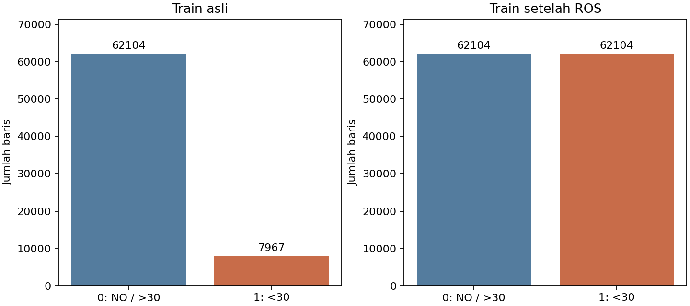
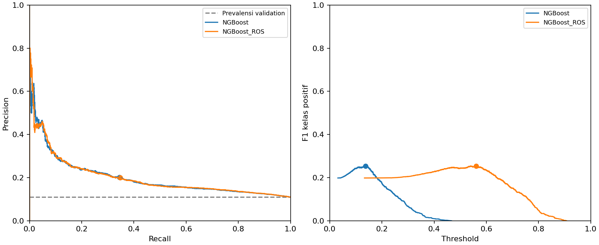

# Laporan pertama Week 13

Klasifikasi rawat inap ulang pasien diabetes

Kelompok 1 | Data Mining | Pembaruan 14 November 2026

| Anggota | NRP |
|---|---|
| Bambang Herlambang | 5803024019 |
| Benedictus Erlangga | 5803024011 |
| Robertus Geraldyn Alexandro Gabeler | 5803024025 |

## Ringkasan dan tujuan penelitian

Laporan pertama ini menyatukan pekerjaan Week 10 sampai Week 12 dan percobaan revisi dosen: pelengkapan karakteristik kode, NGBoost dengan random oversampling, serta penjelasan data pelatihan. Dua algoritma utama adalah NGBoost dan Rotation Forest, dengan DummyClassifier sebagai baseline. Artikel IMRAD Week 15 dan presentasi Week 16 belum menjadi keluaran laporan ini.

Pada uji historis Week 12, NGBoost memperoleh AP 0,2068 dan F1 0,2606. Pada percobaan revisi yang dievaluasi di validation, F1 NGBoost biasa dan NGBoost dengan oversampling hampir sama setelah masing-masing ambang dipilih: 0,2540 dan 0,2534. Hasil tersebut belum menunjukkan keunggulan yang jelas dari oversampling. Skor uji historis dan validasi revisi tidak dibandingkan sebagai eksperimen pada set yang sama.

### Latar belakang dan BOD

Sasaran proyek adalah mengenali kunjungan pasien diabetes yang tercatat diikuti rawat inap ulang dalam kurang dari 30 hari. Unit observasi adalah kunjungan, bukan satu pasien. Proyek ini mempelajari klasifikasi readmission, bukan diagnosis diabetes dan bukan hubungan sebab akibat.

| Komponen | Rumusan |
|---|---|
| Pertanyaan | Apakah kunjungan pasien akan diikuti rawat inap ulang tercatat kurang dari 30 hari? |
| Tujuan | Membandingkan dua algoritma dengan target, split pasien, dan preprocessing yang sama. |
| Waktu prediksi | Saat pasien keluar rumah sakit; informasi selama kunjungan dapat dipakai. |
| Manfaat akademik | Memahami pola readmission dan hubungan precision, recall, threshold serta imbalance. |
| Kriteria awal | Pipeline tanpa overlap pasien dan AP model di atas baseline pada validation. |

BOD di sini mengikuti rumusan masalah dan tujuan pada bahan Week 10. Kepanjangan istilah dan template khusus tidak diasumsikan karena belum diberikan oleh dosen.

## Dataset dan karakteristik data

Dataset Diabetes 130-US Hospitals for Years 1999-2008 berasal dari UCI, DOI 10.24432/C5230J, dengan lisensi CC BY 4.0. Data mencakup 130 rumah sakit dan jaringan layanan di Amerika Serikat pada 1999-2008. CSV memuat 101.766 kunjungan, 71.518 pasien, dan 50 kolom: 47 calon fitur, dua ID, serta satu target.

| Kelompok | Karakteristik |
|---|---|
| Delapan numerik | Lama rawat 1-14 hari dan tujuh hitungan layanan/diagnosis. Kode administrasi dan diagnosis tetap kategorikal. |
| Demografi | Kelompok usia interval 10 tahun, gender, ras, dan kelompok berat dalam pound. |
| Missing | Tanda ? atau kosong; weight 96,858%, medical_specialty 49,082%, payer_code 39,557%. None pada lab berarti tes tidak dilakukan. |
| Target asli | NO: 54.864; >30: 35.545; <30: 11.357 (11,160%). Target biner <30 = 1, lainnya = 0. |
| Pengulangan | 30.248 kunjungan di luar kunjungan pertama pasien. Tidak ada duplikasi baris persis atau ID kunjungan. |

### Arti kode meninggal dan kategori lain

| Kode discharge | Arti | Jumlah |
|---|---|---|
| 11 | Expired atau meninggal | 1.642 |
| 19 | Meninggal di rumah; Medicaid/hospice | 8 |
| 20 | Meninggal di fasilitas medis; Medicaid/hospice | 2 |
| 21 | Meninggal, tempat tidak diketahui; Medicaid/hospice | 0 |

Kode ini hanya berlaku pada discharge_disposition_id. Kode 20 pada admission_source_id berarti Not Mapped. Hospice 13/14 tidak otomatis menunjukkan meninggal. Status obat No/Steady/Up/Down berarti tidak diresepkan/dosis tetap/naik/turun; change Ch/No menunjukkan perubahan terapi. HbA1c dan glukosa memiliki kategori hasil serta None untuk tes tidak dilakukan. Rincian seluruh kode dan frekuensinya dipisahkan pada docs/week-10/kode-kategori.md serta lampiran PDF Week 10.

## Preprocessing dan metode klasifikasi

CSV dibaca sebagai string agar None pada lab tidak berubah menjadi missing. Cleaning mencakup normalisasi spasi dan ?, validasi ID/target/numerik, serta perubahan kode administrasi tidak diketahui dan gender invalid menjadi missing. Kunjungan meninggal dikeluarkan sebagai keputusan cohort untuk prediksi setelah keluar hidup; kunjungan terdahulu pasien tetap dipertahankan. Tersisa 100.114 kunjungan.

| Set | Kunjungan | Pasien | Kelas 0 | Kelas 1 |
|---|---|---|---|---|
| train | 70.071 | 49.307 | 62.104 | 7.967 |
| validation | 15.065 | 10.566 | 13.406 | 1.659 |
| test | 14.978 | 10.566 | 13.247 | 1.731 |

Pembagian GroupShuffleSplit seed 42 memakai sekitar 70/15/15 persen pasien. Tidak ada pasien antarset yang tumpang tindih. Seluruh 70.071 kunjungan train menjadi kumpulan pelatihan; validation untuk pemilihan dan test untuk evaluasi sesudah protokol ditetapkan. NGBoost memakai minibatch_frac 0,75 sehingga setiap iterasi mengambil sampel acak 75% dari kumpulan train, tanpa membuang subset secara permanen.

Keputusan berbasis statistik dipelajari pada train: weight dikeluarkan karena missing lebih dari 50%; acetohexamide, examide dan citoglipton konstan. Tersisa 43 kolom fitur. Numerik diimputasi median dan diskalakan; kategori diimputasi dan di-one-hot, menghasilkan 1.222 fitur. Adapter bersama TruncatedSVD 32 komponen dan StandardScaler juga di-fit pada train saja.

| Model | Konfigurasi |
|---|---|
| NGBoost | Bernoulli; 150 estimator; learning rate 0,03; minibatch 0,75; base tree depth 3; min leaf 20; seed 42. |
| Rotation Forest | 20 estimator; min/max group 3; remove proportion 0,5; n_jobs 2; seed 42. |
| Baseline prior | DummyClassifier strategy prior; probabilitas mengikuti prevalensi train asli. |

AP adalah metrik ranking utama, didampingi precision, recall, F1, ROC-AUC, balanced accuracy dan confusion matrix. Brier score dan log loss lebih kecil lebih baik. AP berbeda dari integrasi trapezoid PR-AUC.

## Hasil Week 11 dan Week 12

### Week 11 pada validation dengan ambang 0,5

| Model | AP | Precision | Recall | F1 |
|---|---|---|---|---|
| Baseline prior | 0,1101 | 0,0000 | 0,0000 | 0,0000 |
| NGBoost | 0,1993 | 0,0000 | 0,0000 | 0,0000 |
| Rotation Forest | 0,1568 | 0,3301 | 0,0205 | 0,0386 |

Baseline menghasilkan akurasi tinggi karena kelas 0 dominan. NGBoost memiliki AP tertinggi tetapi belum memprediksi positif pada ambang 0,5. Rotation Forest menangkap 34 dari 1.659 kasus positif. Akurasi dan threshold 0,5 saja belum cukup menilai model.

### Week 12 pada set uji historis

Model Week 11 dipertahankan. Ambang dipilih untuk memaksimalkan F1 pada validation, dengan ambang lebih tinggi saat seri; NGBoost dipilih berdasarkan AP validation. Protokol dan hash artefak dicatat sebelum set uji dibaca. Set uji berisi 14.978 kunjungan dari 10.566 pasien, dengan 1.731 kasus positif.

| Model | Ambang | AP uji | Precision | Recall | F1 |
|---|---|---|---|---|---|
| Baseline prior | 0,5000 | 0,1156 | 0,0000 | 0,0000 | 0,0000 |
| NGBoost | 0,1438 | 0,2068 | 0,2237 | 0,3120 | 0,2606 |
| Rotation Forest | 0,2000 | 0,1573 | 0,1647 | 0,3628 | 0,2265 |

NGBoost menangkap 540 kasus positif dengan 1.874 false positive; Rotation Forest menangkap 628 dengan 3.186 false positive. Recall Rotation Forest lebih tinggi, sedangkan F1 dan AP NGBoost lebih tinggi pada set uji ini. Analisis kesalahan menurut usia dan jumlah rawat inap terdahulu tersedia di hasil Week 12.

Hasil di atas adalah riwayat evaluasi sebelum percobaan revisi. Model revisi dilatih ulang dan disimpan terpisah; perubahan kecil AP NGBoost validation (0,1993 menjadi 0,1994) dicatat sebagai hasil run berbeda. Skor test model lama tidak dipakai sebagai skor test untuk model revisi.

## Revisi dosen dan oversampling

Percobaan tambahan membandingkan NGBoost tanpa oversampling dan NGBoost dengan RandomOverSampler (ROS). Parameter, seed, split dan adapter dibuat sama. ROS diterapkan pada train setelah adapter di-fit pada train asli; validation/test tidak di-resample. Metode ini menggandakan sampel minoritas tanpa membuat interpolasi kategori diagnosis dan obat.

Train asli terdiri dari 62.104 kelas 0 dan 7.967 kelas 1. Sesudah ROS, masing-masing menjadi 62.104, total 124.208 baris. Tambahan 54.137 baris adalah duplikasi sampel minoritas, bukan pasien atau kunjungan baru.

| Model | AP | Precision | Recall | F1 | Brier |
|---|---|---|---|---|---|
| Baseline prior | 0,1101 | 0,0000 | 0,0000 | 0,0000 | 0,0980 |
| NGBoost | 0,1994 | 0,0000 | 0,0000 | 0,0000 | 0,0948 |
| NGBoost + ROS | 0,2001 | 0,1590 | 0,5238 | 0,2439 | 0,2255 |

Tabel memakai validation dengan ambang 0,5. ROS menangkap 869 kasus positif dan menghasilkan 4.597 false positive, sedangkan NGBoost biasa belum memprediksi positif. Namun AP hanya berubah dari 0,1994 menjadi 0,2001. Brier score memburuk dari 0,0948 menjadi 0,2255 dan log loss dari 0,3329 menjadi 0,6434. Penyeimbangan train mengubah prior dan dapat menggeser probabilitas; model belum dikalibrasi ulang.

## Perbandingan setelah memilih ambang

Untuk membandingkan kedua model dengan aturan yang sama, ambang masing-masing dipilih agar F1 kelas positif maksimum pada validation. Jika seri, dipilih ambang tertinggi. Prediksi validation yang tersimpan dipakai kembali tanpa training ulang; target dan metrik sumber diperiksa sebelum pemilihan.

| Model | Ambang | Precision | Recall | F1 |
|---|---|---|---|---|
| NGBoost | 0,1374 | 0,2013 | 0,3442 | 0,2540 |
| NGBoost + ROS | 0,5605 | 0,1994 | 0,3472 | 0,2534 |

NGBoost biasa menangkap 571 kasus positif dengan 2.266 false positive; ROS menangkap 576 dengan 2.312 false positive. Selisih F1 ROS dikurangi NGBoost biasa adalah -0,0006. Pada split ini hasilnya hampir sama, sehingga oversampling belum menunjukkan keunggulan yang jelas setelah kedua model diberi kesempatan menyesuaikan ambang.

Perubahan ambang tidak mengubah AP, ROC-AUC, Brier score atau log loss karena probabilitasnya tetap. F1 di halaman ini dihitung pada validation yang juga dipakai memilih ambang, sehingga dapat optimistis dan bukan estimasi uji independen. Tidak dilakukan uji signifikansi; selisih kecil tidak membuktikan keunggulan umum.

## Pembahasan dan kesimpulan

Revisi dosen sudah ditindaklanjuti melalui kamus kode yang lebih rinci, percobaan NGBoost dengan oversampling train, dan penjelasan pembagian data. Seluruh bagian train tersedia untuk pembelajaran, sedangkan validation/test dipisahkan berdasarkan pasien. Dua algoritma utama dan baseline telah dijalankan; oversampling diperlakukan sebagai percobaan tambahan pada NGBoost.

Pada uji historis Week 12, NGBoost mempunyai AP dan F1 lebih tinggi daripada Rotation Forest pada konfigurasi yang dicoba. Pada validasi revisi, keuntungan recall ROS pada ambang 0,5 hampir hilang setelah ambang kedua model dipilih dengan aturan F1 yang sama. Karena itu, laporan tidak menyimpulkan bahwa oversampling selalu meningkatkan performa atau bahwa data seimbang menjamin model lebih baik.

### Keterbatasan dan tindak lanjut

Hasil berasal dari satu split berbasis pasien, bukan temporal atau lintas rumah sakit. Kunjungan berulang dalam pasien yang sama membuat observasi tidak sepenuhnya independen. Data historis AS belum mewakili rumah sakit Indonesia; variabel demografi juga memerlukan pemeriksaan bias. Hospice/transfer tetap dipertahankan dan cohort hanya mengecualikan kunjungan berstatus meninggal.

CV berbasis pasien, tuning hiperparameter, ablasi SVD, kalibrasi probabilitas, validasi eksternal dan signifikansi statistik belum dilakukan. Test Week 12 sudah pernah dilihat pada eksperimen terdahulu, sehingga tidak dipresentasikan sebagai holdout baru untuk model revisi. Jika eksperimen dilanjutkan, preprocessing dan ROS harus di-fit ulang pada training fold saja, dengan pemilihan ambang di dalam proses pelatihan.

### Status pengumpulan per minggu

| Minggu | Keluaran dan status |
|---|---|
| 10 | Dataset, contoh, karakteristik, BOD dan algoritma; PDF tersendiri diperbarui dengan kode. |
| 11 | Kode preprocessing/mining dan evaluasi validation; PDF tersendiri. |
| 12 | Protokol ambang, evaluasi test historis dan analisis kesalahan; PDF tersendiri. |
| 13 | Laporan pertama ini, merangkum pekerjaan dan revisi dosen; PDF tersendiri. |
| 14-16 | Percobaan tambahan jika diminta; artikel Indonesia IMRAD dan presentasi belum dibuat. |

Dokumen ini tidak menyatakan bahwa pengumpulan ke LMS atau persetujuan dosen sudah dilakukan. Tidak ada batas tanggal/waktu pada deskripsi tugas yang diberikan.

## Reproduksi dan referensi

Kode, dataset asli, laporan agregat dan generator PDF disimpan pada repository kelompok. Model joblib serta matriks hasil preprocessing tetap lokal dan dapat dibentuk ulang. Versi library training terkunci pada requirements.txt; dependensi PDF dipisahkan dari training.

| Tahap | Perintah dari root repo |
|---|---|
| Preprocessing | python -m src.preprocess |
| Karakteristik | python -m src.profile_data |
| Week 11 | python -m src.mining |
| Week 12 | Ikuti docs/week-12/README.md dengan folder output baru; hasil lama dipertahankan. |
| Revisi dosen | python -m src.revision |
| Ambang revisi | python -m src.revision_thresholds (tanpa training ulang) |
| Pemeriksaan | python -m unittest discover -s tests -v |
| PDF laporan | python scripts/pdf/build_week13.py (environment PDF) |

Bukti angka: results/preprocessing/preprocessing_summary.json; results/week-11/validation_metrics.csv; results/week-12/protocol.json dan test/metrics.csv; results/revisi-dosen/experiment.json, validation_metrics.csv, validation_threshold_metrics.csv serta threshold_selection.json. Hash input pemilihan ambang disimpan untuk keterlacakan.

### Referensi

Clore, Cios, DeShazo dan Strack (2014). Diabetes 130-US Hospitals for Years 1999-2008. UCI. DOI https://doi.org/10.24432/C5230J. Mapping administrasi: IDS_mapping.csv pada arsip dataset.

Duan dkk. (2020). NGBoost Natural Gradient Boosting for Probabilistic Prediction. ICML. https://proceedings.mlr.press/v119/duan20a.html

Rodriguez, Kuncheva dan Alonso (2006). Rotation Forest A New Classifier Ensemble Method. https://www.lucykuncheva.co.uk/papers/jrlkcatpami06.pdf

Dokumentasi scikit-learn 1.7. Average precision dan precision-recall. https://scikit-learn.org/1.7/modules/generated/sklearn.metrics.average_precision_score.html

Dokumentasi imbalanced-learn. RandomOverSampler. https://imbalanced-learn.org/stable/references/generated/imblearn.over_sampling.RandomOverSampler.html
