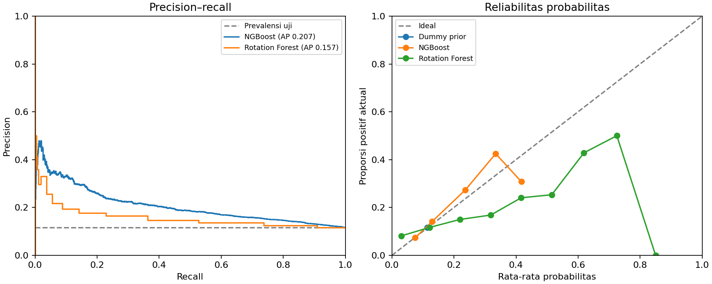
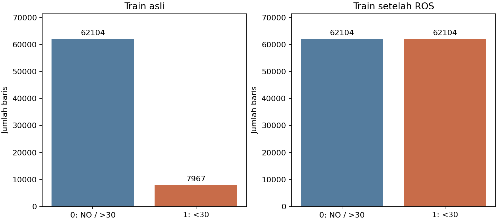
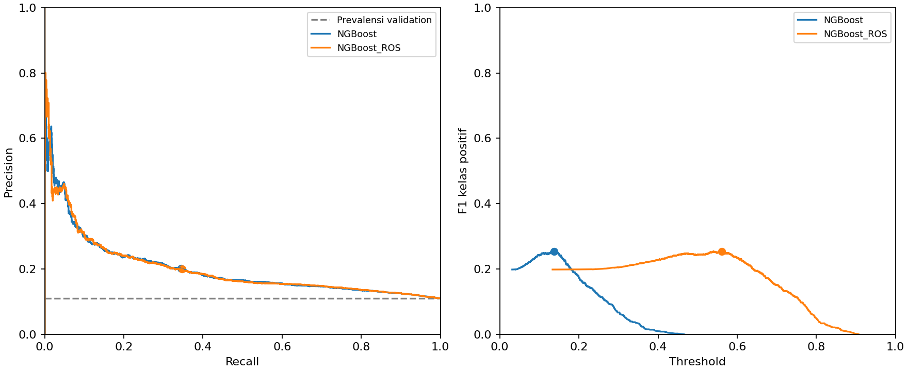

# Laporan pertama Week 13

Klasifikasi rawat inap ulang pasien diabetes

Kelompok 1 | Data Mining | Pembaruan 17 November 2026

| Anggota | NRP |
|---|---|
| Bambang Herlambang | 5803024019 |
| Benedictus Erlangga | 5803024011 |
| Robertus Geraldyn Alexandro Gabeler | 5803024025 |

## Ringkasan laporan pertama

Laporan pertama ini menyatukan pekerjaan Week 10 sampai Week 12 dan percobaan revisi dosen: pelengkapan karakteristik kode, NGBoost dengan random oversampling, serta penjelasan data pelatihan. Dua algoritma utama adalah NGBoost dan Rotation Forest, dengan DummyClassifier sebagai baseline. Artikel IMRAD Week 15 dan presentasi Week 16 belum menjadi keluaran laporan ini.

Pada uji historis Week 12, NGBoost memperoleh AP 0,2068 dan F1 0,2606. Pada percobaan revisi yang dievaluasi di validation, F1 NGBoost biasa dan NGBoost dengan oversampling hampir sama setelah masing-masing ambang dipilih: 0,2540 dan 0,2534. Hasil tersebut belum menunjukkan keunggulan yang jelas dari oversampling. Skor uji historis dan validasi revisi tidak dibandingkan sebagai eksperimen pada set yang sama.

## 1. Pendahuluan

### 1.1 Latar belakang

Sasaran proyek adalah mengenali kunjungan pasien diabetes yang tercatat diikuti rawat inap ulang dalam kurang dari 30 hari. Unit observasi adalah kunjungan, bukan satu pasien. Proyek ini mempelajari klasifikasi readmission, bukan diagnosis diabetes dan bukan hubungan sebab akibat.

Ketidakseimbangan target membuat akurasi tinggi dapat dicapai hanya dengan memilih kelas mayoritas. Di sisi lain, satu pasien dapat muncul beberapa kali sehingga pengacakan kunjungan tanpa memperhatikan pasien berisiko menempatkan riwayat pasien yang sama pada train dan test. Penelitian ini menempatkan pemisahan pasien dan pembacaan metrik positif sebagai dasar evaluasi.

### 1.2 Rumusan masalah

RQ1: Bagaimana karakteristik dataset, makna kode administrasi, missing value, dan pengulangan pasien memengaruhi keputusan preprocessing dan pembagian data?

RQ2: Bagaimana perbandingan NGBoost dan Rotation Forest pada representasi dan split pasien yang sama, menurut AP, precision, recall, F1, serta kualitas probabilitas?

RQ3: Apakah penambahan random oversampling pada NGBoost masih memperlihatkan keuntungan setelah ambang kedua model dipilih dengan aturan F1 maksimum yang sama pada validation?

### 1.3 Tujuan dan batasan

Tujuan laporan adalah menyediakan alur yang dapat diperiksa dari sumber data sampai evaluasi, membandingkan dua konfigurasi klasifikasi, dan menjawab revisi dosen dengan bukti eksperimen. Pembahasan terbatas pada target biner <30, satu pembagian pasien, informasi saat keluar rumah sakit, serta data historis AS. Tidak dilakukan penerapan pada layanan rumah sakit atau pengujian efektivitas intervensi.

Revisi yang sudah dilaksanakan meliputi kamus kode yang lebih lengkap, percobaan NGBoost + ROS, dan penjelasan penggunaan seluruh kumpulan train. Revisi tersebut tetap merupakan bagian laporan Week 13; bukan keluaran Week 14.

## 2. Business objective dan tujuan data mining

Bagian BOD menghubungkan masalah pemantauan readmission dengan sasaran teknis klasifikasi. Calon pembaca hasil adalah pihak akademik yang mempelajari pemilahan risiko kunjungan. Pengelola layanan dapat menjadi pemangku kepentingan konseptual, tetapi laporan ini belum menetapkan kebijakan klinis, biaya kesalahan, atau target operasional rumah sakit.

### 2.1 Tujuan dan kriteria keberhasilan

Tabel 1. Tujuan dan kriteria keberhasilan

| Komponen | Rumusan |
|---|---|
| Pertanyaan | Apakah kunjungan pasien akan diikuti rawat inap ulang tercatat kurang dari 30 hari? |
| Tujuan | Membandingkan dua algoritma dengan target, split pasien, dan preprocessing yang sama. |
| Waktu prediksi | Saat pasien keluar rumah sakit; informasi selama kunjungan dapat dipakai. |
| Manfaat akademik | Memahami pola readmission dan hubungan precision, recall, threshold serta imbalance. |
| Kriteria awal | Pipeline tanpa overlap pasien dan AP model di atas baseline pada validation. |

Kriteria keberhasilan dibatasi pada bukti akademik yang dapat diperiksa: tidak ada overlap pasien, proses dapat diulang, hasil dibedakan menurut set evaluasi, dan model nontrivial memiliki AP validation di atas baseline. Tidak ditetapkan target penurunan readmission, penghematan biaya, atau manfaat klinis karena data eksperimen belum mengukur hasil tersebut.

### 2.2 Situasi, risiko, dan penanganan

Tabel 2. Risiko dan keputusan penanganan

| Risiko atau kendala | Keputusan penanganan |
|---|---|
| Kelas positif sedikit | Periksa AP, precision, recall dan F1; bandingkan dengan prior. ROS hanya untuk train. |
| Pasien muncul berulang | GroupShuffleSplit berdasarkan patient_nbr; overlap pasien antarset harus nol. |
| Missing dan kategori nominal | Seleksi/imputasi dipelajari di train; kode administrasi tidak diperlakukan sebagai besaran. |
| Dimensi one-hot besar | Adapter SVD 32 komponen bersama; hasil dibatasi pada representasi ini. |
| Pemilihan model dari test | Gunakan validasi untuk model/ambang; protokol awal dicatat sebelum evaluasi uji. |
| Perubahan tahap eksperimen | Pisahkan model awal dan revisi; jangan memberi skor test lama kepada model revisi. |

Sumber daya yang dibuktikan adalah dataset lokal, implementasi Python, library yang dipin versinya, repository Git, serta laporan agregat. Spesifikasi perangkat keras, biaya komputasi dan durasi kerja tiap anggota tidak dilaporkan karena belum dicatat secara konsisten.

## 3. Dataset dan karakteristik data

Dataset Diabetes 130-US Hospitals for Years 1999-2008 berasal dari UCI, DOI 10.24432/C5230J, dengan lisensi CC BY 4.0. Data mencakup 130 rumah sakit dan jaringan layanan di Amerika Serikat pada 1999-2008. CSV memuat 101.766 kunjungan, 71.518 pasien, dan 50 kolom: 47 calon fitur, dua ID, serta satu target.

Tabel 3. Karakteristik dataset

| Kelompok | Karakteristik |
|---|---|
| Delapan numerik | Lama rawat 1-14 hari dan tujuh hitungan layanan/diagnosis. Kode administrasi dan diagnosis tetap kategorikal. |
| Demografi | Kelompok usia interval 10 tahun, gender, ras, dan kelompok berat dalam pound. |
| Missing | Tanda ? atau kosong; weight 96,858%, medical_specialty 49,082%, payer_code 39,557%. None pada lab berarti tes tidak dilakukan. |
| Target asli | NO: 54.864; >30: 35.545; <30: 11.357 (11,160%). Target biner <30 = 1, lainnya = 0. |
| Pengulangan | 30.248 kunjungan di luar kunjungan pertama pasien. Tidak ada duplikasi baris persis atau ID kunjungan. |

### 3.1 Contoh data aktual

Tabel 4. Contoh aktual sebelum cleaning

| Usia | Gender | Hari | Obat | Rawat inap terdahulu | HbA1c | Target |
|---|---|---|---|---|---|---|
| [0-10) | Female | 1 | 1 | 0 | None | NO |
| [10-20) | Female | 3 | 18 | 0 | None | >30 |
| [20-30) | Female | 2 | 13 | 1 | None | NO |
| [30-40) | Male | 2 | 16 | 0 | None | NO |

Empat baris tersebut diambil dari data asli sebelum cleaning. ID pasien dan kunjungan tidak ditampilkan. number_inpatient menghitung rawat inap pada tahun sebelum kunjungan, bukan jumlah rawat pada masa depan.

Missing pada grafik dihitung dari ? atau kosong. Selain weight, missing medical_specialty dan payer_code cukup besar, tetapi keputusan drop tetap dihitung dari train. None pada tes laboratorium tidak dimasukkan sebagai missing. Persentase label positif setelah cohort dan per split dapat berbeda dari prevalensi data asli.

### 3.2 Arti kode meninggal dan kategori lain

Tabel 5. Kode status meninggal

| Kode discharge | Arti | Jumlah |
|---|---|---|
| 11 | Expired atau meninggal | 1.642 |
| 19 | Meninggal di rumah; Medicaid/hospice | 8 |
| 20 | Meninggal di fasilitas medis; Medicaid/hospice | 2 |
| 21 | Meninggal, tempat tidak diketahui; Medicaid/hospice | 0 |

Kode ini hanya berlaku pada discharge_disposition_id. Kode 20 pada admission_source_id berarti Not Mapped. Hospice 13/14 tidak otomatis menunjukkan meninggal. Status obat No/Steady/Up/Down berarti tidak diresepkan/dosis tetap/naik/turun; change Ch/No menunjukkan perubahan terapi. HbA1c dan glukosa memiliki kategori hasil serta None untuk tes tidak dilakukan. Rincian seluruh kode dan frekuensinya dipisahkan pada docs/week-10/kode-kategori.md serta lampiran PDF Week 10.

## 4. Rancangan metode dan algoritma

Penelitian memakai supervised binary classification. Dua algoritma dengan mekanisme berbeda dipilih untuk perbandingan awal, lalu dilakukan ablation sederhana penambahan ROS pada NGBoost. Semua tahap yang mempelajari statistik fitur menggunakan train saja. Alur berikut membedakan jalur uji awal dari jalur validasi revisi.

Gambar 2. Alur penelitian dan pemisahan evaluasi awal dari evaluasi revisi

### 4.1 NGBoost

NGBoost membangun prediksi probabilistik melalui natural gradient boosting (Duan dkk., 2020). Implementasi tugas memakai NGBClassifier dengan distribusi Bernoulli untuk label 0/1 dan decision tree sebagai base learner. Probabilitas kelas 1 dipakai untuk ranking dan evaluasi; label prediksi diperoleh dengan menerapkan ambang keputusan. Model probabilistik tidak otomatis berarti probabilitasnya telah terkalibrasi pada data evaluasi.

### 4.2 Rotation Forest dan baseline

Rotation Forest membentuk ensemble dengan rotasi fitur melalui PCA pada kelompok fitur (Rodriguez, Kuncheva dan Alonso, 2006). Dalam proyek ini, Rotation Forest menerima representasi SVD yang sama dengan NGBoost. Baseline DummyClassifier strategy prior menghasilkan probabilitas konstan sesuai prevalensi train dan memprediksi kelas mayoritas pada ambang 0,5. Baseline menguji apakah model memberi nilai tambah terhadap prediktor sederhana.

Pemakaian SVD bersama mengendalikan representasi masukan, tetapi dapat memengaruhi performa kedua algoritma. Belum ada pengujian tanpa SVD. Jumlah estimator kedua model juga berbeda, sehingga hasil tidak diklaim sebagai perbandingan hasil tuning dengan anggaran komputasi setara.

## 5. Implementasi preprocessing dan pembagian data

CSV dibaca sebagai string agar None pada lab tidak berubah menjadi missing. Cleaning mencakup normalisasi spasi dan ?, validasi ID/target/numerik, serta perubahan kode administrasi tidak diketahui dan gender invalid menjadi missing. Kunjungan meninggal dikeluarkan sebagai keputusan cohort untuk prediksi setelah keluar hidup; kunjungan terdahulu pasien tetap dipertahankan. Tersisa 100.114 kunjungan.

Tabel 6. Pembagian kunjungan dan pasien

| Set | Kunjungan | Pasien | Kelas 0 | Kelas 1 |
|---|---|---|---|---|
| train | 70.071 | 49.307 | 62.104 | 7.967 |
| validation | 15.065 | 10.566 | 13.406 | 1.659 |
| test | 14.978 | 10.566 | 13.247 | 1.731 |

Pembagian GroupShuffleSplit seed 42 memakai sekitar 70/15/15 persen pasien. Tidak ada pasien antarset yang tumpang tindih. Seluruh 70.071 kunjungan train menjadi kumpulan pelatihan; validation untuk pemilihan dan test untuk evaluasi sesudah protokol ditetapkan. NGBoost memakai minibatch_frac 0,75 sehingga setiap iterasi mengambil sampel acak 75% dari kumpulan train, tanpa membuang subset secara permanen.

Keputusan berbasis statistik dipelajari pada train: weight dikeluarkan karena missing lebih dari 50%; acetohexamide, examide dan citoglipton konstan. Tersisa 43 kolom fitur. Numerik diimputasi median dan diskalakan; kategori diimputasi dan di-one-hot, menghasilkan 1.222 fitur. Adapter bersama TruncatedSVD 32 komponen dan StandardScaler juga di-fit pada train saja.

Tabel 7. Konfigurasi model awal

| Model | Konfigurasi |
|---|---|
| NGBoost | Bernoulli; 150 estimator; learning rate 0,03; minibatch 0,75; base tree depth 3; min leaf 20; seed 42. |
| Rotation Forest | 20 estimator; min/max group 3; remove proportion 0,5; n_jobs 2; seed 42. |
| Baseline prior | DummyClassifier strategy prior; probabilitas mengikuti prevalensi train asli. |

AP adalah metrik ranking utama, didampingi precision, recall, F1, ROC-AUC, balanced accuracy dan confusion matrix. Brier score dan log loss lebih kecil lebih baik. AP berbeda dari integrasi trapezoid PR-AUC.

### 5.1 Aturan validasi masukan dan pencegahan kebocoran

Tabel 8. Validasi masukan dan pencegahan kebocoran

| Bagian | Pelaksanaan |
|---|---|
| Validasi baris | Target hanya NO/>30/<30; ID tidak kosong; konflik encounter_id menghentikan proses. |
| Validasi numerik | Hitungan harus bilangan bulat nonnegatif; time_in_hospital dalam 1-14 hari. |
| Penggunaan ID | patient_nbr untuk split; encounter_id untuk audit; keduanya tidak masuk prediktor. |
| Fit transformer | Seleksi kolom, median, encoder, scaling dan SVD dipelajari di train asli. |
| Kategori baru | Encoder menangani kategori yang tidak dikenal tanpa fit ulang pada validasi/test. |
| Oversampling | Diterapkan setelah transformasi train; tidak menyeimbangkan validasi/test. |

Data uji memuat pasien yang tidak berada di train atau validation. Namun, split ini tidak menjamin urutan waktu, pemisahan rumah sakit, atau independensi setiap kunjungan dalam pasien yang sama. Hasil menilai pasien berbeda pada cohort yang ditentukan, bukan prediksi tahun mendatang.

## 6. Implementasi mining dan rancangan evaluasi

Modul src/mining.py membaca train dan validation untuk eksperimen awal. Adapter dan model disimpan lokal pada models_paper; hasil agregat memuat parameter, versi library, metrik serta prediksi validasi. Tidak ada fit menggunakan test pada tahap tersebut. Parameter model awal ditentukan sebelum melihat skor validasi dan belum merupakan hasil pencarian hiperparameter.

Modul src/week12.py memisahkan freeze dan evaluate. Tahap freeze memilih ambang F1 pada validasi, mempertahankan baseline 0,5, memilih model utama dari AP validasi, serta mencatat hash input dan model. Tahap evaluate memeriksa kesesuaian artefak sebelum memprediksi test. Protokol awal tersimpan pada results/week-12/protocol.json.

Tabel 9. Definisi metrik evaluasi

| Ukuran | Definisi atau kegunaan |
|---|---|
| Precision | TP/(TP+FP): proporsi prediksi positif yang benar. |
| Recall | TP/(TP+FN): proporsi kasus positif yang berhasil ditemukan. |
| F1 positif | 2 x precision x recall / (precision+recall); kompromi keduanya. |
| Average precision | Ringkasan precision dengan bobot peningkatan recall; tidak memerlukan satu threshold. |
| ROC-AUC | Ranking positif terhadap negatif pada rentang ambang. |
| Brier dan log loss | Kesalahan probabilitas; nilai lebih rendah lebih baik. |
| Confusion matrix | TN, FP, FN, TP menunjukkan jumlah kunjungan pada setiap jenis keputusan. |

Unit hitung metrik adalah kunjungan. Pemilihan ambang mengubah label prediksi dan F1, tetapi tidak mengubah AP, ROC-AUC, Brier atau log loss dari probabilitas yang sama. Analisis per kelompok memakai ambang model yang sama, tanpa memilih ambang berbeda dari skor kelompok test.

## 7. Hasil Week 11 dan Week 12

### 7.1 Week 11 pada validation dengan ambang 0,5

Tabel 10. Hasil validation awal pada ambang 0,5

| Model | AP | Precision | Recall | F1 |
|---|---|---|---|---|
| Baseline prior | 0,1101 | 0,0000 | 0,0000 | 0,0000 |
| NGBoost | 0,1993 | 0,0000 | 0,0000 | 0,0000 |
| Rotation Forest | 0,1568 | 0,3301 | 0,0205 | 0,0386 |

Baseline menghasilkan akurasi tinggi karena kelas 0 dominan. NGBoost memiliki AP tertinggi tetapi belum memprediksi positif pada ambang 0,5. Rotation Forest menangkap 34 dari 1.659 kasus positif. Akurasi dan threshold 0,5 saja belum cukup menilai model.

### 7.2 Week 12 pada set uji historis

Model Week 11 dipertahankan. Ambang dipilih untuk memaksimalkan F1 pada validation, dengan ambang lebih tinggi saat seri; NGBoost dipilih berdasarkan AP validation. Protokol dan hash artefak dicatat sebelum set uji dibaca. Set uji berisi 14.978 kunjungan dari 10.566 pasien, dengan 1.731 kasus positif.

Tabel 11. Hasil test awal pada ambang dari validation

| Model | Ambang | AP uji | Precision | Recall | F1 |
|---|---|---|---|---|---|
| Baseline prior | 0,5000 | 0,1156 | 0,0000 | 0,0000 | 0,0000 |
| NGBoost | 0,1438 | 0,2068 | 0,2237 | 0,3120 | 0,2606 |
| Rotation Forest | 0,2000 | 0,1573 | 0,1647 | 0,3628 | 0,2265 |

NGBoost menangkap 540 kasus positif dengan 1.874 false positive; Rotation Forest menangkap 628 dengan 3.186 false positive. Recall Rotation Forest lebih tinggi, sedangkan F1 dan AP NGBoost lebih tinggi pada set uji ini. Analisis kesalahan menurut usia dan jumlah rawat inap terdahulu tersedia di hasil Week 12.

Hasil di atas adalah riwayat evaluasi sebelum percobaan revisi. Model revisi dilatih ulang dan disimpan terpisah; perubahan kecil AP NGBoost validation (0,1993 menjadi 0,1994) dicatat sebagai hasil run berbeda. Skor test model lama tidak dipakai sebagai skor test untuk model revisi.

### 7.3 Analisis kesalahan menurut riwayat rawat inap

Tabel 12. Recall test menurut riwayat rawat inap

| Rawat inap terdahulu | Kunjungan | Positif | Recall NGBoost | Recall Rotation Forest |
|---|---|---|---|---|
| 0 | 10.013 | 853 | 0,0328 | 0,2063 |
| 1 | 2.759 | 377 | 0,2255 | 0,3289 |
| 2+ | 2.206 | 501 | 0,8523 | 0,6547 |

Recall NGBoost hanya 3,28% pada kelompok tanpa riwayat rawat inap dan 85,23% pada kelompok dengan dua atau lebih rawat inap dalam tahun sebelumnya. Sebanyak 825 dari 1.191 kasus positif yang terlewat berasal dari kelompok tanpa riwayat. Hasil ini memperlihatkan bahwa metrik agregat belum menjamin deteksi yang merata antar kelompok; perbandingan tersebut deskriptif dan tidak membuktikan penyebab kesalahan.

AP mengukur ranking, sedangkan diagram reliabilitas membandingkan rata-rata probabilitas dengan proporsi positif aktual dalam bin. Model tidak otomatis terkalibrasi hanya karena menghasilkan probabilitas. Brier score test awal NGBoost 0,0987 dan log loss 0,3424 lebih rendah daripada baseline 0,1022 dan 0,3580 pada set ini. Hasil tersebut tidak dipindahkan menjadi klaim kalibrasi model revisi.

## 8. Revisi dosen dan oversampling

Percobaan tambahan membandingkan NGBoost tanpa oversampling dan NGBoost dengan RandomOverSampler (ROS). Parameter, seed, split dan adapter dibuat sama. ROS diterapkan pada train setelah adapter di-fit pada train asli; validation/test tidak di-resample. Metode ini menggandakan sampel minoritas tanpa membuat interpolasi kategori diagnosis dan obat.

Train asli terdiri dari 62.104 kelas 0 dan 7.967 kelas 1. Sesudah ROS, masing-masing menjadi 62.104, total 124.208 baris. Tambahan 54.137 baris adalah duplikasi sampel minoritas, bukan pasien atau kunjungan baru.

Tabel 13. Hasil validation revisi pada ambang 0,5

| Model | AP | Precision | Recall | F1 | Brier |
|---|---|---|---|---|---|
| Baseline prior | 0,1101 | 0,0000 | 0,0000 | 0,0000 | 0,0980 |
| NGBoost | 0,1994 | 0,0000 | 0,0000 | 0,0000 | 0,0948 |
| NGBoost + ROS | 0,2001 | 0,1590 | 0,5238 | 0,2439 | 0,2255 |

Tabel memakai validation dengan ambang 0,5. ROS menangkap 869 kasus positif dan menghasilkan 4.597 false positive, sedangkan NGBoost biasa belum memprediksi positif. Namun AP hanya berubah dari 0,1994 menjadi 0,2001. Brier score memburuk dari 0,0948 menjadi 0,2255 dan log loss dari 0,3329 menjadi 0,6434. Penyeimbangan train mengubah prior dan dapat menggeser probabilitas; model belum dikalibrasi ulang.

## 9. Perbandingan setelah memilih ambang

Untuk membandingkan kedua model dengan aturan yang sama, ambang masing-masing dipilih agar F1 kelas positif maksimum pada validation. Jika seri, dipilih ambang tertinggi. Prediksi validation yang tersimpan dipakai kembali tanpa training ulang; target dan metrik sumber diperiksa sebelum pemilihan.

Tabel 14. Hasil validation revisi setelah memilih ambang

| Model | Ambang | Precision | Recall | F1 |
|---|---|---|---|---|
| NGBoost | 0,1374 | 0,2013 | 0,3442 | 0,2540 |
| NGBoost + ROS | 0,5605 | 0,1994 | 0,3472 | 0,2534 |

NGBoost biasa menangkap 571 kasus positif dengan 2.266 false positive; ROS menangkap 576 dengan 2.312 false positive. Selisih F1 ROS dikurangi NGBoost biasa adalah -0,0006. Pada split ini hasilnya hampir sama, sehingga oversampling belum menunjukkan keunggulan yang jelas setelah kedua model diberi kesempatan menyesuaikan ambang.

Perubahan ambang tidak mengubah AP, ROC-AUC, Brier score atau log loss karena probabilitasnya tetap. F1 di halaman ini dihitung pada validation yang juga dipakai memilih ambang, sehingga dapat optimistis dan bukan estimasi uji independen. Tidak dilakukan uji signifikansi; selisih kecil tidak membuktikan keunggulan umum.

## 10. Pembahasan

Revisi dosen sudah ditindaklanjuti melalui kamus kode yang lebih rinci, percobaan NGBoost dengan oversampling train, dan penjelasan pembagian data. Seluruh bagian train tersedia untuk pembelajaran, sedangkan validation/test dipisahkan berdasarkan pasien. Dua algoritma utama dan baseline telah dijalankan; oversampling diperlakukan sebagai percobaan tambahan pada NGBoost.

Pada uji historis Week 12, NGBoost mempunyai AP dan F1 lebih tinggi daripada Rotation Forest pada konfigurasi yang dicoba. Pada validasi revisi, keuntungan recall ROS pada ambang 0,5 hampir hilang setelah ambang kedua model dipilih dengan aturan F1 yang sama. Karena itu, laporan tidak menyimpulkan bahwa oversampling selalu meningkatkan performa atau bahwa data seimbang menjamin model lebih baik.

### 10.1 Keterbatasan dan tindak lanjut

Hasil berasal dari satu split berbasis pasien, bukan temporal atau lintas rumah sakit. Kunjungan berulang dalam pasien yang sama membuat observasi tidak sepenuhnya independen. Data historis AS belum mewakili rumah sakit Indonesia; variabel demografi juga memerlukan pemeriksaan bias. Hospice/transfer tetap dipertahankan dan cohort hanya mengecualikan kunjungan berstatus meninggal.

CV berbasis pasien, tuning hiperparameter, ablasi SVD, kalibrasi probabilitas, validasi eksternal dan signifikansi statistik belum dilakukan. Test Week 12 sudah pernah dilihat pada eksperimen terdahulu, sehingga tidak dipresentasikan sebagai holdout baru untuk model revisi. Jika eksperimen dilanjutkan, preprocessing dan ROS harus di-fit ulang pada training fold saja, dengan pemilihan ambang di dalam proses pelatihan.

### 10.2 Jawaban rumusan masalah

Tabel 15. Jawaban rumusan masalah

| Pertanyaan | Jawaban berdasarkan hasil |
|---|---|
| RQ1 | Kode nominal, missing, kelas positif kecil dan pengulangan pasien mendasari cleaning, imputasi train saja dan split pasien. |
| RQ2 | Pada test awal, NGBoost lebih tinggi dalam AP/F1; Rotation Forest lebih tinggi dalam recall pada konfigurasi yang dicoba. |
| RQ3 | F1 validation setelah pemilihan ambang hampir sama. Penyeimbangan train belum menunjukkan keunggulan yang jelas. |

## 11. Pembagian tugas dan status pekerjaan

Pembagian berikut mengikuti rencana kolaborasi kelompok. Peran merupakan pembagian tanggung jawab, bukan bukti bahwa setiap bagian sudah ditulis atau ditinjau sendiri oleh anggota yang disebut. Pemeriksaan akhir dan keputusan penyerahan tetap menjadi tanggung jawab kelompok.

Tabel 16. Pembagian tanggung jawab kelompok

| Anggota dan NRP | Fokus tanggung jawab |
|---|---|
| Bambang Herlambang 5803024019 | Tujuan/BOD, preprocessing, pembagian pasien, transformasi dan penjelasan pipeline. |
| Benedictus Erlangga 5803024011 | Sumber/karakteristik data, baseline, evaluasi model, grafik dan analisis kesalahan. |
| Robertus Geraldyn Alexandro Gabeler 5803024025 | Implementasi NGBoost/Rotation Forest, parameter dan konfigurasi eksperimen. |

Pembahasan, kesimpulan, referensi, konsistensi angka serta peninjauan format dikerjakan bersama sesuai rencana. Laporan ini menggunakan hasil tersimpan dan tidak menambahkan eksperimen baru hanya untuk memperpanjang dokumen.

### 11.1 Pemenuhan ketentuan Week 10 sampai 13

Tabel 17. Status keluaran tugas

| Minggu | Keluaran dan status |
|---|---|
| 10 | Dataset, contoh, karakteristik, BOD dan algoritma; PDF tersendiri diperbarui dengan kode. |
| 11 | Kode preprocessing/mining dan evaluasi validation; PDF tersendiri. |
| 12 | Protokol ambang, evaluasi test historis dan analisis kesalahan; PDF tersendiri. |
| 13 | Laporan pertama ini, merangkum pekerjaan dan revisi dosen; PDF tersendiri. |
| 14 | Belum dikerjakan; percobaan tambahan mengikuti permintaan dosen pada tahap tersebut. |
| 15 | Artikel IMRAD sudah disiapkan lebih awal dari hasil tersedia; terpisah dari laporan Week 13. |
| 16 | Presentasi belum dibuat. |

PDF pengumpulan Week 10-13 berada pada docs/laporan/ sebagai empat file terpisah. Sumber laporan dan bahan tiap minggu tetap di folder masing-masing. Status ini menunjukkan ketersediaan berkas; pengumpulan ke LMS dan persetujuan dosen belum diverifikasi.

## 12. Pengujian dan reproduksi

### 12.1 Bukti pemeriksaan

Suite lokal memuat 16 tes perilaku preprocessing, evaluasi, model kecil, dan revisi. Pemeriksaan meliputi pasien terpisah, preservasi kategori None, penolakan ID konflik, transformasi yang tidak belajar dari validasi, metrik biner, pemilihan threshold ketika skor seri, serta oversampling train saja. Tes sintetis tidak menggantikan eksekusi dataset penuh atau membuktikan kesimpulan ilmiah.

Tabel 18. Bukti pemeriksaan

| Pemeriksaan | Bukti atau lingkup |
|---|---|
| Preprocessing penuh | preprocessing_summary.json mencatat split, fitur, kualitas dan hash CSV asli. |
| Test tahap awal | protocol.json dan evaluation.json mencatat pilihan ambang, input serta hasil uji. |
| Revisi dosen | experiment.json mencatat kelas sebelum/sesudah ROS, parameter, seed dan metrik validation. |
| Pemilihan ambang | threshold_selection.json menyimpan aturan dan hash prediksi/target sumber. |
| Konsistensi laporan | Tabel dibaca dari sumber CSV; model test lama dan model revisi diberi label terpisah. |

### 12.2 Berkas implementasi dan keluaran

Tabel 19. Berkas implementasi

| Lokasi | Isi |
|---|---|
| src/preprocess.py | Cleaning, target, split pasien dan transformer train. |
| src/profile_data.py | Kamus, frekuensi kode, contoh data dan profil dataset. |
| src/mining.py | Baseline, adapter bersama, NGBoost/Rotation Forest serta evaluasi validation awal. |
| src/week12.py | Freeze protokol lalu evaluasi test dengan verifikasi artefak. |
| src/revision.py | Perbandingan NGBoost tanpa/dengan ROS pada validation. |
| src/revision_thresholds.py | Verifikasi prediksi dan pemilihan ambang revisi tanpa training ulang. |

### 12.3 Cara menjalankan kembali

Kode, dataset asli, laporan agregat dan generator PDF disimpan pada repository kelompok. Model joblib serta matriks hasil preprocessing tetap lokal dan dapat dibentuk ulang. Versi library training terkunci pada requirements.txt; dependensi PDF dipisahkan dari training.

Tabel 20. Perintah reproduksi

| Tahap | Perintah dari root repo |
|---|---|
| Preprocessing | python -m src.preprocess |
| Karakteristik | python -m src.profile_data |
| Week 11 | python -m src.mining |
| Week 12 | Ikuti docs/week-12/README.md dengan folder output baru; hasil lama dipertahankan. |
| Revisi dosen | python -m src.revision |
| Ambang revisi | python -m src.revision_thresholds (tanpa training ulang) |
| Pemeriksaan | python -m unittest discover -s tests -v |
| PDF laporan | python scripts/pdf/build_week13.py (environment PDF) |

Bukti angka: results/preprocessing/preprocessing_summary.json; results/week-11/validation_metrics.csv; results/week-12/protocol.json dan test/metrics.csv; results/revisi-dosen/experiment.json, validation_metrics.csv, validation_threshold_metrics.csv serta threshold_selection.json. Hash input pemilihan ambang disimpan untuk keterlacakan.

## 13. Kesimpulan

Pekerjaan Week 10-12 telah disatukan menjadi laporan pertama dengan dataset, karakteristik kode, tujuan, preprocessing, implementasi mining, serta evaluasi. Train, validation dan test dipisahkan berdasarkan pasien. Seluruh kumpulan train digunakan untuk pembelajaran, dengan mekanisme minibatch pada NGBoost; oversampling hanya diterapkan pada train revisi.

Pada test tahap awal, NGBoost memperoleh AP 0,2068 dan F1 0,2606, sedangkan Rotation Forest memperoleh AP 0,1573 dan F1 0,2265. Pada validation revisi, F1 maksimum NGBoost tanpa dan dengan ROS hampir sama, yaitu 0,2540 dan 0,2534. Dengan demikian, laporan tidak menyimpulkan bahwa oversampling selalu meningkatkan performa. Peningkatan recall pada ambang 0,5 perlu dibaca bersama false positive, ranking dan kualitas probabilitas.

Keterbatasan utama adalah satu split, evaluasi per kunjungan, representasi SVD bersama, belum adanya tuning/CV serta belum ada validasi eksternal. Hasil pemilihan ambang pada validation bukan estimasi independen. Week 14 tetap belum dikerjakan; artikel sudah disiapkan lebih awal dan tidak menggantikan kebutuhan penilaian atau persetujuan dosen.

## 14. Daftar pustaka

Clore, Cios, DeShazo dan Strack (2014). Diabetes 130-US Hospitals for Years 1999-2008. UCI. DOI https://doi.org/10.24432/C5230J. Mapping administrasi: IDS_mapping.csv pada arsip dataset.

Duan dkk. (2020). NGBoost Natural Gradient Boosting for Probabilistic Prediction. ICML. https://proceedings.mlr.press/v119/duan20a.html

Rodriguez, Kuncheva dan Alonso (2006). Rotation Forest A New Classifier Ensemble Method. https://www.lucykuncheva.co.uk/papers/jrlkcatpami06.pdf

Dokumentasi scikit-learn 1.7. Average precision dan precision-recall. https://scikit-learn.org/1.7/modules/generated/sklearn.metrics.average_precision_score.html

Dokumentasi imbalanced-learn. RandomOverSampler. https://imbalanced-learn.org/stable/references/generated/imblearn.over_sampling.RandomOverSampler.html
