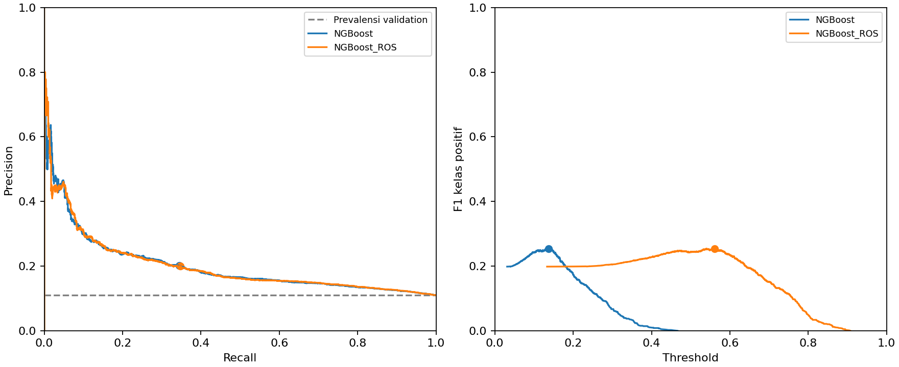

# Percobaan tambahan Week 14

Kelompok 1 Classification

Bambang Herlambang (5803024019), Benedictus Erlangga (5803024011), Robertus Geraldyn Alexandro Gabeler (5803024025)

Pembaruan 14 November 2026. Nomor minggu menunjukkan keluaran tugas; dokumen ini tidak menyatakan kelas Week 14 telah berlangsung atau tugas telah dikumpulkan.

## Dasar percobaan

Dosen meminta pelengkapan karakteristik data, percobaan NGBoost dengan oversampling, serta penjelasan apakah seluruh data digunakan untuk train. Percobaan sudah dilakukan sebagai revisi laporan pertama. Dokumen Week 14 ini menata bukti percobaan tersebut dan keputusan yang dipakai dalam artikel Week 15; tidak ada training atau pembacaan test tambahan saat penyusunan dokumen ini.

## Perubahan yang dilaksanakan

Kamus data dilengkapi dengan arti kode, frekuensi setiap kode administrasi, dan perlakuan cleaning. Kode discharge meninggal 11/19/20/21 memiliki frekuensi 1.642/8/2/0. Jumlah kunjungan setelah pengecualian adalah 100.114. Semua baris yang tersisa masuk salah satu set berdasarkan pasien: 70.071 train, 15.065 validation, dan 14.978 test. Pasien antarset terpisah.

NGBoost biasa dibandingkan dengan NGBoost + RandomOverSampler (ROS), menggunakan parameter dan representasi yang sama. Adapter SVD 32 komponen dan scaling di-fit pada train asli sebelum ROS. Kelas positif train digandakan dari 7.967 menjadi 62.104 agar sama dengan kelas negatif. Validasi dan test tidak di-resample. Kumpulan training ROS berjumlah 124.208 baris; tambahan 54.137 baris bukan pasien baru.

## Hasil pada ambang tetap

Tabel berikut memakai validation dan threshold 0,5.

| Model | AP | Precision | Recall | F1 | Brier |
|---|---|---|---|---|---|
| NGBoost | 0,1994 | 0,0000 | 0,0000 | 0,0000 | 0,0948 |
| NGBoost + ROS | 0,2001 | 0,1590 | 0,5238 | 0,2439 | 0,2255 |

ROS menangkap 869 kasus positif, tetapi menghasilkan 4.597 false positive. AP hanya berubah sedikit dan kesalahan probabilitas menurut Brier score/log loss memburuk. Keseimbangan train tidak dipakai sebagai bukti bahwa semua aspek performa membaik.

## Perbandingan setelah memilih ambang

Ambang masing-masing NGBoost dipilih agar F1 kelas positif maksimum pada validation. Jika seri, dipilih ambang tertinggi. Prediksi tersimpan digunakan kembali tanpa training ulang, dan target serta metrik sumber diverifikasi sebelum pemilihan.

| Model | Ambang | Precision | Recall | F1 |
|---|---|---|---|---|
| NGBoost | 0,1374 | 0,2013 | 0,3442 | 0,2540 |
| NGBoost + ROS | 0,5605 | 0,1994 | 0,3472 | 0,2534 |

NGBoost biasa menghasilkan 571 true positive dan 2.266 false positive; ROS menghasilkan 576 true positive dan 2.312 false positive. Hasil keduanya hampir sama. Keuntungan recall ROS pada 0,5 belum cukup untuk menyimpulkan bahwa model tersebut lebih unggul.

## Keputusan untuk artikel

Artikel mempertahankan hasil test historis NGBoost dan Rotation Forest sebagai tahap awal. Hasil oversampling dilaporkan sebagai percobaan tambahan pada validation, dengan dan tanpa pemilihan ambang. Skor test model tahap awal tidak diklaim sebagai skor test model revisi. Pemilihan ambang pada validation yang juga digunakan untuk pelaporan dapat menghasilkan estimasi optimistis.

Tidak dilakukan uji signifikansi, validasi silang, kalibrasi ulang, ablasi SVD atau eksperimen eksternal. Semua bagian tersebut dicatat sebagai keterbatasan dan tindak lanjut, bukan kegiatan yang seolah sudah dilakukan. Rincian artefak ada pada results/revisi-dosen/experiment.json, threshold_selection.json dan kedua tabel metrik CSV. Perintah reproduksi: python -m src.revision, lalu python -m src.revision_thresholds untuk pemilihan ambang tanpa training ulang.

## Pemenuhan revisi dosen

| Permintaan | Bukti |
|---|---|
| Lengkapi karakteristik dan arti kode | docs/week-10/kode-kategori.md dan PDF Week 10 |
| Coba NGBoost dan oversampling | results/revisi-dosen/experiment.json dan validation_metrics.csv |
| Jelaskan data train | Tabel split dalam metadata preprocessing, laporan Week 13 dan metode artikel |
| Bandingkan hasil setelah ambang disesuaikan | results/revisi-dosen/validation_threshold_metrics.csv dan threshold_report.md |

Artikel IMRAD disimpan terpisah di docs/artikel/. Persetujuan dosen dan pengumpulan ke LMS belum dilakukan.
