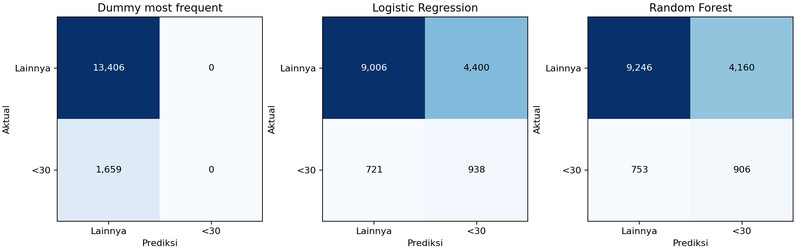

# Percobaan awal week 11

Evaluasi pada validation; tidak membaca X_test/y_test.

| model | accuracy | balanced_accuracy | precision | recall | f1 | roc_auc | average_precision |
|---|---|---|---|---|---|---|---|
| Dummy_most_frequent | 0.8899 | 0.5000 | 0.0000 | 0.0000 | 0.0000 | 0.5000 | 0.1101 |
| Logistic_Regression | 0.6601 | 0.6186 | 0.1757 | 0.5654 | 0.2681 | 0.6620 | 0.2102 |
| Random_Forest | 0.6739 | 0.6179 | 0.1788 | 0.5461 | 0.2694 | 0.6674 | 0.2014 |

## Interpretasi

- Average precision tertinggi pada percobaan ini: **Logistic_Regression**.
- Prevalensi kelas positif validation: 0.1101; ini acuan AP prediktor skor konstan.
- Dummy mayoritas dapat memiliki akurasi tinggi sambil tidak mengenali kasus positif.
- Threshold 0,5 tetap; pembobotan kelas membuat precision/recall perlu dibaca bersama.
- Average precision adalah ringkasan kurva precision-recall, bukan integrasi trapezoid PR-AUC.
- Skor ini dari satu split dan konfigurasi awal, bukan hasil tuning, CV atau uji final.
- Week 12 dapat menambah validasi berbasis pasien, tuning dan analisis kesalahan; test tetap disimpan.

