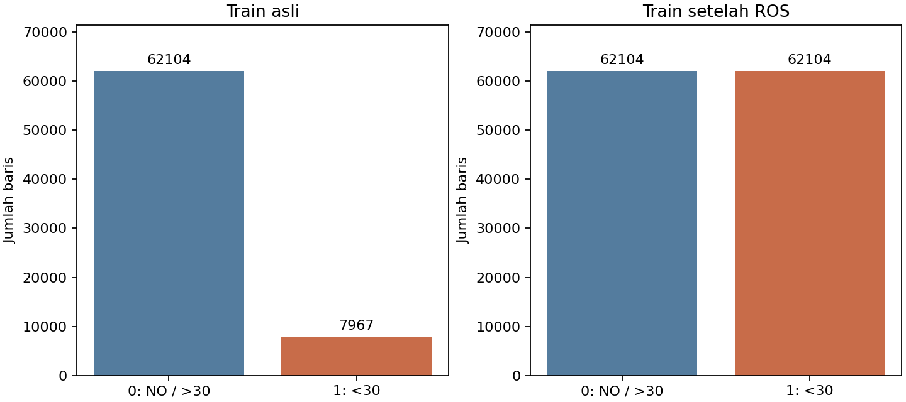

# Revisi dosen — NGBoost dan oversampling

## Apakah seluruh data digunakan untuk train?

Tidak. Data asli memiliki 101.766 kunjungan dan 50 kolom. Sebanyak 1.652 kunjungan berstatus meninggal (discharge 11/19/20/21) dikeluarkan, sehingga tersisa 100.114 kunjungan. Pembagian sekitar 70%/15%/15% berdasarkan pasien, bukan pengacakan baris. Seluruh 70.071 kunjungan pada train tersedia untuk pelatihan. Validation untuk evaluasi/pemilihan; test untuk evaluasi sesudah konfigurasi dikunci.

| set | kunjungan | pasien | kelas_0 | kelas_1 |
|---|---|---|---|---|
| train | 70071 | 49307 | 62104 | 7967 |
| validation | 15065 | 10566 | 13406 | 1659 |
| test | 14978 | 10566 | 13247 | 1731 |

NGBoost memakai minibatch_frac=0,75: seluruh train menjadi kumpulan data pelatihan, tetapi setiap iterasi boosting mengambil sampel acak 75% dari kumpulan tersebut. Pada varian ROS, kumpulannya adalah train setelah oversampling. Ini berbeda dari membuang sebagian train secara permanen.

Angka tabel split berasal dari metadata preprocessing; runner ini hanya membaca fitur/target train dan validation. Data test tidak dibaca. Pasien antarset terpisah. ID pasien/kunjungan dan readmitted tidak masuk fitur. Dari 47 kandidat fitur, weight dan tiga kolom konstan dikeluarkan berdasarkan train, tersisa 43 kolom sebelum one-hot (1.222 fitur), lalu SVD menjadi 32 komponen. Angka ini untuk dataset penuh seed 42.

## Percobaan terkontrol

Train asli: {'0': 62104, '1': 7967}. Sesudah RandomOverSampler: {'0': 62104, '1': 62104}; tambahan 54,137 baris merupakan duplikasi acak kelas minoritas, bukan pasien baru. Kedua NGBoost memakai parameter, seed, split dan adapter yang sama. Dummy prior dilatih pada train asli sebagai baseline prevalensi.

Imputasi, encoding, SVD dan scaling di-fit pada train asli. Oversampling hanya setelah transformasi train. Validation dan test mempertahankan distribusi kelas asli. Random oversampling dipilih agar tidak membuat interpolasi kategori obat/diagnosis. Jika kelak memakai CV, fit preprocessing dan oversampling harus diulang pada training fold saja.

## Hasil validation (threshold 0,5)

| model | accuracy | balanced_accuracy | precision | recall | f1 | average_precision | roc_auc | brier_score | log_loss |
|---|---|---|---|---|---|---|---|---|---|
| Dummy_prior | 0.8899 | 0.5000 | 0.0000 | 0.0000 | 0.0000 | 0.1101 | 0.5000 | 0.0980 | 0.3468 |
| NGBoost | 0.8899 | 0.5000 | 0.0000 | 0.0000 | 0.0000 | 0.1994 | 0.6415 | 0.0948 | 0.3329 |
| NGBoost_ROS | 0.6424 | 0.5905 | 0.1590 | 0.5238 | 0.2439 | 0.2001 | 0.6426 | 0.2255 | 0.6434 |

Recall berubah dari 0.0000 ke 0.5238; precision dari 0.0000 ke 0.1590; F1 dari 0.0000 ke 0.2439; AP dari 0.1994 ke 0.2001.

NGBoost_ROS menangkap 869 kasus positif, melewatkan 790, dan menghasilkan 4.597 prediksi positif yang salah. AP hampir sama, sementara Brier score dan log loss memburuk; peningkatan deteksi pada threshold 0,5 tidak berarti ranking atau kualitas probabilitas meningkat secara berarti.

Oversampling menyeimbangkan train, tetapi tidak menjamin semua metrik membaik. AP menilai ranking tanpa threshold; F1/recall/precision di atas memakai 0,5 yang sama. Perubahan prior train dapat menggeser probabilitas; baca Brier/log loss dan kalibrasi. Probabilitas belum dikalibrasi ulang. Hasil ini satu split validation, bukan skor test baru atau bukti keunggulan umum. Test Week 12 sudah pernah dievaluasi pada eksperimen terdahulu; jangan menyebutnya holdout yang belum pernah dilihat untuk klaim lanjutan.



## Reproduksi

Kedua model juga dibandingkan dengan ambang yang memaksimalkan F1 pada validation.
Lihat [hasil pemilihan ambang dan batas interpretasi](threshold_report.md).

```powershell
.\.venv\Scripts\python.exe -m pip install -r requirements.txt
.\.venv\Scripts\python.exe -m src.preprocess
.\.venv\Scripts\python.exe -m src.profile_data
.\.venv\Scripts\python.exe -m src.revision
```

Hasil lama Week 11/12 dipertahankan sebagai riwayat. Artefak model revisi: data/processed/diabetes/models_revision (lokal). Arti kode lengkap: [kode kategori](../../docs/week-10/kode-kategori.md).

Referensi: [RandomOverSampler](https://imbalanced-learn.org/stable/references/generated/imblearn.over_sampling.RandomOverSampler.html), [NGBoost](https://proceedings.mlr.press/v119/duan20a.html).
