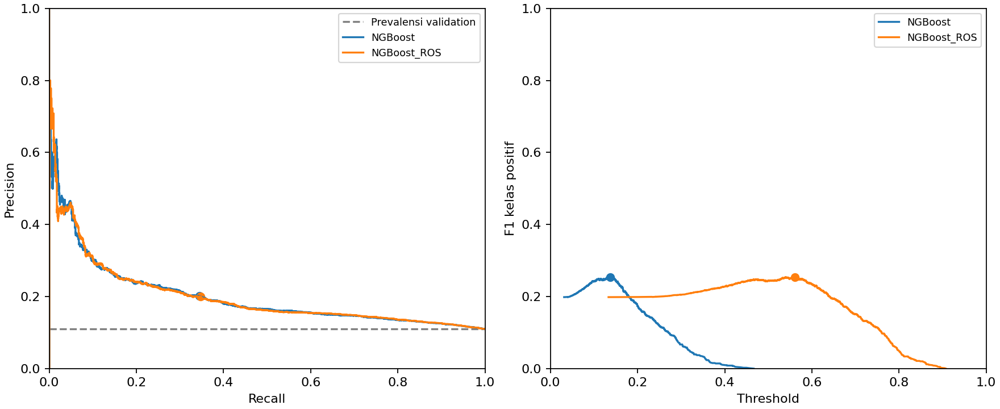

# Perbandingan ambang NGBoost dan NGBoost + oversampling

Prediksi validation dari eksperimen revisi digunakan kembali tanpa training ulang. Target dibandingkan baris per baris dengan y_validation; metrik pada ambang 0,5 diverifikasi terhadap experiment.json. Fitur/target test tidak dibaca.

## Aturan pemilihan

Untuk setiap NGBoost, pilih ambang yang memaksimalkan F1 kelas positif pada validation. Jika F1 seri, pilih ambang tertinggi. Dummy prior tetap pada 0,5. Aturan yang sama diterapkan pada kedua model; ini bukan penyamaan nilai ambangnya.

## Hasil pada validation

| model | policy | threshold | precision | recall | f1 | average_precision | roc_auc | brier_score | log_loss | tp | fp | fn | tn |
|---|---|---|---|---|---|---|---|---|---|---|---|---|---|
| Dummy_prior | reference_0_5 | 0.5000 | 0.0000 | 0.0000 | 0.0000 | 0.1101 | 0.5000 | 0.0980 | 0.3468 | 0 | 0 | 1659 | 13406 |
| NGBoost | reference_0_5 | 0.5000 | 0.0000 | 0.0000 | 0.0000 | 0.1994 | 0.6415 | 0.0948 | 0.3329 | 0 | 0 | 1659 | 13406 |
| NGBoost | selected_on_validation | 0.1374 | 0.2013 | 0.3442 | 0.2540 | 0.1994 | 0.6415 | 0.0948 | 0.3329 | 571 | 2266 | 1088 | 11140 |
| NGBoost_ROS | reference_0_5 | 0.5000 | 0.1590 | 0.5238 | 0.2439 | 0.2001 | 0.6426 | 0.2255 | 0.6434 | 869 | 4597 | 790 | 8809 |
| NGBoost_ROS | selected_on_validation | 0.5605 | 0.1994 | 0.3472 | 0.2534 | 0.2001 | 0.6426 | 0.2255 | 0.6434 | 576 | 2312 | 1083 | 11094 |

Sesudah pemilihan ambang, NGBoost biasa memperoleh F1 **0.2540**, precision **20.13%**, recall **34.42%** pada ambang **0.137382**. NGBoost + ROS memperoleh F1 **0.2534**, precision **19.94%**, recall **34.72%** pada ambang **0.560540**.

Selisih F1 (ROS dikurangi biasa) adalah **-0.0006**. NGBoost biasa menghasilkan 571 true positive dan 2,266 false positive; ROS menghasilkan 576 true positive dan 2,312 false positive.

## Interpretasi dan batas kesimpulan

Perubahan threshold mengubah label prediksi, precision, recall dan F1. AP, ROC-AUC, Brier score dan log loss tidak berubah karena probabilitasnya tetap sama. Bandingkan efek oversampling setelah kedua model sama-sama diberi kesempatan memilih ambang; recall 0 pada ambang 0,5 bukan berarti NGBoost biasa tidak mampu mendeteksi kasus positif.

Angka selected_on_validation dihitung pada data yang juga dipakai memilih ambang, sehingga merupakan hasil pemilihan yang dapat optimistis, bukan estimasi uji independen. Selisih kecil pada satu split tidak membuktikan keunggulan umum atau signifikansi statistik. Oversampling sebelumnya hanya memberi perubahan AP kecil dan memperburuk Brier/log loss; pemilihan threshold tidak memperbaiki kalibrasi probabilitas.

Ambang yang dipilih beserta hash sumber disimpan di threshold_selection.json. Data test Week 12 sudah pernah digunakan pada eksperimen terdahulu. Evaluasi lanjutan yang lebih kuat dapat memakai validasi silang berbasis pasien dengan pemilihan ambang di dalam fold pelatihan atau data eksternal yang belum digunakan.



## Reproduksi tanpa training ulang

```powershell
.\.venv\Scripts\python.exe -m src.revision_thresholds
```

Jika prediksi lokal belum tersedia, jalankan python -m src.revision terlebih dahulu. Runner training tersebut juga menghasilkan perbandingan ambang ini.

[Kembali ke laporan revisi](report.md)
