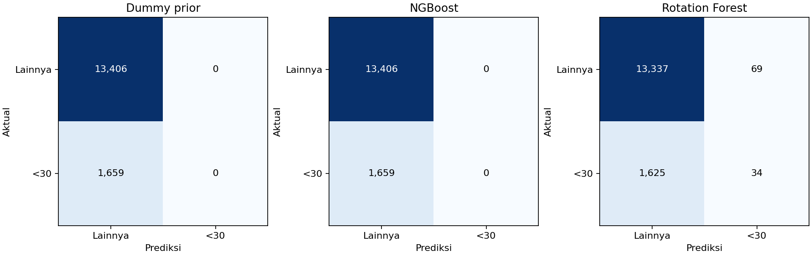
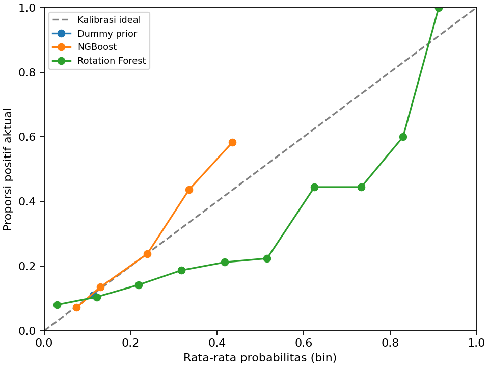

# Percobaan awal week 11

Evaluasi pada validation; tidak membaca X_test/y_test.

| model | accuracy | precision | recall | f1 | roc_auc | average_precision | brier_score | log_loss |
|---|---|---|---|---|---|---|---|---|
| Dummy_prior | 0.8899 | 0.0000 | 0.0000 | 0.0000 | 0.5000 | 0.1101 | 0.0980 | 0.3468 |
| NGBoost | 0.8899 | 0.0000 | 0.0000 | 0.0000 | 0.6417 | 0.1993 | 0.0948 | 0.3329 |
| Rotation_Forest | 0.8876 | 0.3301 | 0.0205 | 0.0386 | 0.5932 | 0.1568 | 0.1010 | 0.6968 |

## Interpretasi

- Average precision tertinggi pada percobaan ini: **NGBoost**.
- Prevalensi kelas positif validation: 0.1101; ini acuan AP prediktor skor konstan.
- Dummy mayoritas dapat memiliki akurasi tinggi sambil tidak mengenali kasus positif.
- Threshold 0,5 tetap; tidak ada class weighting atau oversampling. Baca precision/recall bersama.
- Dummy_prior memprediksi probabilitas prevalensi train, bukan selalu probabilitas nol.
- Kedua algoritma memakai adapter SVD 32 komponen + scaling yang sama, di-fit hanya pada train.
- Brier score dan log loss lebih kecil lebih baik; model probabilistik tidak otomatis terkalibrasi.
- Hasil LR/RF lama menggunakan representasi dan pembobotan berbeda; bukan perbandingan terkontrol dengan eksperimen ini.
- Average precision adalah ringkasan kurva precision-recall, bukan integrasi trapezoid PR-AUC.
- Skor ini dari satu split dan konfigurasi awal, bukan hasil tuning, CV atau uji final.
- Week 12 dapat menambah validasi berbasis pasien, tuning dan analisis kesalahan; test tetap disimpan.

