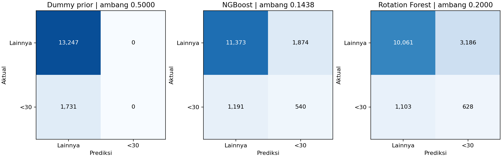
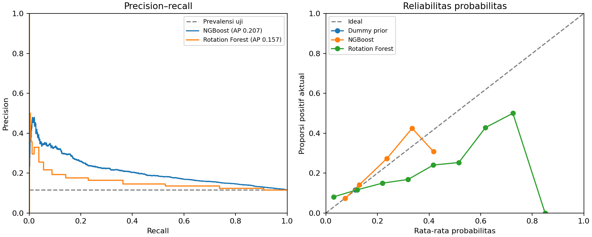

# Week 12 — Evaluasi pada set uji

Target positif: rawat inap ulang dalam <30 hari. Set uji memuat 14,978 kunjungan dari 10,566 pasien, dengan 1,731 kasus positif (11.56%). Tidak ada pasien yang tumpang tindih antarset.

## Pemilihan pada validation

Model dan preprocessing Week 11 dipertahankan. Ambang kedua model dipilih untuk memaksimalkan F1 kelas positif pada validation. Jika seri, dipilih ambang tertinggi. Dummy prior tetap pada 0,5. Tidak ada fit ulang atau tuning hiperparameter.

| model | threshold | f1_at_0_5 | f1 | precision | recall | average_precision |
|---|---|---|---|---|---|---|
| Dummy_prior | 0.5000 | 0.0000 | 0.0000 | 0.0000 | 0.0000 | 0.1101 |
| NGBoost | 0.1438 | 0.0000 | 0.2546 | 0.2161 | 0.3098 | 0.1993 |
| Rotation_Forest | 0.2000 | 0.0386 | 0.2253 | 0.1622 | 0.3689 | 0.1568 |

Model utama ditetapkan dari AP validation: **NGBoost**. Pilihan dan hash artefak disimpan di [protokol](../protocol.json) sebelum set uji dibaca.

## Hasil pada set uji

`locked` memakai ambang dari validation. `reference_0_5` adalah pembanding tetap Week 11. Perubahan ambang memengaruhi label prediksi, sementara AP, ROC-AUC, Brier dan log loss memakai probabilitas yang sama.

| model | policy | threshold | precision | recall | f1 | average_precision | roc_auc | brier_score | log_loss |
|---|---|---|---|---|---|---|---|---|---|
| Dummy_prior | locked | 0.5000 | 0.0000 | 0.0000 | 0.0000 | 0.1156 | 0.5000 | 0.1022 | 0.3580 |
| NGBoost | locked | 0.1438 | 0.2237 | 0.3120 | 0.2606 | 0.2068 | 0.6535 | 0.0987 | 0.3424 |
| NGBoost | reference_0_5 | 0.5000 | 0.0000 | 0.0000 | 0.0000 | 0.2068 | 0.6535 | 0.0987 | 0.3424 |
| Rotation_Forest | locked | 0.2000 | 0.1647 | 0.3628 | 0.2265 | 0.1573 | 0.5936 | 0.1053 | 0.7014 |
| Rotation_Forest | reference_0_5 | 0.5000 | 0.2963 | 0.0185 | 0.0348 | 0.1573 | 0.5936 | 0.1053 | 0.7014 |

Pada ambang terkunci, model utama menangkap **540 dari 1,731** kasus positif dan menghasilkan **1,874** peringatan salah. Sebanyak **1,191** kasus positif terlewat.

Rotation_Forest menangkap **628** kasus positif dan menghasilkan **3,186** peringatan salah.

## Analisis kesalahan

Kelompok berikut memakai jumlah rawat inap dalam tahun sebelum kunjungan indeks. Perbandingan deskriptif per kelompok memakai ambang yang sama untuk tiap model.

| model | group | n | positives | fp | fn | recall | precision |
|---|---|---|---|---|---|---|---|
| NGBoost | 0 | 10013 | 853 | 100 | 825 | 0.0328 | 0.2188 |
| Rotation_Forest | 0 | 10013 | 853 | 1416 | 677 | 0.2063 | 0.1106 |
| NGBoost | 1 | 2759 | 377 | 360 | 292 | 0.2255 | 0.1910 |
| Rotation_Forest | 1 | 2759 | 377 | 718 | 253 | 0.3289 | 0.1473 |
| NGBoost | 2+ | 2206 | 501 | 1414 | 74 | 0.8523 | 0.2319 |
| Rotation_Forest | 2+ | 2206 | 501 | 1052 | 173 | 0.6547 | 0.2377 |

Recall NGBoost adalah **3.28%** pada kelompok tanpa riwayat rawat inap dan **85.23%** pada kelompok dengan dua atau lebih. Kelompok tanpa riwayat menyumbang **825** dari **1,191** kasus positif yang terlewat.

Rincian per rentang usia dan riwayat rawat inap tersedia di [CSV analisis](error_groups.csv). Kelompok kecil memiliki estimasi yang mudah berubah. Hasil berasal dari satu pembagian pasien, dihitung per kunjungan, dan belum mengukur performa lintas rumah sakit, waktu, atau pemakaian klinis.
